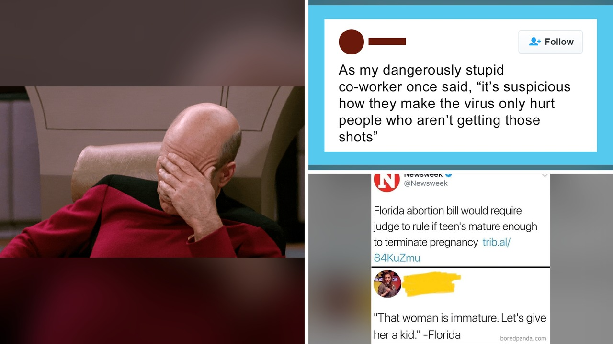

# لقطات شاشة غريبة تكشف مواقف غير متوقعة

هل تتخيل أن يضطر أحدهم لتدريس مادة الجيولوجيا التاريخية بنفسه، فقط لأن الجيولوجي المتخصص الذي كان يفترض أن يدرس المادة يؤمن بنظرية الأرض الفتية؟ هكذا فجأة، يجد الأستاذ نفسه أمام موقف يسد الأنفاس! بصراحة، الإنترنت يفيض يومياً بلقطات شاشة توثق مواقف تتجاوز المنطق، وتجعل المرء يتساءل كيف يتصرف بعض الناس في حياتهم اليومية.

قرأت مؤخراً مجموعة من المنشورات والصور المتبادلة التي تظهر غياباً تاماً للمنطق السليم لدى البعض. أحياناً يكون الموقف مجرد خطأ طريف، لكن في أحيان أخرى نرى قرارات تأخذ الغرابة إلى مستوى آخر تماماً!

## مواقف لا تُصدّق على الإنترنت

استوقفتني لقطات من منشورات تداولها الناس تعكس تفاصيل غريبة جداً. مثلاً، تلك المحادثات والتعليقات التي تتناول الغلاء وصعوبة المعيشة، حيث يرى البعض أنه حتى البقاء على قيد الحياة بات مكلفاً، فكيف بالتفكير في إنجاب الأطفال؟ وهناك منشورات أخرى تسلط الضوء على شعارات مثل الحلم الأمريكي أو التصريحات السياسية الشهيرة التي تمتدح قاطعي شوط العلم الضعيف.

يا جماعة، الغريب في الأمر ليس الموقف نفسه، بل الإصرار على مشاركته علناً أمام الجميع! ألا تلاحظون أن الواقع أحياناً يقدّم قصصاً أغرب من أي سيناريو خيالي؟

## حيل سفر وتصرفات غريبة

من بين اللقطات المتداولة أيضاً، ظهرت أم تشارك حيلة ملونة ومبتكرة للسفر، تجعل الأطفال الصغار يصمتون ويهدؤون تماماً خلال رحلات الطيران. وفي مقابل ذلك، تظهر صور لأشخاص في مواقف لا حس فيها بالواقع، كمن تلتقط صورة وهي لا تدرك أبداً ما يحدث حولها بذهول تام!

شلون يمكن لحيلة بسيطة في طائرة أن تجاور تصرفات عشوائية تامة في مكان واحد؟ هالسالفة تظهر تباين العقول بطريقة مضحكة. ومجرد رؤية هذه المشاهد تجعل المتابعين يضحكون، ويهزون رؤوسهم ذهولاً، مش معقول كمية المواقف التي تشهدها شبكات التواصل كل يوم.

## رأيي الشخصي

رأيي الشخصي أن هذه اللقطات المتداولة ليست مجرد سقطات عابرة، بل هي مرآة لطبيعة التنوع البشري والمواقف السريالية التي نمر بها دون أن نتوقعها. الحياة الواقعية أحياناً تتفوق على أي خيال كوميدي.

الآن، لو خيروك بين التعامل يومياً مع أستاذ جيولوجيا لا يؤمن بعلم الجيولوجيا، أو السفر في طائرة مليئة بأطفال يمارسون حيل التلوين، ماذا تختار؟
