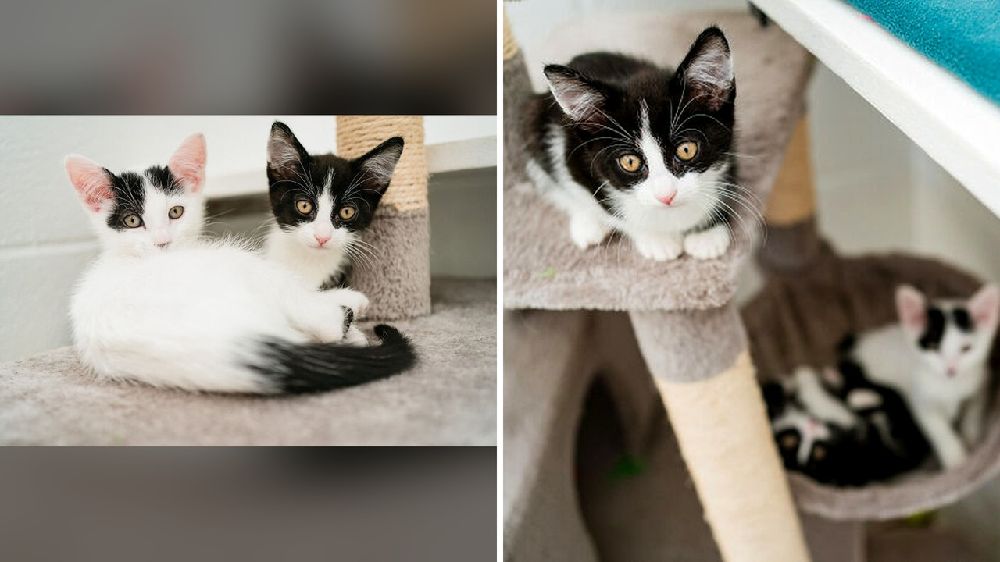

# عثروا على صندوق مقرمشات أمام المستشفى وبداخله مفاجأة

وصل موظفو مستشفى "بلو كروس" للحيوانات في منطقة هامرسميث بالعاصمة البريطانية ذات صباح عمل عادي، فتوقعوا رؤية صندوق مقرمشات فارغ مُلقى في القمامة. لكن الصوت الضعيف الصادر من داخل الصندوق جعل الجميع يتوقفون في مكانهم.

عندما فتح الموظفون الصندوق، لم يجدوا طعامًا، بل أربعة قطط صغيرة جدًا جرى التخلي عنها في العراء لتواجه مصيرها بمفردها. بصراحة، المشهد كان كفيلًا بملء قلب أي شخص بالحزن والدهشة في الوقت نفسه. هل تتوقعون كيف يمكن لشخص أن يترك كائنات بهذا الحجم الضعيف في الشارع؟

## مفاجأة صباحية أمام باب المستشفى

لحسن الحظ، سقطت هذه الكائنات الصغار في المكان الصحيح تمامًا. تولى الفريق البيطري في المستشفى فحص القطط الأربعة فورًا، وتأكدوا من سلامتها الصحية ووفروا لها الرعاية الشاملة والغذاء المناسب.

الخبر الذي قرأته أوضح أن جمعية "بلو كروس" الخيرية للرفق بالحيوان في المملكة المتحدة تعتني بآلاف الحيوانات سنويًا، سواء عبر خدماتها البيطرية أو مراكز الإنقاذ وإعادة الإيواء. هذه الرعاية الدافئة تذكرني بما قرأته سابقًا عن كيفية متابعة الرعاية الجينية والفحوص الدقيقة للقطط لحمايتها وصونها.

**اقرأ أيضًا:** [قطة تبهر عائلتها باكتشاف جيني نادر في دمها](https://www.almosaitiron.com/2026/11/blog-post_911.html)

## أزمة تكاليف ورعاية صحية

ما استوقفني في التقرير هو تحليل الجمعية لأسباب هذه الظاهرة. ترجع الجمعية تزايد حالات التخلي عن الحيوانات إلى أزمة غلاء المعيشة المستمرة، حيث يتجنب بعض المالكين دفع تكاليف عمليات التعقيم البيطرية لقططهم.

كما أعربت الجمعية عن قلقها من لجوء البعض لتزويج القطط بهدف بيع صغارها، وعندما يفشلون في العثور على المشترين، ينتهي المطاف بتلك الصغار إلى التخلي عنها. تخيلوا أن تتحول قلة الحيلة أو التجارة غير المحسوبة إلى سبب في ترك صغار لا حول لها ولا قوة؟

## نهاية دافئة قبل أعياد الميلاد

أوضحت أماندا رومبول، وهي أخصائية الرفق بالحيوان في الجمعية، أن الفريق نجح في إيجاد بيوت دافئة ومحبة للقطط الأربعة بسرعة كبيرة، وتحديدًا قبل حلول أعياد الميلاد.

وحثت أماندا أي شخص يواجه صعوبة في العثور على رعاية لحيوانه، أو لديه ولادات غير مرغوب فيها، على التواصل مع الجمعيات لطلب المساعدة بدلاً من تركها.

رأيي الشخصي أن الرفق بالحيوان مسؤولية أخلاقية لا تتجزأ، وأن أزمة التكاليف لا تبرر القسوة، بل تستوجب طلب المساعدة من الجهات المختصة. هل ترون أن الحل يكمن في توفير دعم مالي للعمليات البيطرية، أم في تغليظ العقوبات على من يتخلى عن حيواناته؟
