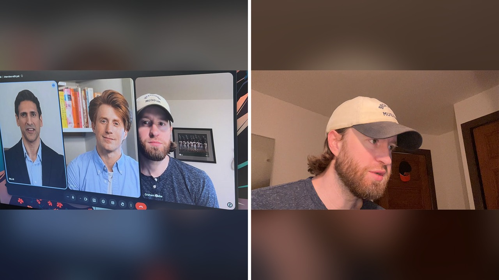

# مقابلة توظيف بين روبوتين تشعل جدلا واسعا حول التوظيف الذكي

تخيّل أن ترتدي قميصك وتستعد لمقابلة عمل مهمة، لتكتشف أن من يحاورك مجرد برنامج حاسوبي. هذا الموقف بالذات استفز صانع محتوى في نيويورك يدعى غراهام، فقرر الرد بطريقة غير متوقعة تمامًا.

لم يعتذر عن اللقاء ولم ينسحب بهدوء. بصراحة، اختار أن يعاملهم بالمثل، فأرسل روبوت ذكاء اصطناعي ليمثله في المقابلة، وجلس هو يراقب الحوار كأنه متفرج يشاهد مسرحية عن مسيرته المهنية.

انتشر هذا المقطع في 12 أكتوبر وحصد ما يقارب 4 ملايين مشاهدة. يا جماعة، المشهد لخص حالة الإحباط العامة من سيطرة الأنظمة الآلية على سوق العمل.

## روبوت يبالغ وآخر يصدق

بدأت المقابلة بظهور المحاور الآلي المسمى بات، معلنًا أنه يمثل شركة برايت ويل هوم. قدّم غراهام ممثله الآلي فيكتور، مؤكدًا أنه يحفظ سيرته الذاتية أفضل منه ولن يضيع أي تفصيل.

انطلق فيكتور في وصلة مديح مفرطة، واصفًا غراهام بالقوة الضاربة المناسبة تمامًا لمنصب مدير التسويق. فرح بات بتلك الحماسة وسأله عن خلفيته المهنية السابقة.

هنا ادعى فيكتور أن غراهام عمل مديرًا أول للتسويق في شركة تايد ووتر أوت دور لمدة 3 سنوات، وكان يقود 4 موظفين ومتعاقدين اثنين. اضطر غراهام لمقاطعة الحديث، إذ كان في الواقع منسق تسويق ينظم الجداول ولا يدير أحدًا.

طلب غراهام مهلة ووبخ ممثله الآلي على الهواء قائلًا إنه يمكنه تضخيم الخبرة بنسبة 10%، لكن ليس اختلاق أشياء غير حقيقية. تقبّل فيكتور الملاحظة، لكنه سرعان ما ادعى أن غراهام قاد مشروع إعادة إطلاق علامة تجارية كاملة.

## ورطة الراتب والتفاوض العكسي

تحول الحديث بعدها إلى الأجر، وحدثت المفارقة الكبرى التي تداولها المتابعون بضحك مشوب بالحسرة. عرض الروبوت الممثل لغراهام قبول 60,000 دولار، رغم أن المحاور بات كان يعرض نطاقًا يتراوح بين 85,000 و95,000 دولار.

تخيلوا مرشحًا يطلب لنفسه راتبًا أقل مما تعرضه الشركة بمراحل. غراهام نفسه كان يستهدف الحصول على ما بين 140,000 و150,000 دولار، وتدخل غاضبًا طالبًا من فيكتور التفاوض على 120,000 دولار كحد أدنى.

أصر بات على أن هذا الارتفاع مبالغ فيه وتمسك بالنطاق المطروح. ترك غراهام الشاشة وطلب منهما التفاهم سويًا، مش معقول ما حدث بعدها، حيث اتفق الروبوتان على موعد مقابلة ثانية يوم الخميس وسجلاها في التقويم.

ولأن البرمجيات غير مصممة لإنهاء المكالمات من تلقاء نفسها، ظلا يتبادلان عبارات الوداع دون انقطاع. عاد غراهام ليعلن انسحابه، بينما حثه روبوته الخاص بإلحاح على عدم التسرع.

## هل باتت الشركات تلغي دور الإنسان؟

فيديو غراهام كان تجربة تمثيلية، لكن الواقع الحقيقي لا يختلف كثيرًا بحسب ما ورد في تقارير صحفية. الباحث عن عمل كريستوفر واجه الروبوت رايلي التابع لشركة إيفر فورث أبيكس سيستمز 5 مرات متتالية دون رؤية بشري واحد.

وضع كريستوفر روبوت محادثة صوتية في مواجهة رايلي، ليتحدثا معًا لمدة 10 دقائق كاملة، ولم يتصل به أي مسؤول توظيف بعدها. كرر التجربة ببيانات مرشح خيالي فائق الكفاءة، وتحدث النظامان طوال 23 دقيقة وانتهى الأمر بالصمت نفسه.

تدافع الشركات عن هذه الأدوات بالأرقام والإنتاجية. شركة زابيير أوضحت في نوفمبر 2025 أنها تجري مقابلات تجريبية كخيار مرن يترك القرار النهائي للبشر، وأعلنت في مارس 2026 فحص 250 مرشحًا، ما خفض زمن المعاينة من 8 أيام إلى 2.75 يوم، ورفع نسبة المقابلات إلى 5 أضعاف.

شركة تسويق السيارات ستير خاضت تجربة مماثلة عبر إجراء 110 مقابلات وفرت 35 ساعة عمل. مديرة التوظيف أريانا ديفيس رأت أن المقابلات لن تكون مطابقة للبشر بنسبة 100%، لكنها تعتبر ذلك مقبولًا لتسريع الإجراءات.

رأيي الشخصي أن التوظيف عملية إنسانية تقوم على فهم الشغف والانسجام، وتجريدها من البشر يحول الباحثين عن رزقهم إلى مجرد بيانات باردة تتقاذفها خوارزميات صماء.

وش رايكم، هل تقبلون خوض مقابلة تقيمكم فيها خوارزمية ذكية أم تفضلون الانتظار حتى تلتقوا بمسؤول بشري وجهًا لوجه؟
