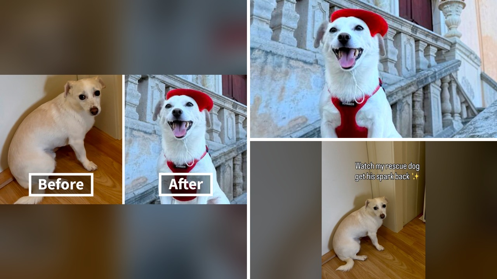

# كلب من صندوق مهجور إلى طواف العالم برقم قياسي

عُثر عليه داخل صندوق كرتوني مغلق بشرائط لاصقة على جانب طريق في لوس أنجلوس. كان كلبًا صغيرًا عمره عامان فقط، تملأ البرغوث الحية جسده، ويرتجف رعبًا.

عندما وافق ويليام أتك على إيوائه مؤقتًا، لم يتخيل أن الأمر سيتحول لمغامرة أبدية. بصراحة، ظنها مساعدة عابرة، لكنها كانت بداية تغيير شامل.

منح ويليام الكلب الأمان والصبر. فهل تتخيلون كيف يمكن لقرار إيواء مؤقت أن يقلب حياة شاب وكلبه الخائف رأسًا على عقب؟

## من صندوق مغلق إلى خائف يرتجف

في الأيام الأولى، كان الكلب الذي أطلق عليه ويليام اسم إيلكو يعاني من خوف شديد تجسد في ارتجاف جسده المستمر. كان المشهد قاسيًا، إذ عُزل سابقًا داخل صندوق مغلق بطريقة تجرّدت من الرحمة.

احتاج الكلب الصغير وقتًا طويلاً ليستوعب أن الأذى لن يطاله مجددًا، وأن البشر ليسوا جميعًا مصدرًا للتهديد. وبفضل طمأنة ويليام المستمرة ومحبته، بدأ إيلكو يخرج تدريجيًا من قوقعة الخوف التي حاصرت أفكاره.

مع مرور الوقت، نمت ثقته بنفسه وبدأت شخصيته المرحة والمحبة للمغامرة بالظهور بشكل واضح. تحول ذلك الأليف المذعور إلى كائن مقدام يتطلع برغبة كبيرة لاستكشاف كل ما تقدمه له حياته الجديدة.

تحولت علاقة الإيواء المؤقت السريعة إلى رابطة وثيقة للغاية. أصبحت هذه الصلة الإنسانية سببًا مباشرًا في إحداث تغيير جذري في مسار حياة كل منهما إلى الأبد.

## قرار يغير مجرى الحياة

كان ويليام يبلغ من العمر ستة وعشرين عامًا، وكان يعيش في لوس أنجلوس ويمارس عملًا تقليديًا من التاسعة صباحًا حتى الخامسة مساءً. كان يقضي أوقاته في تدبير أمواله وجمع كل ما يمكن توفيره من رواتبه.

تخيلوا أن ويليام قرر الاستغناء عن عمله المستقر والتخلي عن نمط حياته الاعتيادي. قام ببيع جميع ممتلكاته الشخصية التي لا تتسع لها حقيبة ظهره، ليجهز إيلكو لخوض حياة التنقل والترحال معه عبر دول العالم.

وجهتهما الأولى كانت باتجاه تايلاند، وكانت تلك المرة الأولى التي يركب فيها إيلكو متن طائرة. وما كان يمكن أن يكون تجربة مخيفة لكلب مُنقذ، تحول إلى بداية رحلة استثنائية لم تكن تخطر على بال.

كيف ينقلب مسار حياة إنسان بالكامل بسبب كائن صغير احتاج ملجأً مؤقتًا؟ سار كل شيء بسلاسة، وحصل إيلكو بعدها على جواز سفر دولي خاص به، ليصبح جاهزًا للانطلاق عبر الحدود برفقة ويليام.

## جواز سفر وأربعون دولة

الآن، يشارك ويليام وإيلكو مغامراتهما عبر حسابهما على إنستغرام تحت اسم awayonearth، حيث يتابعهما أكثر من ستمئة وثلاثين ألف شخص من مختلف أنحاء العالم.

زار الثنائي حتى الآن أكثر من خمس وأربعين دولة. وتوثق مقاطعهما اللقاءات غير المنسية مع مختلف الشعوب والأماكن، لتظهر للعالم ما يمكن أن يحدث عندما يحصل حيوان مُنقذ على بيئة صالحة للنمو والازدهار.

هذه الرغبة في خوض المغامرات وتسجيل الأرقام القياسية مع الحيوانات أراها تتكرر بطرق مدهشة، فقد حكيت لكم سابقًا عن فرس استثنائية استطاعت دخول موسوعة غينيس بفضل ذيلها القياسي.

**اقرأ أيضًا:** [فرس في أوهايو تكسر رقما قياسيا بأطول ذيل في العالم](https://www.almosaitiron.com/2026/10/blog-post_18.html)

لم تعد القصة مجرد تنقل بين الدول، بل تحولت إلى مهمة إنسانية تكشف للعالم كيف يمكن لحيوان انتُشل من صندوق مغلق أن يصبح رحالة يجوب القارات ويسعى لنيل لقب عالمي.

## رحلة برية نحو رقم قياسي

يستعد ويليام وإيلكو حاليًا لخوض فصل جديد ومثير في حياتهما. يتضمن هذا التحدي الانطلاق في رحلة برية طويلة تبدأ من ولاية ميشيغان وتمر بعشرات المناطق حتى تصل إلى الأرجنتين.

الهدف الأساسي من هذه المغامرة الكبرى هو السعي لتسجيل رقم قياسي عالمي جديد بصفتها رحلة الكلب الأكثر سفرًا في العالم. يا جماعة، إنها خطوة تؤكد القيمة الكبيرة التي تنطوي عليها الفرصة الثانية في حياة أي أليف.

ولضمان نجاح الرحلة، أطلقا حملة تبرعات عبر منصة جو فند مي لتغطية النفقات المباشرة لأسفارهما. تشمل هذه المصاريف تكاليف الفحوصات البيطرية، ومصاريف الإقامة في الفنادق التي تسمح بدخول الحيوانات، بالإضافة إلى الاحتياجات اليومية لضمان صحته وسلامته.

تثبت قصة إيلكو أن الماضي القاسي لأي حيوان لا ينبغي أن يحدد شكله المستقبلي. فالكلب الذي وُجد يومًا متروكًا داخل صندوق مغلق، بات اليوم يستكشف أركان العالم ويخوض تجارب لم تكن ممكنة لولا الرحمة.

رأيي الشخصي أن كل حيوان مُنقذ يستحق فرصة عادلة لتذوق طعم المحبة والحرية، وأن ما فعله ويليام هو تجسيد حقيقي للإنسانية في أبهى صورها.

لو أتيحت لك الفرصة، هل تختار ترك عملك التقليدي للترحال مع أليف نجاته من الموت، أم تفضل توفير بيئة مستقرة له في مكان واحد؟
