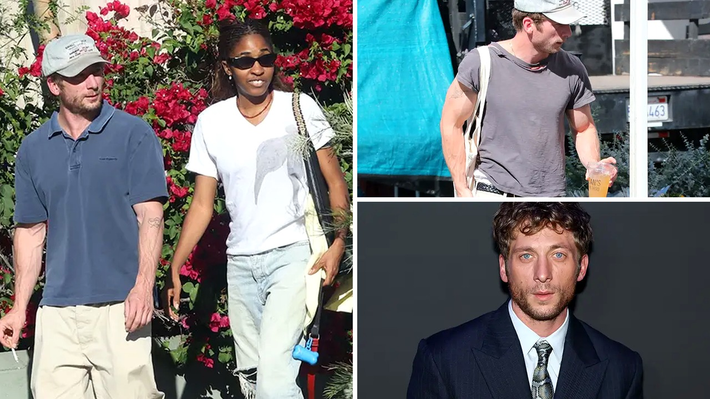

# تفاصيل صورة جيريمي ألين وايت تثير الجدل بين معجبيه

مظهر عفوي في شوارع لوس أنجلوس كان كفيلًا بأن يشعل شبكات التواصل الاجتماعي بالتحليلات والتكهنات. الممثل جيريمي ألين وايت، البالغ من العمر 35 عامًا، ظهر وهو يعانق زميلته في البطولة أيو إديبيري قبل أن ينطلقا في نزهة قصيرة مع كلابهما يوم الخميس الماضي، الخامس من نوفمبر.

التفاصيل في البداية بدت عادية تمامًا، لكن المتابعين لم يمرروا المشهد بسلام. بمجرد انتشار الصور، ترك الكثيرون الحديث عن اللقاء الأخوي وركزوا على تفصيلة غريبة في ذراعي النجم العالمي جعلتهم يتساءلون عن وضع صحته.

## التدخين أم العضلات؟

ظهر جيريمي في الصور وهو يرتدي قميصًا كحليًا وبنطالًا واسعًا باللون البيج مع قبعة بيسبول بيضاء، بينما ارتدت أيو نظارات شمسية وقميصًا أبيض مع بنطال أخضر فاتح وحملت كوب قهوة. لكن يا جماعة، ما استوقف الجمهور حقًا هو ظهور سيجارة في يد جيريمي، بالتزامن مع بروز عروق ذراعيه بشدة بشكل غير مألوف.

هذا المظهر جعل البعض يتساءل على منصات التواصل: لماذا تبرز عروق ذراعيه بهذا الشكل القوي؟ بل إن البعض ذهب إلى ربط هذا البروز بفرط التدخين أو استهلاك مواد معينة. الصراحة، التساؤل انتشر كالنار في الهشيم، فهل يعقل أن تتسبب سيجارة واحدة في كل هذه الضجة والتحليلات حول صحته؟

## ماذا يقول الطب عن عروق الذراعين؟

عندما قرأت التقرير الطبي المرفق بالخبر، وجدت أن الربط بين النيكوتين وبروز العروق غير دقيق علميًا. بحسب التقرير الصادر عن المعاهد الوطنية للصحة، فإن النيكوتين يحفز إفراز الأدرينالين ويؤدي إلى انقباض الأوعية الدموية وتضيقها، خصوصًا تلك الممتدة تحت الجلد، مما يعني أنه لا يسبب كبر حجم العروق أو بروزها.

السبب الحقيقي البسيط، كما أوضح موقع متدرب طبيًا مثل "ميديكال نيوز توداي"، يعود إلى انخفاض نسبة الدهون تحت الجلد مع زيادة الكتلة العضلية. تخيلوا أن التمارين الرياضية وارتفاع حرارة الجسم يدفعان العروق نحو السطح لتصبح أكثر وضوحًا. وبصراحة، هذا ينطبق تمامًا على جيريمي الذي خضع لتدريبات بدنية شاقة من أجل دوره في فيلم المصارعة "ذا أيرون كلو"، إضافة إلى ظهوره في حملة إعلانية لملابس كالفن كلاين في يناير 2024. فهل تعتقدون أن هذا البروز الوريدي مظهر رياضي طبيعي أم نتيجة إجهاد؟

## علاقة تتجاوز حدود الشاشة

الصور العفوية أعادت أيضًا إحياء شائعات قديمة حول وجود علاقة عاطفية بين بطلا مسلسل "ذا بير". ورغم أن الثنائي لم يؤكدا أبدًا وجود أي ارتباط رومانسي، فإن صداقتهما ظلت تحت الأضواء منذ انطلاق المسلسل عام 2022. هالسالفة بدأت عندما التقيا لأول مرة في مدرسة الطهي بمعهد التعليم الفندقي في باسادينا للتحضير لدوريهما، حيث جسد جيريمي شخصية الطاهي كارمي بيرزاتو، وجسدت أيو شخصية شريكته سيدني أدامو.

المسلسل الذي أخرجه كريستوفر ستورر حقق نجاحًا هائلًا وحصد 22 جائزة إيمي على مدار 5 مواسم، حتى انتهى بموسمه الأخير في 25 يونيو 2026. وفي المقابلات الصحفية، مثل لقائهما مع مجلة فانيتي فير في مايو 2024، أشاد الطرفان ببعضهما، حتى أن أيو مزحت قائلة إن عينيه الزرقاوين جميلتان للغاية. كما ظهرا معًا في اختبار الصداقة لمجلة جي كيو في يوليو 2026، وأكدا للوس أنجلوس تايمز في يونيو 2026 أن أجمل ما في علاقتهما هو الإيمان المطلق ببعضهما البعض.

## ترشيح لبطولة مميزة وتحفظات سريعة

الضجة لم تتوقف عند الصور والتدخين والعروق؛ إذ تزامن ذلك مع تقارير كشف عنها الصحفي جيف سنايدر تشير إلى أن مارفل ستوديوز مهتمة بالممثل ليكون خيارًا محتملًا لخلافة هيو جاكمان في دور "ولفرين" ضمن إعادة إطلاق سلسلة إكس من. التحليلات اعتبرته مناسبًا لأن طول قامة جيريمي وبنيته العضلية يتقاربان مع النسخة الأصلية للقصص المصورة التي تتراوح فيها قامة الشخصية بين 5 أقدام و3 بوصات و5 أقدام و5 بوصات.

لكن شلون تطورت هذه الشائعة؟ سنايدر عاد وأوضح أن الأنباء جرى تضخيمها، وأن مجرد عقد اجتماع محتمل لا يعني التفاوض على عقد أو تقديم عرض رسمي. فهل ترونه بالفعل خيارًا مناسبًا لخلافة هيو جاكمان أم أن التوقعات سبقت الواقع؟

رأيي الشخصي أن التدقيق المكثف في تفاصيل أجساد الممثلين وحياتهم الشخصية أصبح مبالغًا فيه، حيث يُقرأ كل مظهر عفوي في الشارع كأنه لغز صحي أو بيان رسمي. هل ترون أن اهتمام الجمهور بالتفاصيل الجسدية للنجم دليل محبة، أم أنه ينتهك خصوصيته ويتجاوز حدود نقد أعماله؟
