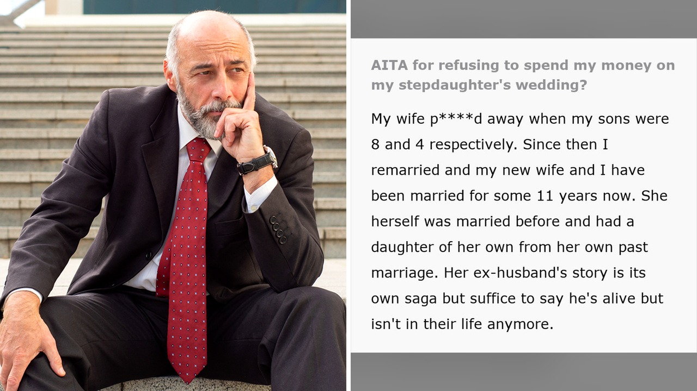

# ابنة زوج تطلب 160 ألف دولار لزفافها رغم جحودها

أن تخبر إنسانًا طوال سنوات بأنه لا يمثّل لك شيئًا، ثم تأتي فجأة لتطلب منه شيكًا بمئة وستين ألف دولار، هذا تمامًا ما وضع رجلاً في حيرة إنسانية مؤلمة، بعدما وجد نفسه مطالبًا بتمويل الجزء الأكبر من حفل زفاف ابنة زوجته.

القصة ليست مجرد خلاف حول نفقات، بل هي مرآة لعلاقات أسرية تفقد أحيانًا روحها ودفأها لتتحول إلى مجرد صفقات جافة. الصراحة، ما قرأته عن هذه الواقعة يدعو للتأمل في حدود الواجب والعطاء.

## جدار من الجفاء

بحسب ما نُشر، اعتادت الفتاة طوال فترة نشأتها أن تظهر عدم محبتها لزوج أمها، ولم تتوقف عند حد التباعد العاطفي بل قالت له في إحدى المرات بوضوح تام إنه ليس والدها. عاش الرجل مع هذا الجحود محاولاً تقبّل الأمر الواقع، مدركًا أن مشاعر الأبوة لا يمكن فرضها بالقوة.

لكن المفارقة حدثت حين حان وقت ترتيبات الزواج، إذ نسيت الشابة كل سنوات الجفاء وطرقت بابه مطالبة بمساهمة ضخمة تبلغ 160 ألف دولار لتغطية مصاريف الحفل، وكأن كل الإساءات السابقة لم تكن موجودة. يا جماعة، كيف يطلب شخص هذا الدعم الهائل من إنسان أنكر فضله بالأمس؟

## تكاليف الزواج وتبدل الأعراف

تعالوا نتوقف عند التقرير الذي أشار إلى أن تكاليف الزواج اليوم بلغت مستويات غير مسبوقة. تشير الأرقام المذكورة إلى أن ما نسبته تسعة وعشرون بالمئة من الأزواج اليوم يدفعون تكاليف زفافهم كاملة دون مساعدة العائلة، بينما يتولى تسعة وخمسون بالمئة دفع جزء منها على الأقل.

تغيرت العادات التي كانت تلزم الآباء بتحمل الفاتورة كاملة، وبات الاعتماد على النفس خيارًا واسع الانتشار، خاصة عندما تتجاوز التكاليف كل حدود المنطق.

## استشارة بحثًا عن راحة الضمير

أحس الرجل بأن العلاقة أصبحت مشوهة وقائمة فقط على تبادل المنافع والمصلحة المادية البحتة، فقرر أن يشارك حيرته عبر الإنترنت ليسأل الناس: هل يعد تصرفي غير منطقي لو رفضت تمويل حفل زفاف فتاة تبرأت مني ورفضتني كأب؟

كان الرجل يحتاج فقط إلى سماع صوت العقل بعد أن أثقلته الحيرة، محاولاً الموازنة بين كرامته الشخصية وعدم إفساد فرحة الفتاة.

رأيي الشخصي أن الأبوة الحقيقية تُبنى على الاحترام والتقدير أولاً، والمال لا يمكن أن يكون بديلاً عن المشاعر الإنسانية الصادقة، ومن حق هذا الرجل تمامًا أن يرفض تمويل تطلعات لا ترافقه فيها أدنى درجات التقدير.

لو كنت في مكان هذا الرجل، هل ستمنحها المال حرصًا على تماسك الأسرة، أم سترفضه لأن الاحترام لا يتجزأ؟
