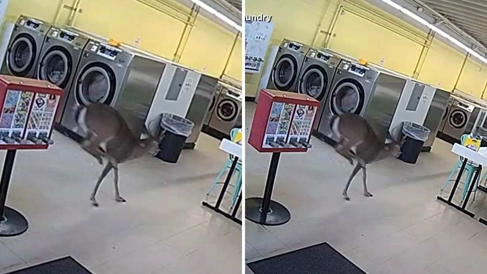

# غزال يقتحم مغسلة ملابس في نورث كارولاينا ويسبب فوضى غير متوقعة

تخيّلوا أنك تخرج بكل هدوء من مغسلة ملابس، وفجأة يقفز بوجهك غزال بري قادم من اللاشيء! هذا ما حدث بالضبط يوم الثلاثاء في مغسلة "ويشي واشي" الواقعة بشارع ساوث مين في مدينة وينستون-سالم بولاية نورث كارولاينا.

كاميرات المراقبة في المكان كانت تسجل كل شيء لحظة بلحظة. الغزال لم يكتفِ بالاصطدام بسيدة كانت تشق طريقها للخروج من المغسلة، بل واصل اندفاعه وتحطم عبر النافذة الزجاجية ليدخل إلى الداخل. الصراحة، المشهد يبدو كأنه لقطة من فيلم كوميدي، لكنه واقعي تمامًا.

## لحظات من الذهول والفوضى

بمجرد أن اخترق النافذة الزجاجية، بدأ الغزال يركض بعشوائية بين أرجاء المكان. لم يقف الأمر عند الركض، بل تسلق الغزال أجهزة الغسيل والتجفيف ووقف فوقها وسط دهشة الموجودين.

كانت الفوضى عارمة لدقائق معدودة، حيث حاول الحيوان استكشاف المخرج. هل تصورت يومًا أن تذهب لغسيل ملابسك فتجد غزالًا يقفز فوق الغسالات؟ هالسالفة تذكرني بموقف مشابه حكيته لكم سابقًا عن دب اقتحم مكتبة عامة في كاليفورنيا وأكل العسل.

**اقرأ أيضًا:** [دب يقتحم مكتبة في كاليفورنيا ويسرق وعاء عسل](https://www.almosaitiron.com/2026/10/blog-post_464.html)

## فرار سريع وأضرار بسيطة

بعد أن طاف المكان بأكمله، تمكن الغزال من العثور على طريقه للخروج. المفارقة أنه خرج من نفس النافذة المكسورة التي دخل منها، ليختفي سريعًا كما ظهر.

يا جماعة، صاحب المغسلة كوري بيندرجراس صرح بأن فرصة حدوث مثل هذا الأمر هي واحد في المليون، مشيرًا إلى أن أحداً لا يمكنه توقع سيناريو كهذا. المهم أن الحادث مر على خير، حيث أكد بيندرجراس عدم وقوع أي إصابات بين الموجودين. الأضرار الرئيسية كانت محصورة في الزجاج المكسور فقط، وقد تولت شركة محلية إصلاحه بالكامل في وقت لاحق من اليوم نفسه.

## اقتحام غير متوقع

رأيي الشخصي أن هذه الحوادث تذكرنا بأن المفاجآت قد تأتينا في أكثر الأوقات اعتيادية، والجميل في الأمر أن الجميع خرج سالماً بما في ذلك المغسلة التي عادت للعمل سريعاً.

لو تصادمت مع غزال عند باب محل تجاري، هل كنت ستستمر في قضاء حاجتك أم ستغادر المكان فوراً؟
