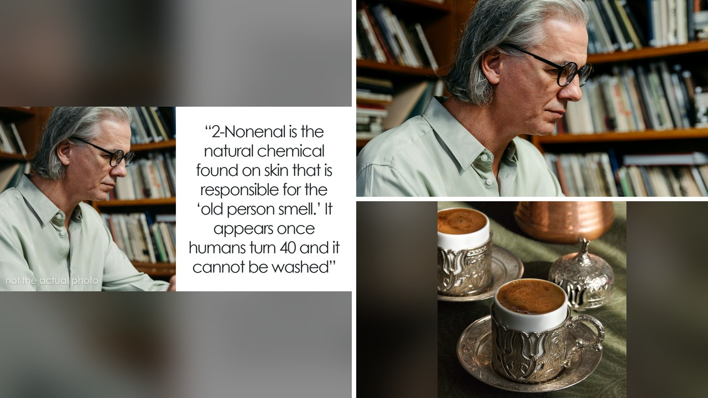

# حقائق تاريخية وغريبة ستدهشك تفاصيلها الواقعية

تخيلوا أن تحاولوا إخراج بقايا طعام من أسنانكم باستخدام مسمار وسلك، فتكون النتيجة الخضوع لجراحة قلب مفتوح استمرت سبع ساعات! هذا ليس مشهدًا من فيلم سينمائي، بل واقعة حقيقية قرأتها مؤخرًا ضمن مجموعة من أغرب الوقائع العلمية والتاريخية.

الواقع أحيانًا يملك سيناريوهات أشد غرابة من الخيال. تعالوا نتوقف عند بعض هذه التفاصيل المذهلة التي وردت في التقرير وعززت دهشتي من هذا العالم.

## حليب بأدمغة العجول وجراحة بسبب بذرة ذرة

في القرن التاسع عشر، كانت قطاعات من صناعة الألبان الأمريكية تبيع حليبًا مخففًا بالماء. ولكي يعيدوا للماء المائل للزرقة لونه الطبيعي، كانوا يضيفون الصباغ والطبشور وغبار الجبس. أما القشطة على الوجه، فكانت تُصنع من مهروس أدمغة العجول! وكان هذا الحليب مليئًا بالبكتيريا ويُحفظ بسوائل التحنيط.

بصراحة، هذه التفصيلة جعلتني أشعر بالامتنان لأننا لا نعيش في ذلك العصر. وفي حادثة أخرى لا تقل غرابة، أصيب رجل بفرط شغاف القلب وتلف فيه بعد محاولته الفاشلة لإزالة حبة ذرة فشار استقرت في فمه باستعمال غطاء قلم وعود أسنان وسلك ومسمار فلزي.

## عظام بشرية حقيقية وخديعة الذكاء الاصطناعي

عند افتتاحه في ستينيات القرن الماضي، استعان منتزه ديزني لاند بعظام بشرية حقيقية في لعبة قرصان الكاريبي. والسبب بحسب ما نُشر أن العظام الاصطناعية المتاحة حينها لم تكن مقنعة بما فيه الكفاية، فتم جلب العظام الحقيقية من المركز الطبي بجامعة كاليفورنيا في لوس أنجلوس.

مش معقول كيف كانت المعايير مختلفة في ذلك الوقت! أما الحين وفي عصرنا الرقمي، انطليت خديعة تقنية على موظف مالية في شركة متعددة الجنسيات، حيث حول مبلغ 25 مليون دولار إلى محتالين. الموظف انضم إلى مكالمة فيديو كان كل المشاركين فيها، بمن فيهم المدير المالي وزملاؤه، عبارة عن مقاطع تزييف عميق صُنعت بالذكاء الاصطناعي.

## انتقام قديم بعد خمسة عشر عاما

خلال فترة دراسته العسكرية، كان لدى نابليون زميل يدعى فيليبو، وكان الاثنان يتبادلان الشتائم والشجار بالأيدي باستمرار. لم تكن مجرد خصومة عابرة بين طفلين، بل استمرت الضغينة سنوات طويلة.

بعد خمسة عشر عامًا، خطط فيليبو للدفاع في حصار عكا، ونفذ خطة تسببت في إلحاق أول هزيمة عسكرية كبيرة بنابليون في مسيرته. يا جماعة، التاريخ مليء بتفاصيل صغيرة غيرت مجرى المعارك الكبرى.

رأيي الشخصي أن القراءة في هذه الغرائب تجعلنا ندرك كم نحتاج إلى الحذر والتدقيق، سواء في طعامنا أو في التكنولوجيا التي نثق بها اليوم.

لو خيروك بين الشرب من حليب القرن التاسع عشر أو الانضمام لمكالمة فيديو مع شخصيات زائفة بالذكاء الاصطناعي، فماذا تختار؟
