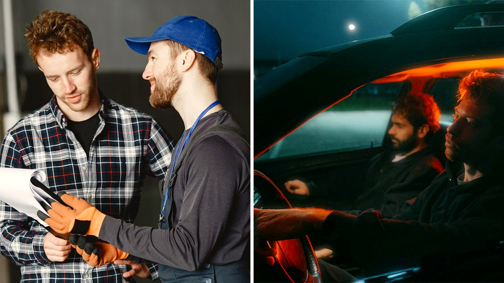

# صدفة في طائرة تنصف سائقا بعد سوء معاملة في ورشة سيارات

أن تترك سيارتك بين يدي شخص لا تعرفه، أمر يشبه المغامرة غير محسوبة العواقب. كل سائق يدرك تلك اللحظة الثقيلة حين تتعطل مركبته، ويضطر للبحث عن ورشة صيانة جديدة تمامًا.

هذا الموقف الصعب عاشه سائق وجد نفسه فجأة بلا خياره المعتاد، بعدما عجز ميكانيكيه الموثوق عن إجراء إصلاح معين. التجربة برمتها تحولت إلى عبء نفسي قاسٍ، لكن الأيام كانت تخبئ له مخرجًا لم يخطر ببال أحد.

## حين يغيب من تثق به

العثور على فني سيارات مخلص يشبه العثور على كنز حقيقي في هذا الزمن. وحين تضطر للذهاب إلى ورشة أخرى، تشعر بضغط داخلي كبير خوفًا من استغلال حاجتك أو مضاعفة المشكلة بدل حلها.

صاحب قصتنا لجأ إلى ورشة بديلة، لكن المعاملة التي تلقاها هناك كانت سيئة للغاية من قِبل موظفين افتقروا لأبسط قواعد اللباقة. جعلوا مسألة إصلاح عطل مركبته تجربة مرهقة ومليئة بالتوتر غير المبرر. هل سبق أن شعرت بأنك تدفع مالك مقابل إهانة واضحة؟

بصراحة، مثل هذه المواقف لا تمس جيب الإنسان فحسب، بل تترك أثرًا مزعجًا في نفسه، خاصة عندما يشعر بقلة الحيلة أمام مماطلة أصحاب المهن.

## أرقام تكشف قلق السائقين

ما واجهه هذا الرجل ليس حالة استثنائية، بل هو واقع يختبره أغلب قائدي المركبات حول العالم. الأرقام تظهر أن ثمانية وسبعين بالمئة من السائقين في استطلاع لمنصة تقييم المستهلكين لا يثقون دائمًا في ورش الصيانة.

تسعة وستون بالمئة من المشاركين ربطوا ثقتهم بشخصية الفني الذي يفحص المركبة، بينما اثنان وعشرون بالمئة فقط يمنحون ثقتهم المطلقة لمن يتولى إصلاح سياراتهم. المسألة لا تتوقف عند المعاملة فقط، بل ترتبط أيضًا بتكاليف مادية مرهقة.

دراسة تكاليف القيادة تفيد بأن الصيانة والإطارات تكلف نحو أحد عشر سنتًا لكل ميل، أي حوالي ألف وستمئة وخمسين دولارًا سنويًا لمتوسط قيادة يبلغ خمسة عشر ألف ميل. بل إن متوسط تكاليف إصلاح الحوادث القابلة للتأمين يرتفع ليقارب أربعة آلاف وسبعمئة وثمانية وستين دولارًا.

## نصائح لتفادي خيبة الأمل

لتجنب مثل هذه التجارب المرهقة، ينصح الخبراء بضرورة التحقق جيدًا قبل تسليم المفاتيح لأي ورشة. جون إيبوتسون، رئيس الفنيين في مركز اختبار السيارات التابع لمنظمة تقارير المستهلك، يرى أن التوصيات الشفهية من المعارف هي المعيار الأصدق لتقييم جودة الخدمة.

كما تحذر كاثلين لونغ، المسؤولة في إحدى منصات صيانة السيارات، من الانخداع بالمظاهر البراقة والفروع الفخمة للسلاسل الكبرى، مؤكدة أنها لا تضمن دائمًا أسعارًا عادلة. تخيّلوا كم من سائق يدفع مبالغ إضافية لمجرد واجهة براقة!

الحل يكمن في طلب تقدير تكلفة مكتوب يفصل بوضوح أسعار قطع الغيار وأجور الأيدي العاملة قبل بدء أي عمل. التواصل الصادق والواضح مع الزبون هو العلامة الفارقة بين المهني الحقيقي ومن يراوغ لزيادة الفاتورة دون مبرر.

## مقعد الطائرة ورسالة العدالة

بينما كان بطل قصتنا يستعد للعودة إلى مدينته محبطًا من سوء الخدمة، صعد إلى طائرته وهو يحمل مرارة التجربة. جلس في مقعده وتبادل حديثًا وديًا وعفويًا مع المسافر الجالس بجانبه.

مع مرور الوقت وتشعب الحديث، ظهرت المفاجأة المذهلة؛ تبين أن جاره في المقعد ليس سوى نائب الرئيس الإقليمي للشركة نفسها المسؤولة عن تلك الورشة. استمع المسؤول باهتمام لتفاصيل الشكوى وما حدث مع السائق من تجاوزات وإساءة.

المسؤول لم يتجاهل الأمر، بل باشر التحقيق في الواقعة فورًا واتخذ قرارات حازمة؛ أنهت الشركة تعاملها مع مقاول الباطن، وخسر الميكانيكي المتسبب في المشكلة وظيفته، ورافقه مديره أيضًا بالقرار نفسه. نال السائق إنصافه في النهاية بفضل صدفة بحتة.

رأيي الشخصي أن مثل هذه النهايات المريحة تعيد إلينا الشعور بالتوازن حين تعجز الطرق التقليدية عن حمايتنا، ولو أن العدالة يجب ألا تنتظر صدفة في السماء لتتحقق. لو كنت مكان هذا السائق في الطائرة، هل كنت ستشتكي بتفصيل للمسؤول الجالس بجانبك أم كنت ستفضل الصمت وعدم إثارة المشاكل خلال الرحلة؟
