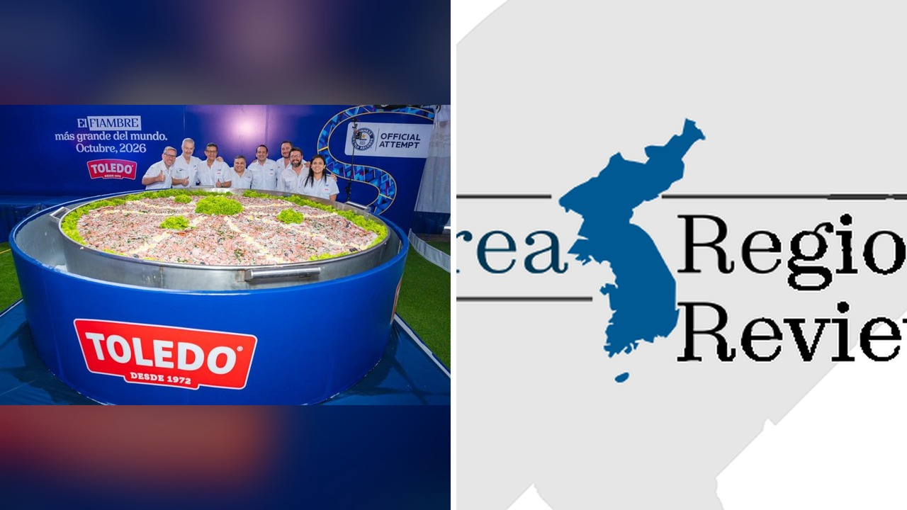

# شيفات غواتيمالا يطهون أكبر سلطة فيامبر في العالم

### بداية غير متوقعة
تخيّلوا أنكم تشوفون وعاءً يزن **4,325.9 باوند** من الفيامبر، وهو وزن يقترب من وزن سيارة صغيرة. أنا لما قرأت الخبر استغربت، لأن الفيامبر عادةً ما تكون صحنًا بسيطًا يُقدَّم في المناسبات، لكن هالمرة صارت مسرحًا لتحدي عالمي. ما رأيكم في فكرة تحويل طبق تقليدي إلى رقم قياسي عالمي؟

### طهاة يلتقون في العاصمة
في قلب مدينة غواتيمالا، جمعوا مجموعة من الشيفات تحت رعاية شركة تويدو أليمنتوس. الصراحة، ما كان في شيء يوضح حجم المهمة غير عدد اللحم والخضار: حوالي **4,000 رطل** من المكونات تم خلطها مع صلصة خاصة. وش رايكم إنهم قدروا يخلطوا كل هالكمية بدون ما يطيحوا على الأرض؟

### مزيج النكهات والاحتفالات
السلطة ضمت بيضًا، لحوم باردة، سجق، ذرة، فلفل، خس، بصل، وغيرهم. بعد ما وزنها مقيّم جونيز، تم تقديمها للجمهور مع موسيقى حية وعروض نسج تقليدية. يا جماعة، الحدث جاء قبل يومي **عيد جميع القديسين** و**عيد الأرواح**، اللي عادةً يُعَد فيها الفيامبر طبقًا أساسيًا. يعني، ما فاجأني إنهم استغلوا المناسبة لتكبير الفعالية.

### النهاية والسؤال الأخير
بعد ما تم الإعلان عن النجاح، تم توزيع القطع على الحضور، وكان المشهد كله فرحة وضحك. رأيي الشخصي إن هذا النوع من المحاولات يبرز قوة التراث الثقافي عندما يُدمج مع روح الابتكار. لكن، هل تعتقدون أن تحويل الأطباق التقليدية إلى أرقام قياسية قد يضر قيمتها الأصلية؟

### سؤال للقراء
إذا كان بإمكانكم اختيار طبق تقليدي من بلدكم لتسجيل رقم قياسي عالمي، أي طبق ستختارون ولماذا؟
