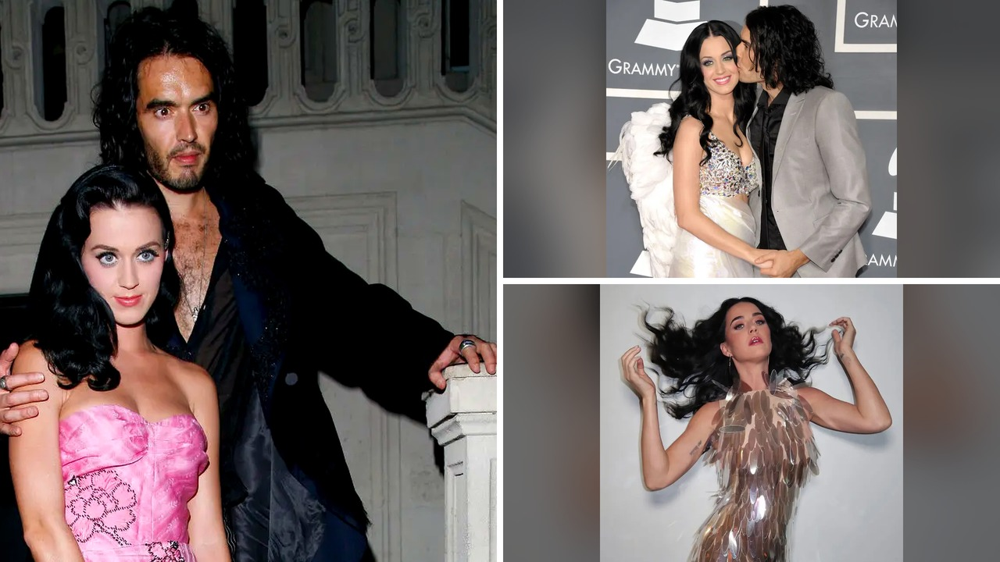

# تصريحات كاتي بيِري الغامضة عن راسيل براند تشتعل من جديد

## حفلة بريطانية تعيد إشعال القصة

تخيلوا معي أن نكتة على المسرح تتحول فجأة إلى حديث العالم. هذا بالضبط ما حدث عندما كانت المغنية كاتي بيِري تقيم حفلة في المملكة المتحدة في يوليو 2026. خلال تفاعلها مع الجمهور عبر لعبة جماعية، طلبت من الحاضرين أن يتخيلوا ردة فعلهم عند رؤية أزواجهم السابقين. الحفلة شهدت عبارة عفوية أطلقتها عندما قالت بصراحة إنها تمني النفس ألا يكون طليقها حاضراً لأنه يفترض أن يكون في السجن. الحين ومع صدور حكم قضائي قاسي بالسجن لمدة عشر سنوات ونصف بحق الممثل الكوميدي راسيل براند في نوفمبر، ربط المتابعون بسرعة بين تلك المزحة وما جرى خلف الأبواب المغلقة خلال زواجهما القصير الذي لم يستمر سوى أربعة عشر شهرًا وانتهى برسالة نصية مفاجئة.

## الحقيقة التي احتفظت بها في الخزنة

ما فاجأني حقاً هو حجم التلميحات التي أطلقتها بيِري عبر السنين دون أن تكشف التفاصيل كاملة. ففي حوار أجري مع مجلة فوغ سنة 2013، وصفت طليقها بأنه شخص متحكم للغاية. والأغرب أنها أشارت إلى وجود حقيقة قاسية تحتفظ بها مغلقة في خزنتها لاستخدامها عند الحاجة. في تلك الفترة، شبّهت آثار الطلاق بندبة جسدية واضحة للعيان. الصحافي البريطاني بيرس مورغان التقى بها أيضاً في حفل بولاية واشنطن، ولاحظ أنها تتهرب من الحديث العميق خشية أن يبوح لسانها بالحقيقة التي لم تكن مستعدة بعد للاعتراف بها أمام نفسها، ناهيك عن مشاركتها مع الجمهور الذي لم يكن يدرك شيئاً عن كواليس ذلك الانفصال السريع الذي بدأ بطلب الزواج في الهند سنة 2009.

## لقب راسيل المثير للجدل

بصراحة، استوقفني اللقب الغريب الذي أطلقته عليه المغنية في أحاديثها الخاصة. عندما تحدث مورغان عن لقائهما القديم في مقال كتبه لصيف 2013، أشار إلى أنها وصفته صراحة بأنه راسيل مشابه للشخصية التاريخية غريغوري راسيل. هذا الرمز التاريخي أرتبط غالباً بالغموض والنفوذ، وبدا لافتاً أن المعني بالأمر لم ينزعج من التشبيه بل وجده طريفاً ومناسباً لطبيعته الصاخبة. الحوادث تلاحقت بعد ذلك ليجد براند نفسه في قفص الاتهام مداناً بتهم تتعلق بسوء السلوك وفرض الحيمية، وهو ما نتباه طوال المحاكمة مدعياً أن جميع علاقاته كانت مبنية على الرضا والقبول، بينما رأت هيئة المحلفة غير ذلك.

## غضب عارم أمام المحكمة

لم يتوقف الجدل عند إدانة الفنان فحسب، بل امتد ليتشعب نحو ردود فعل عائلية صادمة أمام محكمة ساذوورك كراون. عندما واجه الصحفيون والد المبرر لتصرفات ابنه رون براند، دخل في مشادة كلامية حادة رافضاً الاعتراف بنزاهة القضاء برمته، وهو ما أثار موجة غضب عارمة بين مستخدمي منصات التواصل الاجتماعي الذين تساءلوا عن المصدر الذي استقى منه الابن سلوكياته. الشرطة بدورها أكدت أن التحقيقات لا تزال مستمرة مع ظهور بلاغات جديدة من نساء أخريات. رأيي الشخصي هو أن الصمت الطويل الذي التزمته النجوم أحياناً يكون أبلغ بكثير من مئة تصريح، وما قيل قبل سنوات يحمل اليوم دلالات لا يمكن تجاهلها. شو رأيكم، هل كانت تلك التلميحات كفيلة بكشف الحقيقة مبكراً؟
