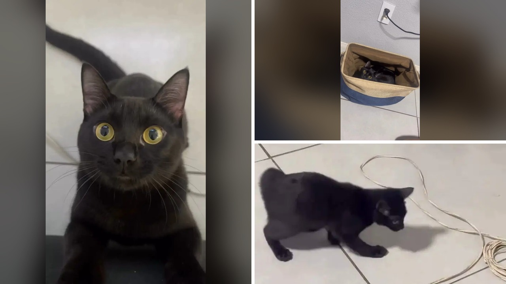

# قط أسود يتحول إلى لون مختلف بسبب حالة نادرة

في الثاني عشر من يونيو عام 2024، تلقت المصورة البرازيلية كواني ستيفاني، التي تعيش في مدينة بيلو هوريزونتي، هدية ميلاد مميزة كانت تتطلع إليها منذ وقت طويل. جرو قط صغير باللون الأسود الفاحم، أطلقت عليه اسم "فوماتشا"، وهي كلمة تعني "الدخان" باللغة البرتغالية. كانت كواني تحلم دائماً باقتناء قط أسود بالكامل كي يتناغم شكله مع كلب العائلة الأسود أيضاً. وسرعان ما توطدت العلاقة بينهما، وأصبح القط الصغير رفيقاً لا يفارق صاحبته.

لم يخطر ببال كواني وقتها أن هذا القط الأسود الجميل سيبدو كائناً مختلفاً تماماً بعد مرور أكثر من عام واحد فقط. تخيّلوا كيف يمكن لبقعة وردية دقيقة، ظهرت على أنفه الداكن دون سابق إنذار، أن تشكل بداية لتحول كامل ومدهش في مظهر حيوان أليف.

## بداية التغير المفاجئ

طوال العام الأول من حياته في المنزل، كان فوماتشا يبدو كأي قط أسود عادي تماماً، يركض ويلعب في الغرف ويقضي يومه بكل هدوء. غير أن الملاحظة الأولى بدأت عندما انتبهت كواني لتلك البقعة الوردية الصغيرة جداً على أنفه الأسود. في البداية، لم تكن تلك العلامة تثير أي قلق جدي، لكن مع مرور الوقت بدأت التفاصيل تتغير بطريقة غير متوقعة.

شغلت البقع البيضاء مساحات جديدة على فروه الأسود الناعم، وأخذت تتسع وتنتشر تدريجياً في أماكن متفرقة من جسده. هذا التحول البصري التدريجي جعل كواني تشعر بقلق حقيقي على صحة أليفها الصغير، فقررت عدم الانتظار والذهاب فوراً للاستشارة الطبية. هل كنت ستشعر بالقلق لو لاحظت تغيراً مفاجئاً وبدون سبب واضح في لون فرو أليفك في المنزل؟

تذكرنا هذه المواقف الطبية النادرة بمدى المفاجآت التي قد تخفيها لنا الحيوانات الأليفة في أجسادها وصحتها، وهو ما يذكر بحالات أخرى اكتشف فيها أصحاب الحيوانات خصائص جينية مذهلة وغير متوقعة في دماء أليفتهم.

**اقرأ أيضًا:** [قطة تبهر عائلتها باكتشاف جيني نادر في دمها](https://www.almosaitiron.com/2026/11/blog-post_911.html)

## التشخيص الطبي والسبب العلمي

لتتحقق كواني من سلامة فوماتشا، عرضته على طبيبين بيطريين للوقوف على السبب الحقيقي لظهور هذه البقع النادرة. هناك تلقت الخبر الذي أزال عن كاهلها حملاً ثقيلاً من الخوف؛ حيث أوضح الأطباء أن القط مصاب بالحالة المعروفة باسم "البهاق". وهذه الحالة الجلدية النادرة لدى القطط تحدث عندما تتأثر الخلايا الصباغية المسؤولة عن إنتاج الصبغة الطبيعية في الجلد والشعر، أو تتعرض للتلف والموت، وغالباً ما يرتبط ذلك باستجابات مناعية ذاتية داخل الجسم.

وكانت النقطة الأهم والتي جلبت الراحة الكبيرة لصاحبته هي أن البهاق حالة غير ضارة بالصحة العامة على الإطلاق. فهو ليس مرضاً معدياً، ولا يتسبب في أي ألم أو حكة أو مشاكل عضوية أخرى للقط. إلا أن الأمر يتطلب فقط عناية واهتماماً ومتابعة بيطرية مستمرة، لأن المناطق التي تفقد صبغتها الطبيعية تصبح أكثر عرضة وأكثر تأثراً بأشعة الشمس. الصراحة، كان معرفة هذه الحقيقة الارتياح الأكبر لكواني، لأن أهم ما يعني أي مربٍ هو صحة صديقه الصغير وراحته.

تخيّل أن تبحث عن قط بلون معين وترتبط به، ثم تراه يغير ثوبه بالكامل أمام عينيك دون أن يفقد شيئاً من نشاطه وحيويته، بل إنه يملك طاقة ولعباً يفوقان العديد من القطط الأخرى!

## من قط منزلي إلى ظاهرة عالمية

على مدار الأشهر التالية، استمر التحول في الازدياد، حتى أصبح فرو فوماتشا الأسود الموحد سابقاً يضم مزيجاً استثنائياً من البقع البيضاء والرمادية والداكنة. أصبحت المقارنة بين صوره القديمة كجرو صغير وصوره الحالية أمراً مذهلاً، حتى إنه بات من الصعب على من يراه للمرة الأولى أن يصدق أن الصور تعود للقط نفسه.

أمام هذا التغير المدهش، قررت كواني توثيق رحلة قطها في مقطع فيديو ونشره عبر حسابها على منصة إنستغرام. ويا جماعة، كانت ردود الفعل أضخم بكثير مما تتخيل. بحلول شهر أكتوبر من عام 2026، حصد الفيديو أكثر من 18.5 مليون مشاهدة وما يزيد على 2.2 مليون إعجاب، وانهالت آلاف التعليقات المندهشة من المتابعين حول العالم.

امتلأت التعليقات بالعديد من المزحات اللطيفة والتأملات؛ فبعض المتابعين شبهوا تحوله المدهش بالمغني مايكل جاكسون، بينما مزح آخرون وقالوا إنه يبدو وكأنه تلطخ أو دحرج نفسه في وعاء من الدقيق! ولم يتوقف الأمر عند التسلية والتفاعل، بل أحدثت القصة تأثيراً توعوياً غير متوقع، إذ تواصل عدة مربين مع كواني ليعربوا عن امتنانهم، بعدما انتبهوا إلى وجود تغيرات مماثلة في فرو حيواناتهم الأليفة دون أن يفهموا أسبابها من قبل.

## المحبة لا تتغير بتغير الألوان

اليوم، يواصل فوماتشا حياته اليومية الممتعة برفقة صاحبته المحبة، غير مدرك على الإطلاق أن فروه الفريد قد جعل منه نجماً معروفاً على شبكة الإنترنت. ربما كانت كواني تتمنى في البداية قطاً أسود خالصاً ليطابق كلبها، لكن مشاهدتها لهذا التحول النادر جعلت قصتهما معاً أكثر عمقاً وسحراً.

رأيي الشخصي أن المظهر الخارجي لحيواناتنا قد يتغير بطرق لا نتوقعها، لكن مشاعر الدفء والارتباط الإنساني بها تبقى كما هي دون أن تتبدل. ففي النهاية، وتحت هذا الفرو الفريد متعدد الألوان، لا يزال فوماتشا هو ذلك القط المشاكس والمفعم بالحيوية والحب الذي دخل حياة كواني في يوم ميلادها.

لو مر أليفك بتغير فريد في شكله، هل تفضل أن تحتفظ بتفاصيل قصته لنفسك أم تشاركها مع العالم كما فعلت كواني؟
