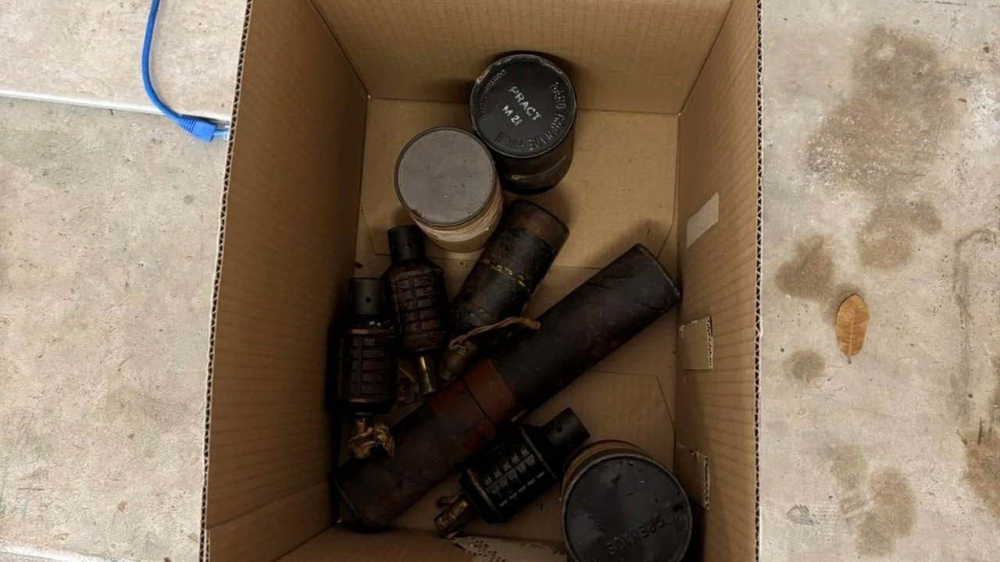

# مشتريات قديمة تقود أمريكياً لصندوق قنابل حية

تفتح صندوقاً اشتريته من تصفية ممتلكات منزلية، وتتوقع كتباً أو تحفاً قديمة، لتجد أمامك قنابل يدوية حقيقية جاهزة للانفجار. هذا المشهد غير المتوقع تماماً هو ما عاشه أحد المتسوقين في ولاية تكساس مؤخراً، عندما قرر فحص ما جلبه معه إلى البيت.

بصراحة، حين قرأت الخبر توقفت طويلاً عند الصدمة التي شعر بها هذا الشخص في تلك اللحظة بالذات.

## صفقة عادية جداً

القصة بدأت في مدينة أوستن، حيث ذهب أحد السكان إلى مزاد تصفية مقتنيات منزلية خاص، واشترى بعض الصناديق المغلقة. الأمور حتى هذه النقطة كانت تسير بشكل اعتيادي تماماً، مثل أي جولة تسوق يبحث فيها صاحبها عن مقتنيات رخيصة أو أشياء ذات قيمة تاريخية.

لكن هالسالفة أخذت مساراً مختلفاً تماماً بمجرد أن بدأ المشتري بفرز الأغراض وتفريغ محتوياتها بيده. تخيّلوا شعوره وهو يرفع الغطاء ليجد معدات عسكرية ثقيلة قابعة في القاع دون أدنى تحذير!

## ما فاجأني في الصندوق

الصدمة لم تكن مجرد قطع حديدية للزينة، بل كانت المفاجأة أن الصندوق يضم ما بدا أنه قنابل يدوية تعود إلى حقبة الحرب العالمية الثانية. هنا لم يتردد الرجل واتصل بالشرطة فوراً، لتصل دوريات الأمن إلى الموقع للتعامل مع هذا البلاغ الغريب في يوم إثنين غير عادي.

السؤال الذي خطر ببالي: وش رايكم في الموقف لو كنتم مكانه؟ هل كنتم ستلمسون تلك القطع للتأكد أم تتراجعون فوراً؟

## رعب عمره 80 عاماً

عندما وصلت فرقة تفكيك المتفجرات التابعة لشرطة أوستن إلى الموقع، انقلب الشك إلى حقيقة مرعبة. الخبراء فحصوا الصندوق وأكدوا رسمياً أن القنابل ليست مجرد مجسمات تذكارية فارغة، بل هي قنابل حية ونشطة بالكامل.

أصعب ما في الأمر، حسب ما نُشر، هو أن التعامل مع متفجرات عمرها 80 عاماً يمثل مهمة في غاية الخطورة؛ لأن استقرار المواد الكيميائية بداخلها عبر كل هذه العقود الطويلة يكون مجهولاً تماماً وغير مضمون. لكن لحسن الحظ، نجح الفريق المتخصص في ضبط القنابل ونقلها بعيداً عن المكان بأمان تام.

رأيي الشخصي أن خروج المشتري من هذه المغامرة بسلام هو المكسب الحقيقي، فالأشياء القديمة قد تحمل أحياناً كوارث لم نحسب حسابها. لو عثرت يوماً على صندوق قديم وغامض، هل تفتحه بيدك أم تتركه مكانه؟
