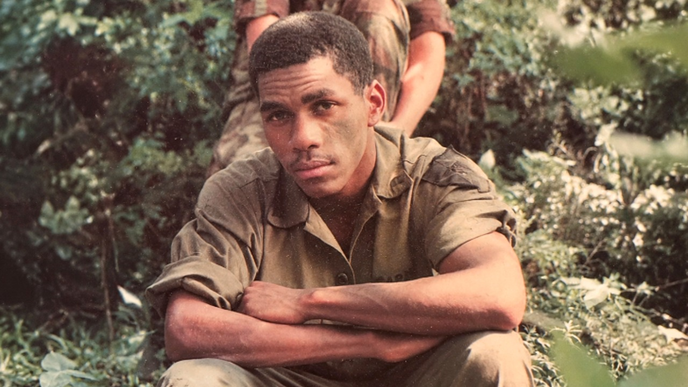

# موقف إنساني لمحارب قديم ينقذ صديقه المسن وزوجته من البرد

الموقف البسيط أحيانًا يتحدث بصوت أعلى بكثير من أكثر المبادرات ضخامة. هذا ما شعرت به تمامًا عندما قرأت عن محارب قديم يُدعى روي. رجل عاش حياته وهو يحمل قيمة العطاء، لكن الموقف الذي حُكي عنه مؤخرًا يمسّ القلب ببساطه الشديد.

تخيّلوا أن تجد صديقًا لك، رجلًا مسنًا يعيش مع زوجته، يضطران لتقنين الوقود الذي يدفئ منزلهما في أوقات البرد. الموقف ليس سهلاً، والعيش في بيت بارد لحسابات ضيقة أمر يؤلم النفس.

## اتصال واحد يغير كل شيء

حسب ما ورد في التقرير، ما إن عرف المحارب القديم روي بوضع صديقه وزوجته، حتى اتخذ قرارًا فوريًا. لم يتردد، ولم يجلس ليفكر طويلًا أو يكتفي بإظهار التعاطف الشفهي.

ببساطة شديدة، رفع سماعة الهاتف وأجرى مكالمة سريعة. قال للسيدة على الطرف الآخر بكلمات مقتضبة ومباشرة: املئي خزانهم بالكامل. بهذه البساطة والوضوح، أنهى معاناة صديقه دون زرقشات أو استعراض.

## العطاء حين يكون أسلوب حياة

الصراحة، هذا التصرف العفوي يظهر كيف ينظر بعض الأشخاص لمفهوم الصداقة والدعم. روي لم ينتظر أن يطلب منه صديقه المسن المساعدة، بل بادر من تلقاء نفسه فور علمه بالقصة.

يا جماعة، بعض الأفعال لا تحتاج ميزانيات ضخمة ولا خططًا معقدة، بل تحتاج فقط لمشاعر صادقة وإحساس بالآخرين. تدخّلٌ واحد في اللحظة المناسبة قد يعيد الدفء لبيت كامل، ويمنح صاحبه شعورًا بأنه ليس وحده في مواجهة الأوقات الصعبة.

## موقف يتحدث عن صاحبه

رأيي الشخصي أن أحسن أنواع العطاء هو ما يأتي دون ضجيج، حين يرفع شخص الهاتف وينهي مشكلة صديقه في لحظة دون أن يحرجه أو يجعله يشعر بالثقل. ما فعله روي يذكرنا بأن الدفء الحقيقي ليس فقط في الوقود الذي يملأ الخزانات، بل في وجود أشخاص في حياتنا يستشعرون حاجتنا قبل أن ننطق بها.

إذا وجدت صديقًا مقربًا يمر بظرف صعب ويرفض الطلب، هل تفضل المبادرة بمساعدته فورًا دون إذن، أم تنتظر حتى يطلبها بنفسه؟
