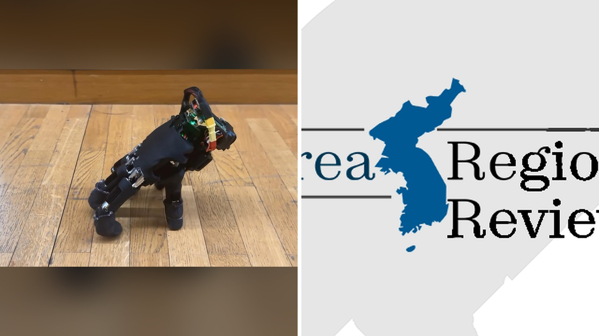

# يد روبوتية تمشي على أصابعها تدهش الباحثين

تخيلوا يدًا بلا ذراع، تمشي على أصابعها كأنها تتسلق جبالًا صغيرة. هذا ما فعلته مجموعة من الباحثين في ETH Zürich لتتناسب مع أجواء أكتوبر المخيفة.

أنا قرأت التقرير، وما فاجأني هو أن هذه اليد ليست مجرد نموذج عرض، بل تعتمد على تعلم الآلة لتتعلم التوازن وتتحرك بذكاء. وش رايكم لو رأيناها تنقذ حياة في كوارث؟

## كيف تعلمت الأصابع المشي?

الفريق استخدم خوارزميات تعلم الآلة، وخلّى اليد تتدرب داخل محاكاة حاسوبية بدل ما يبرمجوا كل حركة يدويًا. الصراحة، التدريب كان يشبه لعب لعبة فيديو، حيث جربت اليد آلاف الحركات حتى وجدت الطريقة المثلى لتوازنها. لأن الأصابع ليست متماثلة، لازم تتعلم تنسق بينها وتظل واقفة. هل تعتقدون أن هذا النهج سيغير طريقة برمجة الروبوتات في المستقبل؟

## ماذا تستطيع اليد المتجولة؟

الفيديو اللي نشروا يوري اليد تمشي على أسطح مختلفة، تنقلب وتقوم من نفسها، تدفع كرات صغيرة، وحتى تكتب على لوحة مفاتيح. يا جماعة، تخيّلوا إن الروبوت يقدر يدخل أماكن ضيقة وينفذ مهام إنقاذ دون الحاجة لجسم كبير. الباحثون يقولون إن القدرة على الوقوف بعد السقوط تجعلها مرنة للبيئات المتقلبة. وش ممكن نستخدمها في صناعاتنا اليومية؟

## لماذا يثير هذا المشهد القشعريرة؟

المشهد يبدو شوية مخيف، خاصةً لما تشوف اليد تمشي كأنها كائن حي. لكن الروبوت يوري رسالة أعمق: كيف نجعل الآلات تتكيف وتستكشف أجسامها بطرق غير متوقعة. هذا الذكّرني بالإنجاز اللي شوفناه في قصة الطائر اللي حصل على منقار اصطناعي مزدوج. 

**اقرأ أيضًا:** [أول طائر في العالم يحصل على منقار اصطناعي مزدوج](https://www.almosaitiron.com/2026/10/blog-post_17.html)

رأيي الشخصي أن هذه التقنية تفتح بابًا جديدًا للروبوتات الصغيرة، خصوصًا في عمليات الإنقاذ داخل الأنقاض أو الفحوصات الطبية الدقيقة. أعتقد إننا قريبين من رؤية تطبيقات عملية لها. إذا كان عليك اختيار: هل تفضّل رؤية هذه اليد تساعد في إنقاذ حياة أم تُظهر عروضًا فنية في معارض التكنولوجيا؟
