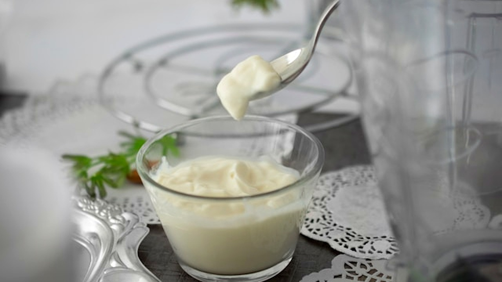

# أغرب المشروبات في العالم بين نبيذ الأفاعي ونكهة النمل

هل تخيلت يومًا أن تشرب نبيذًا نُقعت فيه أفعى سامة بالكامل، أو أن تتذوق مشروبًا يُستخرج طعمه المميز من النمل الأخضر؟ عندما قرأت التقرير عن أغرب المشروبات حول العالم، وقفت مندهشًا أمام الابتكارات التي تتجاوز المألوف في عالم المشروبات.

تعال نتوقف عند هذه التجربة الفريدة التي تأخذنا في جولة عبر ثقافات ومكونات غير متوقعة إطلاقًا.

## نبيذ الأفاعي بين الطب والغرابة
أحد أغرب المشروبات التي استوقفتني في التقرير هو نبيذ الأفاعي. لا يُصنع هذا المشروب من الأفعى نفسها، بل عبر نقع أفعى سامة داخل نبيذ الأرز. ما استغربته حقًا أن الكحول الموجود في النبيذ يحيّد سم الأفعى ويجعله غير ضار على الإطلاق. يذكر الطب الصيني التقليدي أن جرعة من هذا النبيذ تمنح الجسم تأثيرًا منعشًا ومنشطًا.

لكن الأمر لا يتوقف عند هذا الحد؛ فهناك نسخة أكثر جرأة تُذبح فيها الأفعى الحية في التو واللحظة، ثم يُخلط دمها وعصارتها الصفراوية مع الكحول لتقديمها كجرعة سريعة. الصراحة، هذا المشهد يبدو قاسيًا ومربكًا لأي شخص، فهل تجرؤ على تجربة مشروب كهذا؟

## جين المشروبات بطعم النمل
من الصين ننتقل إلى أستراليا، حيث يلتقي التراث المحلي بتصنيع المشروبات الحديثة. يستخدم السكان الأصليون من شعب لاراكيا في المقاطعة الشمالية النمل الأخضر كنوع من العلاج والطب التقليدي. وتقوم إحدى شركات المشروبات في منطقة أديليد هيلز بدمج هذا النمل الأخضر في مرحلة تقطير مشروب الجين.

الغريب أن النمل يمنح المشروب نكهة واضحة من الليمون والكزبرة. بل إن النمل المستقر في قاع الزجاجة قابل للأكل تمامًا لمن يملك الشجاعة لتذوقه. هذا المزيج بين الأعشاب والتقاليد المحلية يطرح سؤالاً: هل يمكن للمكونات البرية أن تصبح نكهة مفضلة في المستقبل؟

## بيرة الأطفال ومكونات غير متوقعة
في اليابان، ظهر مفهوم مختلف تمامًا يذكرنا بحلويات السجائر القديمة التي كنا نتظاهر بتدخينها في الصغر. هناك مشروب يُدعى بيرة الأطفال، وهو خالي تمامًا من الكحول ويملك طعم الكولا، لكنه يُعبأ في زجاجات بنية ذات ملصقات تشبه زجاجات البيرة الحقيقية، ويعلوه رغوة كثيفة ليعطي المظهر نفسه.

أما أغرب تجارب التخمير، فقد شهدتها أستراليا في مصنع فيكتوريا لسبعة سنتات، حيث قام المصنعون بعزل الخميرة من منطقة السرة لديهم لاستخدامها في تصنيع البيرة! فكرة التخمير هذه جاءت بإلهام من مصنع آخر استخدم خميرة مستخرجة من لحية أحد المصنعين. وقد وُصف المشروب الناتج بأنه بيرة بلجيكية تحتوي على قشور البرتقال الطازج وبذور الكزبرة المحمصة، وتتميز بنكهات التوابل والقرنفل والموز.

## كوكتيل المايونيز وتجارب التخمير
يا جماعة، أكثر ما أثار اندهاشي واشمئزازي في الوقت نفسه هو كوكتيل يُدعى كحة التدخين. يتكون هذا المشروب من جرعة من المشروب العشبي ييغرميستر مع ملعقة كبيرة من المايونيز تطفو على السطح. وضع المايونيز فوق مشروب سائل يبدو خيارًا غريبًا للغاية ولا يتقبله التذوق العادي بسهولة.

رأيي الشخصي أن التجريب في عالم الطهي والمشروبات أمر ممتع ويفتح آفاقًا للتعرف على الثقافات، لكن دمج مكونات كالمايونيز أو استخراج الخميرة من أجسام البشر يتجاوز حدود التذوق إلى الغرابة المفرطة.

وش رايكم، لو عُرض عليك الاختيار بين تجربة مشروب بالنمل الأخضر أو بيرة الأطفال اليابانية، أيهما تختار؟
