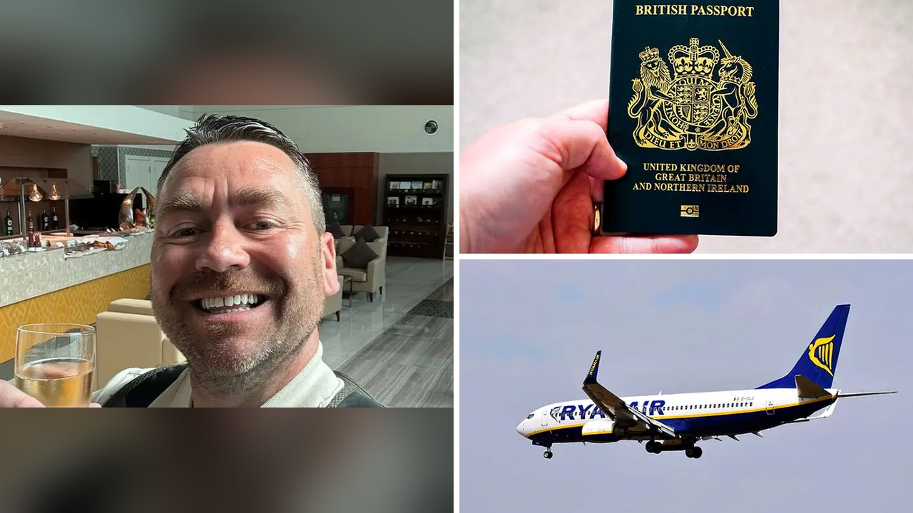

# مسافر يطير إلى إسبانيا بجواز سفر زوجته دون كشفه

تخيّل أن تصل إلى مطار دولة أخرى بعد رحلة طيران دولية، ثم تكتشف فجأة أن جواز السفر الذي تحمله ليس لك، بل لزوجتك! هذا التفكير وحده يربك أي مسافر، لكنه حدث بالفعل مع بن مور، البالغ من العمر ثمانية وأربعين عامًا، والقادم من منطقة تولك في ستافوردشاير.

كان الرجل متوجهًا إلى إسبانيا يوم الجمعة العشرين من نوفمبر للمشاركة في حفلة عزوبية مع أصدقائه. صعد إلى الطائرة وغادر المملكة المتحدة، ووصل إلى وجهته دون أن يستوقفه أحد في إجراءات المغادرة. بصراحة، القصة تبدو أقرب لمشهد سينمائي، لكن نتائجها على الأرض كانت مختلفة تمامًا.

## صدمة في طابور الجوازات

عندما وقف بن في طابور مراقبة الجوازات بمطار أليكانتي الإسباني، استوعب الكارثة. تخيّلوا الصدمة التي حلّت عليه في تلك اللحظة! ظن في بداية الأمر أنه أخذ جواز زوجته بالخطأ إلى جانب جوازه الأصلي، لكن الواقع كان أقسى من ذلك بكثير.

ذكر بن، بحسب التقرير، أن وجهه شحب تمامًا وأن لونه اختفى فور اكتشافه الأمر. قشعريرة باردة سرت في جسده وهو يفتش حقائبه ثماني مرات متتالية، على أمل أن يجد جوازه الخاص. كيف يعقل أن يصل إلى مطار إسباني بدونه؟

لم يجد حلاً سوى التوجه إلى الشرطة الإسبانية ليشرح لهم الموقف بنفسه. لكن الضباط هناك وقفوا في ذهول تام، ولم يصدقوا ما يسمعونه إطلاقًا. وما زاد الطين بلة هو عائق اللغة الذي جعل شرح هذه الحادثة الغريبة أمراً معقداً ومربكاً للغاية.

## كيف عبر الحدود دون تدقيق؟

هنا يطرح السؤال نفسه: كيف تمكن مسافر من صعود طائرة دولية بجواز سفر شخص آخر؟ توقف المسؤولون عن إدارة مطار مانشستر، حيث بدأت رحلة بن، عند هذه النقطة لتوضيح آلية العمل. وأكد المطار أن مسؤولية التحقق من جوازات السفر تقع على عاتق شركات الطيران وليست إدارة المطار نفسها.

وأوضح المتحدث باسم المطار أن الركاب يبرزون بطاقات صعود الطائرة فقط عند المرور عبر التفتيش الأمني. كما أكدت وزارة النقل هذه التفاصيل، مبيّنة أن الفحص الأمني يسبق صعود الطائرة ويهدف لأغراض أمنية مختلفة تماماً عن مطابقة وثيقة السفر مع هوية حاملها.

وكان بن يسافر على متن طيران ريان إير، بينما كانت شركة سويس بورت هي الطرف الثالث المسؤول عن إجراءات تدقيق وثائق الركاب في المطار. الشركة أكدت أنها تأخذ مسؤولياتها الأمنية والتحقق من الوثائق بجدية بالغة، وأعلنت فتح مراجعة داخلية شاملة لتعزيز إجراءات الفحص الإجباري لدى طواقمها التشغيلية. هالسالفة كشفت ثغرة غير متوقعة في إجراءات التدقيق.

## نهاية سريعة لرحلة الاحتفال

رغم أن بن نجح في الوصول إلى الأراضي الإسبانية، إلا أن عدم امتلاكه لصفة الدخول القانونية بصفته صاحب الجواز أنهى عطلته قبل أن تبدأ. يا جماعة، تخيلوا الشوق للحفلة ثم العودة الفورية من المطار! لم يتمكن الرجل من الانضمام لأصدقائه ومشاركتهم الحفل كما كان مخططًا.

بعد أن أوضح موقفه للشرطة الإسبانية، تم منعه من مواصلة رحلته وتقرر إعادته مباشرة إلى المملكة المتحدة. ووصف بن تعامل رجال الشرطة معه خلال تلك المواجهة بأنه كان مهددًا ومثيرًا للرهبة، مما جعل تجربة السفر برمتها تجربة غير سارة على الإطلاق. شو رأيكم في هذا الموقف الصعب الذي وجد نفسه فيه؟

## خطأ آخر في مطار إدنبرة

المثير للدهشة أن هذه الحادثة لم تكن الوحيدة في تلك الفترة. ففي اليوم التالي مباشرة، الحادي والعشرين من نوفمبر، وقع خلل آخر يرتبط بإجراءات الجوازات ولكن في مطار إدنبرة. مسافرون قادمون من مطار كيفلافيك الدولي في أيسلندا على متن طيران إيزي جيت جرى توجيههم بالخطأ إلى منطقة الوصول المحلي بدلاً من الوصول الدولي.

هذا الخطأ الذي تسبب فيه أحد موظفي شركة مناولة أرضية أدى إلى تجاوز الركاب لفحص الجوازات مؤقتاً. وأكد مطار إدنبرة أن الفحوصات المطلوبة أجريت لاحقاً للركاب بعد اكتشاف الخطأ، واعتذر المطار عن التجربة التي مر بها المسافرون، مشيراً إلى أن الشركة المعنية تتعامل مع الأمر وستقدم تقريراً لوزارة النقل.

رأيي الشخصي أن الأخطاء البشرية في المطارات قد تحدث، لكن وصول شخص لبلد آخر بجواز غيره يظهر أهمية مراجعة الأوراق الشخصية بنفسك قبل الخروج من المنزل بدلاً من الاعتماد الكلي على نقاط التدقيق. هل ترون أن المسؤولية الأكبر تقع على المسافر الذي لم ينتبه لوثيقته، أم على شركة التدقيق التي سمحت له بالصعود؟
