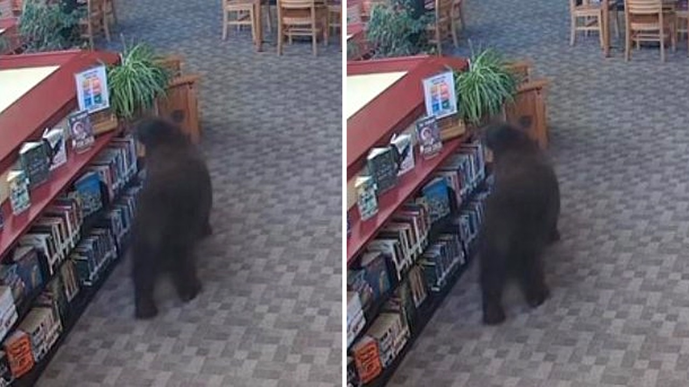

# دب يقتحم مكتبة في كاليفورنيا ويسرق وعاء عسل

الساعة تشير إلى السادسة صباحًا، والمكان مكتبة عامة يُفترض أن تعمّها السكينة التامة، وفجأة يدخل زائر ضخم لا يبحث عن رواية ولا كتاب تاريخ. قرأت هذا الخبر واستوقفتني تفاصيله الطريفة؛ دب حقيقي يتجول بهدوء بين الرفوف في ولاية كاليفورنيا الأمريكية، لكن المفارقة مش معقولة الصراحة، فالزيارة تزامنت تمامًا مع الذكرى المئوية للظهور الأول لشخصية الدب الشهير ويني ذا بوه، وكأننا نرى شخصية كرتونية خرجت لتعيش واقعنا.

## ضيف غير متوقع عند الفجر

تخيّلوا المشهد معي؛ الدب تسلل صباح يوم أربعاء إلى فرع مكتبة مقاطعة مونو في ماموث ليكس. لم يكسر بابًا بعنف ولم يُحدث جلبة مخيفة، بل دخل كأنه يعرف طريقه جيدًا. يا ترى كيف سيكون تصرفك لو فتحت باب عملك باكرًا ووجدت أمامك هذا الضيف ذو الفراء؟ ما فاجأني بحق حسب مقطع الفيديو الذي نشرته إدارة المكتبة، هو تلك الثقة والهدوء اللذين تحرك بهما الحيوان الضخم داخل مكان مغلق مخصص للقرّاء.

## وليمة خفيفة من غرفة الاستراحة

فور دخوله، لم يضع الدب وقته في التسكع؛ توجه مباشرة إلى إمدادات الوجبات الخفيفة الخاصة بالموظفين، ويبدو أن حاسة شمه قادته إلى الكنز بسرعة. فتح لنفسه بوفيهًا خاصًا، حيث التهم زبدة الفول السوداني، وتناول تشكيلة من كؤوس الخوخ، وحفنة من البسكويت بمخلبه، وطبعًا لم ينسَ الوجبة الكلاسيكية: وعاء كامل من العسل. هالسالفة جعلتني أبتسم تلقائيًا، فالمشهد مطابق تمامًا لما يفعله الدب الكرتوني الكلاسيكي حين يبحث عن طعامه المفضل، وكأن الدب قرر الاحتفال بالمئوية على طريقته الخاصة.

## زائر مهذب ووعاء مفقود

المثير للدهشة بحق أن هذا الزائر، وبعد أن أنهى وليمته الشهية، قام بجولة استطلاعية قصيرة بين رفوف الكتب، ثم غادر بمفرده بكل هدوء. بحسب ما ذكره مسؤولو المكتبة، لم تسقط أرفف ولم يتعرض أي كتاب لأذى، ولم تُسجل أية أضرار في المكان. كانت خسارتهم الوحيدة، كما أوضحوا بفكاهة، أن وعاء العسل لم يعد إلى مكانه حتى لحظة نشر الخبر. هل يمكن اعتبار هذا الدب أكثر تهذيبًا من بعض رواد المكتبات من البشر؟

رأيي الشخصي أن هذه الواقعة تثبت كيف يمكن للطبيعة أن تصنع صدفًا لا تخطر على بال أذكى مؤلفي القصص، وتمنحنا لحظة دهشة نادرة وسط روتين الحياة. وش رايكم أنتم، هل نعتبر تصرف هذا الدب مجرد غريزة جوع عادية، أم صدفة مذهلة تشبه حكايات الأطفال؟
