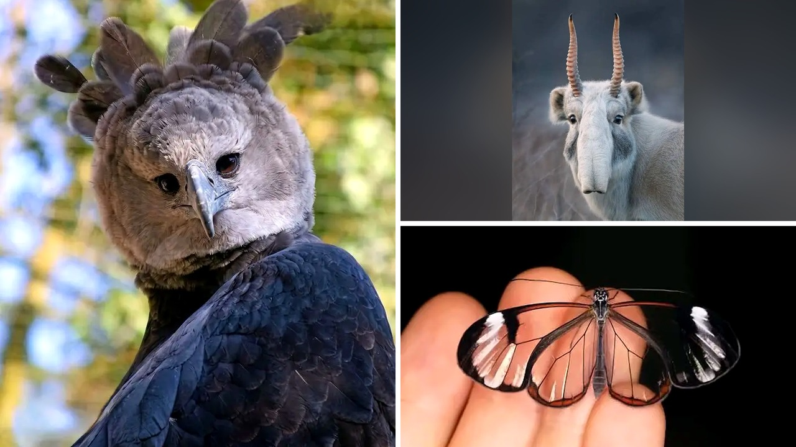

# حيوانات غريبة الشكل أثارت دهشة المتابعين

هل تنظر أحيانًا إلى صورة حيوان وتظن فورًا أنها مجرد مجسم سينمائي أو رسم من فيلم كرتوني؟ بصراحة، هذا ما شعرت به تمامًا عندما قرأت عن منشور تفاعلي عبر منصة ثريدز، حيث طُلب من المستخدمين مشاركة صور لأكثر الكائنات غاربةً ورسمًا في الطبيعة.

المفاجأة لم تكن في الأشكال العجيبة وحدها، بل في إدراكنا أن هذه المخلوقات تعيش معنا بالفعل على هذا الكوكب. تعالوا نتوقف عند هذه الظاهرة التي جعلت آلاف المتابعين يتساءلون عن أسرار الخلق وإبداع الطبيعة.

## ملايين الأنواع وما خفي أعظم

بحسب ما ورد في التقرير، نجح العلماء حتى الآن في تحديد وتصنيف أكثر من مليون ونصف المليون نوع من الحيوانات. هل تتخيلون هذا الرقم الضخم؟ والمثير أكثر أن الباحثين يعتقدون أن هناك ملايين الأنواع الأخرى التي لم تُكتشف بعد.

هذا التنوع الهائل يجعلنا أمام عالم مليء بالمفاجآت التي تشبه ما نراه في أسواقنا الشعبية القديمة من تنوع لا حصر له. تخيّلوا أن ما نعرفه ليس سوى جزء بسيط من كائنات تمتلك أشكال أجساد غريبة، وأنماط ألوان غير مألوفة، وميزات تبدو شبه مستحيلة للوهلة الأولى.

## بين الواقع وأفلام الخيال

عند الاطلاع على التفاصيل المشاركة في النقاش، استوقفني كيف أن بعض هذه الحيوانات يبدو وكأنه خُلق خصيصًا لفيلم خيالي. هالسالفة تجعل المرء يفكر في حدود خيالنا البشري مقارنة بما تقدمه الطبيعة بالفعل.

أشكال الأجسام العجيبة والتفاصيل الدقيقة المدهشة جعلت المشاهدين يظنون أن الصور مقتطعة من أفلام رسوم متحركة. هذا ذكّرني بما حكيته لكم سابقًا عن كائنات فريدة تملك خصائص جينية مذهلة غير متوقعة.

**اقرأ أيضًا:** [قطة تبهر عائلتها باكتشاف جيني نادر في دمها](https://www.almosaitiron.com/2026/11/blog-post_911.html)

## إبداع الطبيعة وتساؤلات البشر

يا جماعة، الطبيعة تصيغ تفاصيل كائناتها بطريقة تجعل بعضها يبدو وكأنه خيالي ومبتكر بدلاً من أن يكون مخلوقًا عاديًا موجودًا في البيئة. الكائنات الحقيقية التي تداول الناس صورها أظهرت تنوعًا مذهلاً يجمع بين الأشكال الغريبة والألوان الصادمة.

أليس غريبًا أن نعيش على كوكب واحد مع كائنات تشبه أبطال القصص الخيالية دون أن ندري عنها شيئًا؟ هذه التفاصيل المدهشة فتحت بابًا واسعًا لإعادة النظر في مدى تنوع الحياة البرية من حولنا وتفاصيلها غير المتوقعة.

رأيي الشخصي أن هذا النقاش يذكرنا بأهمية استكشاف التنوع البيولوجي المذهل حولنا، وكيف أن الواقع يتفوق غالبًا على أكثر مخيلاتنا جموحًا.

هل تفضلون متابعة الوثائقيات عن الكائنات الغريبة المعروفة أم قراءة أسرار اكتشاف كائنات جديدة لم نسمع عنها من قبل؟
