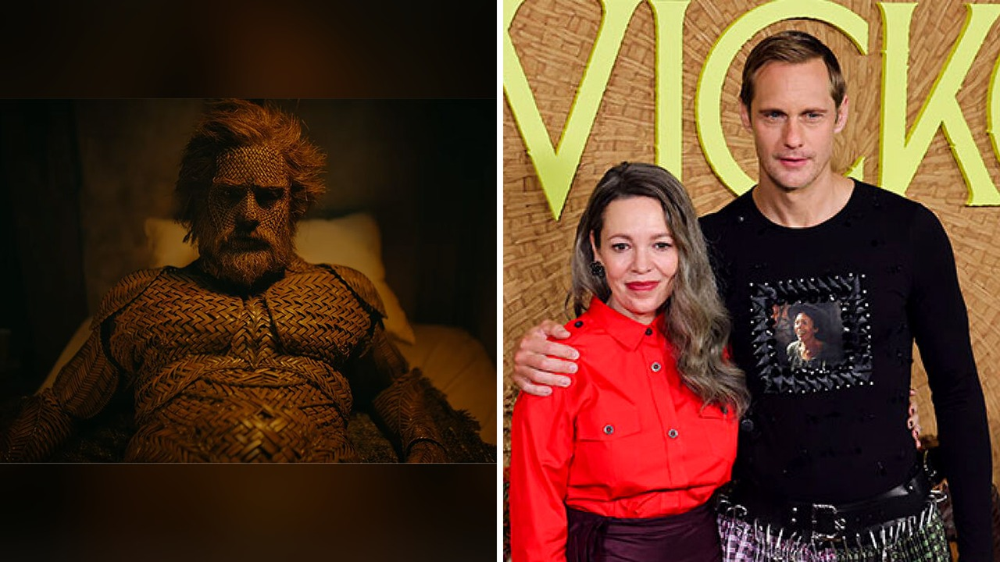

# زوج من القش يثير ضجة ومخاوف طبية خطيرة

## دور أبطال القش في فيلم ويكر

تخيلوا أن تدور قصة فيلم حول امرأة تواجه وحدتها بطريقة غير تقليدية تماماً. هذا ما حدث في فيلم ويكر الذي صدر في الثالث والعشرين من أكتوبر، حيث تجسد أوليفيا كولمان دور صائدة سمك وحيدة تطلب من صانع سلال تصميم زوج لها. المفاجأة أن هذا الشريك المصنوع يدوياً يستطيع إرضاءها بطرق متعددة، ليتحول البطل ألكسندر سكارسجارد بسرعة إلى مادة خصبة لهوس جماهيري واسع عبر الإنترنت.

الناس لم تفوت الفرصة وبدأت تتخيل كيف تبدو الحياة مع رجل طوله ستة أقدم ونصف ذو عيون زرقاء ومنسوج من الروطان. الصراحة، ما فاجأني هو سرعة تفاعل الجمهور ومشاركة صور لقطع أثاث منزلية وأدوات إضاءة غريبة الأشكال ظهرت بشكل مختلف كلياً بعد خروجهم من صالات السينما، حتى إن ايكيا دخلت على الخط ووصفت منتجاتها الخشبية بأنها مؤهلة لتكون أزواجاً مستقبليين. هل تتخيلون إلى أي مدى وصلت هذه التخيُّلات يا جماعة؟

## تحذيرات صارمة من الأطباء والمختصين

بينما استمر الجمهور في تخيل هذا العالم، ظهرت تحذيرات طبية جادة للغاية لتوقف هذه الموجة عند حدها. الدكتورة إيمي نوفات، طبيبة النساء والتوليد، أكدت أن الخيال صحي لكن المشكلة تبدأ حين يغرينا لنتطبيقه واقعياً على حساب صحتنا. الأخشاب قابلة للتفتت والانشطار، والمواد النباتية تحتضن البكتيريا والفطريات المسببة للتهابات خطيرة.

الطبيبة كشفت أنها عالجت نساء تعرضن لجروح وتمزقات أثناء تجربة أشياء غريبة تطلبت تدخلات جراحية دقيقة. هذا النوع من المخاطر دفع خبراء آخرين للتدخل ومشاركة تحذيرات مشابهة حول الأضرار الجسيمة التي قد تنجم عن محاولة تطبيق هذه السيناريوهات السينمائية دون وعي كافٍ بصحة الأنسجة الحساسة.

## مخاطر خفية وتفاصيل لم تصدقوها

الحديث لم يقتصر على ذلك، بل امتد ليشمل آراء جراحين مختصين مثل الدكتور إيفان جولدستين وأليكس هول اللذين حذرا من المخاطر المرتبطة بالمناطق الأكثر حساسية في الجسم. الأخشاب المصنوعة من الصفصاف أو الخيزران أو البامبو تشكل خطراً حقيقياً بسبب الشظايا، فضلاً عن تعقيدات استخدام المزلقات التي قد تمتصها المواد المنسوجة أو تتفاعل معها بشكل خطير.

المختصون أشاروا إلى أن نقص الثقافة الصحية يجعل البعض يفكر في تجارب قد تنتهي بغرفة العمليات مع أدوات جراحية وكاميرات داخلية لمعالجة طوارئ الأخشاب الشائكة. حتى إن بعضهم طرح مزاحاً مقترحات مستحيلة مثل استخدام موانع واقية مضادة للثقب، في إشارة واضحة لاستحالة جعل هذه الأدوات آمنة للاستخدام البشري.

رأيي الشخصي أن ما يحدث يثبت قدرة السينما على صناعة تريندات غريبة لدرجة تدفع الأطباء للتدخل للتحذير من أشياء بديهية. هل يمكن أن تتحول مشاهد الأفلام يوماً إلى خطر حقيقي يتطلب تدخلاً طبياً عاجلاً؟
