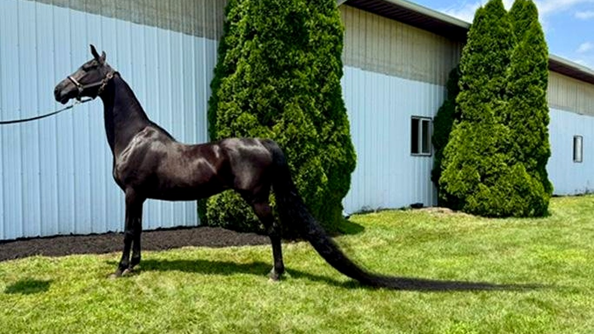

# فرس في أوهايو تكسر رقما قياسيا بأطول ذيل في العالم

عندما يبلغ طول ذيل حصان أكثر من أربعة أمتار، يصبح المشي بحد ذاته مهمة تتطلب تدبيرًا خاصًا. هذا بالتحديد ما حدث في ولاية أوهايو الأمريكية، حيث دخلت الفرس جيني موسوعة غينيس للأرقام القياسية بعد قياس رسمي مذهل لذيلها.

تخيّلوا ذيل حصان يمتد بطول ثلاثة عشر قدمًا وست بوصات، أي ما يزيد على أربعة أمتار من الشعر المتدفق. هل رأيتم من قبل شيئًا كهذا؟ الصراحة، عندما طالعت تفاصيل هذا القياس، توقفت مذهولًا أمام المفارقة العجيبة التي بدأت بها حكاية هذه الفرس.

## بداية غير متوقعة بالمرة

الفرس جيني، المملوكة لكل من ماكينزي لو وريتشيل إستيس، لم تبدأ حياتها بهذا المظهر الاستعراضي الخارق. الحكاية تعود إلى عام 2019، حين حصلت عليها ماكينزي كهدية بمناسبة عيد ميلادها الثالث عشر. الغريب في الأمر، بحسب ما ذكرته مالكتها، أن جيني كانت قد اقتلعت ذيلها بالكامل تقريبًا في صغرها قبل أن تنتقل إلى رعايتها.

وعندما استلمتها ماكينزي، كان الشعر بالكاد يلامس الأرض ولم يكن طويلًا إطلاقًا. جيني تنتمي إلى سلالة سادلبريد الأمريكية، وهي سلالة معروفة أصلًا بذيولها الطويلة والمنسابة في العروض. قررت المالكتان ترك الذيل ينمو دون قص تماشيًا مع متطلبات هذه السلالة، لكن النمو فاق كل التوقعات، وبدأت هالسالفة تأخذ منحى مختلفًا تمامًا مع مرور الوقت.

## التحدي نحو القمة واللقب التاريخي

مع استمرار نمو الذيل عامًا بعد عام، لمعت الفكرة في ذهن مالكتيها: لمَ لا نرى إلى أي مدى يمكن أن يصل هذا الشعر، وننافس رسميًا على اللقب العالمي؟ هذا الإصرار على مطاردة الأرقام الفريدة يذكّرنا بمدى شغف الناس بكسر المستحيل، تمامًا مثلما رأينا في قصة كسر الأرقام الصعبة التي تناولناها سابقًا.

**اقرأ أيضًا:** [مسنة بريطانية تسجل رقما قياسيا في المشي على أجنحة الطائرات](http://www.almosaitiron.com/2026/10/blog-post.html)

وبالفعل، بعد التوثيق والقياس المعتمد، حطمت جيني الرقم القياسي السابق المسجل منذ عام 2007، والذي كان يبلغ اثني عشر قدمًا وست بوصات. الفارق قدم كاملة حسمت اللقب لصالح جيني، لتتوج رسميًا بلقب صاحبة أطول ذيل حصان في العالم.

## نهاية سعيدة لجلسات التمشيط المرهقة

المهم في القصة، ومباشرة بعد حسم الرقم القياسي رسميًا، حصلت جيني أخيرًا على جلسة تقليم طال انتظارها لتخفيف طول الذيل. وأوضحت ماكينزي أن الفرس كانت في غاية الحماس لهذه الخطوة، مشيرة إلى أنها كانت تتطلع بكل تأكيد للتخلص من جلسات العناية والتنظيف الطويلة والمرهقة التي كان يفرضها ذيل بهذا الطول غير المسبوق.

رأيي الشخصي أن ترك الذيل ينمو لكسر الرقم كان تجربة ملفتة، لكن القرار الأفضل حقًا هو تقليمه في النهاية لإراحة الحيوان من ثقل يومي مزعج. لو كنتم في مكان صاحبة الفرس، هل كنتم ستفضلون الاحتفاظ بالرقم القياسي والذيل كاملًا، أم أن راحة الفرس أهم من أي مجد استعراضي؟
