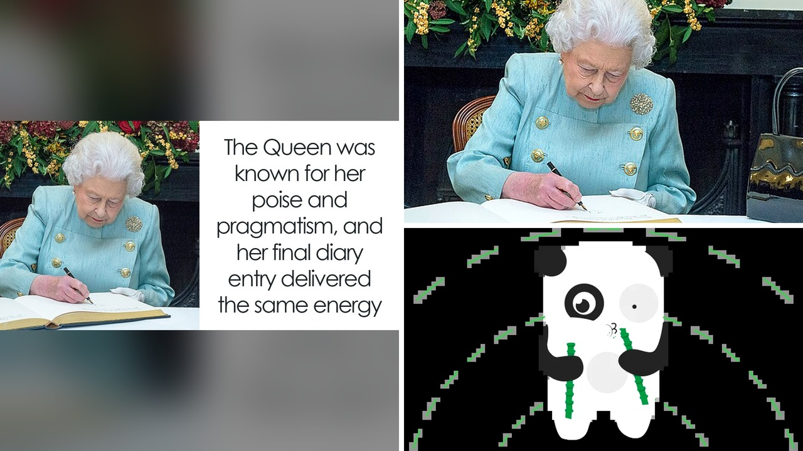

# خمس كلمات فقط: كشف مذكرات الملكة إليزابيث قبل رحيلها

تخيل أن تلتزم عادة واحدة يومياً طوال سبعين عاماً، دون أن تتخلف عنها ليلة واحدة مهما بلغ بك التعب. هذا بالضبط ما كانت تفعله الملكة إليزابيث الثانية حتى آخر أيام حياتها.

قبل وفاة الملكة بيومين فقط في قلعة بالمورال بأسكتلندا، وفي السادس من سبتمبر عام 2022، جلست كعادتها لتكتب سطرها الأخير. فما الذي يمكن لشخصية عاشت تسعة وتسعين عاماً وحكمت لعقود طويلة أن تكتبه في تلك اللحظة التاريخية؟

## روتين حازم لا يتغير

استوقفني جداً التزام الملكة الصارم بجلستها المسائية. لم تكن تكتب وهي مستلقية على السرير، بل تجلس دائماً أمام مكتبها الخشبي، حتى لو تأخر الوقت جداً. كانت تستخدم قلم حبر تقليدي بحبر أسود، وتدون تفاصيل يومها في دفاتر جلدية فاخرة تحمل رمزها الملكي وأرقاماً رومانية متسلسلة.

لم يكن الأمر مجرد هواية، بل كان واجباً ينبغي ألا تفوته مطلقاً. ورغم أن الأطباء أخبروها في أواخر عام 2021 بأنها قد لا تتجاوز عيد الميلاد، إلا أنها تجاوزت التوقعات واستمرت في أداء مهامها بنفس الانضباط. هل تساءلتم يوماً كيف يستطيع شخص الحفاظ على روتين يومي صارم طوال سبعة عقود دون كسل؟ بصراحة، هذا ينبئ عن قدرة هائلة من الضبط النفسي.

## خمس كلمات قبل الرحيل

في ذلك اليوم نفسه، استقبلت الملكة رئيسة الوزراء الجديدة ليز تراس لتعيينها، في آخر ظهور رسمي لها بعد رحلة طويلة من الخدمة. كما زارها سكرتيرها الخاص السير إدوارد يونغ للمساعدة في ترتيب أداء اليمين لوزراء الحكومة الجديدة.

وعندما حل المساء، فتحت دفترها وكتبت عبارة واحدة فقط من خمس كلمات باللغة الإنجليزية: إدوارد جاء لرؤيتي. يا جماعة، هذه العبارة البسيطة جداً، كما كشف المؤرخ الملكي روبرت هارد مان في كتاب عن الملك تشارلز الثالث، كانت خالية تماماً من أي دراما أو مشاعر فياضة. مجرد حقيقة مجردة ومباشرة، تمثل طريقتها التي عرفها الجميع بها طوال حياتها.

## أرشيف للتاريخ لا للمشاعر

هالموضوع يدعو للتفكير؛ فالدفتر لم يكن يوماً مساحة لتفريغ المشاعر أو كتابة المذكرات الشخصية الحميمية. الملكة نفسها أوضحت هذه الفلسفة سابقاً للكاتب كينيث روز عندما قالت له إنها لا تملك الوقت لتسجيل المحادثات، بل تسجل الأحداث فقط.

كانت تنظر للدفتر كأرشيف رسمي موجه للمؤرخين في المستقبل، وليس كتاب اعترافات أو انطباعات شخصية. حتى في كلماتها الأخيرة، لم تترك انطباعات عن حياتها أو وداعاً طويلاً، بل وثقت المهام اليومية كأنها ستستمر غداً في العمل دون تغيير.

## اختلاف بين جيلين

يقودنا هذا إلى تتبع العادة نفسها مع ابنها الملك تشارلز. كشف التقرير أن الملك تشارلز يستمر في كتابة اليوميات أيضاً، لكن بأسلوب مختلف تماماً عن والدته.

فهو لا يلتزم بالتدوين التوثيقي الدقيق للأحداث، بل يخربش ملاحظاته وتأملاته وانطباعاته الشخصية في نهاية اليوم، مما يعكس علاقة أكثر مرونة وشخصية مع الكتابة. الانضباط في العادة موجود لدى الطرفين، لكن كل ملك يعبر عنها بأسلوبه الخاص.

رأيي الشخصي أن تلك الكلمات الخمس الأخيرة تعكس بساطة مذهلة وشجاعة هادئة في مواجهة النهاية دون استعراض أو دراما.

لو أتيحت لك الفرصة لقراءة مذكرات شخصية بارزة، هل تفضل قراءة التدوينات الجافة الدقيقة للأحداث أم التأملات الشخصية المليئة بالمشاعر؟
