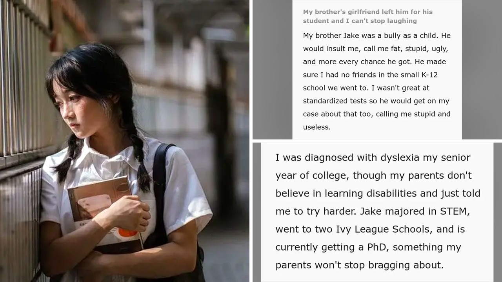

# عندما يدفع الطفل المدلل ثمن خطئه وتتغير حياته

تخيل أن تعيش طوال حياتك في ظل شقيق يحظى بكل الحب والتغاضي، بينما تُحرم أنت من أبسط مشاعر التفهم داخل بيتك. هذا تمامًا ما عاشته امرأة وجدَت نفسها دائمًا الأقل تفضيلًا لدى والديها مقارنة بأخيها.

الأخ عاش عمره وهو يأخذ كل من حوله كأمر مسلم به، يمارس المضايقات على أخته دون أن يحاسبه أحد. ولكن السحر انقلب على الساحر، الصراحة، حين قررت خطيبته أن تتركه وتنهي العلاقة، لتذهب مع شخص يكرهه هو بشدة.

هذا التحول المفاجئ أثلج صدر الأخت بعد سنوات من الشعور بالظلم، لكن الأبوين واصلا معاملة ابنهما كطفل مدلل حتى بعد هذه الصدمة. فما الذي يحدث عندما ينشأ شخص بلا أي رادع؟

## التمييز الأسري وظل الطفل المدلل

حسب ما ورد في الخبر، عاشت صاحبة القصة معاناة طويلة مع التمييز الأسري. كان شقيقها يمثل الطفل المفضَّل الذي يفلت دائمًا من العقاب، مهما كانت تصرفاته قاسية تجاه أخته. هذا النمط من التربية جعله يتعامل مع جميع العلاقات في حياته باستهتار، بما في ذلك علاقته بخطيبته التي ظن أن وجودها مضمون إلى الأبد.

لكن الأمور أخذت منحنى آخر عندما التقت الخطيبة بشخص آخر، واختارت الخروج من هذه العلاقة تمامًا. والأدهى أنها ارتبطت بشخص يمقته الأخ من أعماق قلبه، مما تسبب في فرحة عارمة للأخت التي رأت في ذلك عدالة تأخرت كثيرًا. هل يعقل أن تصل قسوة التمييز داخل الأسرة إلى هذا الحد؟

## وجهة نظر الطب النفسي في الطفل المفضَّل

للتوضيح أكثر حول هذه الحالة، تشير الدكتورة كيت إشلمان، وهي طبيبة نفسية في كليفلاند كلينك، إلى أن مصطلح متلازمة الطفل المدلل هو مصطلح شائع في الثقافة العامة وليس تشخيصًا طبيًا رسميًا. ولكن آثاره في مرحلة البلوغ تكون واضحة للغاية، وعلى رأسها انعدام المسؤولية.

توضح الدكتورة أن بعض الأطفال المدللين يكبرون وهم يعتقدون أنهم لا يرتكبون أي خطأ لأن والديهم لم يطالبوهم قط بتحمل المسؤولية. وفي العلاقات العاطفية، قد يطور هؤلاء النرجسية وتوقعات غير واقعية من الطرف الآخر، أو يتبنون نمط التعلق التجنبي، وهو ما ظهر جليًا في سلوك الأخ مع خطيبته.

## بين الدعم الحقيقي والحماية الزائدة

يا جماعة، الدعم شيء والحماية المفرطة شيء آخر تمامًا. بحسب التقرير، استمر الأبوان في الدلال والحماية المفرطة لابنهما حتى بعد انفصال خطيبته عنه. وهنا يوضح الدكتور آدم بورلاند، الطبيب النفسي في كليفلاند كلينك، أن الحماية الزائدة تمنع الشخص من التعلم والتطور.

ويرى الدكتور بورلاند أن هذا التصرف يحدث عندما يرى الأهل أحباءهم يتخذون قرارات غير صحية، فيتدخلون لحل المشكلات نيابة عنهم بدلاً من تركهم يواجهون عواقب أفعالهم. ويؤكد أن الخطوة الأولى لإيقاف هذا السلوك هي أن يعترف الوالدان بدورهما ويلتزما بالتغيير لحماية ابنهم وحماية أنفسهم.

رأيي الشخصي أن تعاطف الأهل مع أبنائهم أمر طبيعي، لكن تغطية أخطائهم المستمرة تدمر مستقبلهم وتظلم من حولهم. أيهما أشد خطراً في رأيك: التمييز بين الأبناء داخل البيت أم إعفاء الطفل المدلل من تحمل عواقب أفعاله؟
