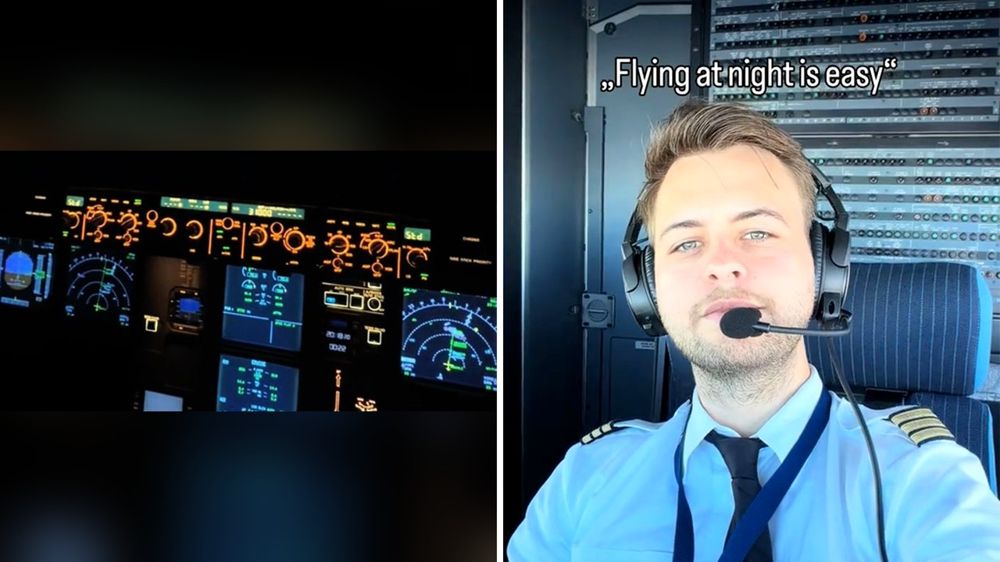

# ماذا يرى الطيار في الظلام؟ فيديو يكشف حقيقة الطيران في الليل

تخيل نفسك تجلس بجوار نافذة الطائرة ليلاً، وتتأمل أضواء المدن متلألئة في الأسفل وتظن أن الطيار يرى الطريق أمامه بوضوح. التحليق بين السحاب تجربة مليئة بالهدوء بالنسبة للركاب، لكن خلف باب كابينة القيادة يدور عالم آخر تماماً.

الواقع مختلف تماماً عما ترسمه مخيلتك في الجو. مقطع فيديو من داخل كابينة القيادة كشف حقيقة قد تجعلك تعيد التفكير في رحلتك القادمة.

عندما ينظر الطيار من نافذته الأمامية في منتصف الليل، لا يرى سوى ظلام مطلق يحيط به من كل اتجاه دون أية أضواء تكشف الطريق.

## ظلام دامس وخلف الكواليس

استوقفني مقطع فيديو قصير نشره طيار يدعى ماتياس، وهو يقود طائرة من طراز إيرباص أي 320 ومقيم في مدينة فيينا. ينشر ماتياس عادة مقاطع فيديو لرحلاته واقتراب الهبوط عبر الأجهزة. وفي السابع والعشرين من أكتوبر عام 2026، ظهر ماتياس بقميصه الأزرق الفاتح وربطة عنقه الزرقاء الداكنة وبطاقة التعليق وسماعاته المعتادة، قبل أن يدير الكاميرا نحو النافذة الأمامية للكابينة.

المشهد كان مفاجئاً بحق للجميع. خارج النافذة لا يوجد سوى عتمة شديدة ولا يمكن رؤية أي شيء على الإطلاق، بينما تضيء شاشات وأزرار أجهزة التحكم وحدها أمامه. الصراحة، حصد هذا المقطع سبعة عشر مليون مشاهدة وأكثر من مليوني إعجاب من متابعيه الذين يبلغ عددهم مليون شخص. كتب ماتياس معلقاً أن الجو في الخارج مظلم جداً ولا يمكنهم رؤية شيء، لكن المفاجأة أنه أردف قائلاً إنهم لا يحتاجون لرؤية الخارج إطلاقاً أثناء الطيران.

## هل تمتلك الطائرات مصابيح أمامية

يا جماعة، انهالت آلاف التعليقات المندهشة من ركاب كانوا يعتقدون أن الطائرات تسير بمصابيح أمامية قوية تسلط أضواءها على الطريق تماماً كالسيارات. أحد المتابعين علق بأسلوب طريف قائلاً إنه يثق بالطيار والطيار يثق بالله. وكتب آخر أن هالسالفة كان يجب أن تبقى حبيسة المحادثات الخاصة بالطيارين، مؤكداً أنه لن يسافر ليلاً بعد اليوم.

أحد المتابعين سخر قائلاً إن الرحلة تسير فقط بالبركة والوقود، بينما عبر آخر عن احترامه للطيارين مشيراً إلى أنه يخشى الذهاب إلى دورة المياه في الظلام. وعلق متابع آخر بأنه يفضل الطيران ليلاً لأنه لا يرى الأرض، ولم يكن يعلم أن الطيار أيضاً لا يراها. وتساءل أحدهم بخوف عن كيفية تجنب الاصطدام بطائرة أخرى، ليرد عليه آخر بتهكم قائلاً إنهم سيعتذرون ويواصلون طريقهم. هل تساءلت يوماً كيف يمكن لشخص أن يقود مركبة عملاقة بسرعة هائلة في منتصف الليل دون أن يرى ما أمامه؟

هذا الذعر من الطيران في العتمة والشغف بكواليس السماء ذكّرني بتلك السيدة البريطانية الجريئة التي تحدثنا عنها سابقاً، والتي اختارت ألا تكتفي بالجلوس داخل الطائرة بل مشت على أجنحتها في الهواء.

**اقرأ أيضًا:** [مسنة بريطانية تسجل رقما قياسيا في المشي على أجنحة الطائرات](http://www.almosaitiron.com/2026/10/blog-post.html)

## تحكم كامل عبر الأجهزة

أوضح الطيار ماتياس أن الطيران يعتمد كلياً على قواعد الطيران الآلي أو ما يُعرف بالإبحار باستعمال الأجهزة. هذا النظام يتيح تحديد الارتفاع والسرعة والاتجاه بدقة متناهية دون الحاجة لمعالم أرضية. وتُطبق هذه القواعد بشكل أساسي طوال وقت الطيران حتى في وضح النهار وفي تمام الساعة الثانية ظهراً تماماً كما في الساعة الثانية فجراً. الرؤية بالنسبة للطيار أمر اختياري، بينما تبقى الأجهزة الرقمية وشاشات الملاحة هي العنصر الإجباري الذي لا يمكن الاستغناء عنه.

في الليالي الصافية وعندما يكون القمر كاملاً، يمكن للطيارين مشاهدة بعض التضاريس والمعالم الجوية. لكن في الليالي المظلمة شديدة العتمة، لا يتغير أي شيء في إجراءات السلامة. الطائرة تحلق بدقة عالية وتعرف مسارها بالضبط عبر الحسابات الرقمية وشاشات التوجيه دون الحاجة للنظر عبر الزجاج.

## تدريب مكثف لمواجهة العتمة

شرح أحد خبراء الطيران التفاصيل التقنية لهذه العملية الحساسة. مايكل بورش، وهو مدير العمليات الجوية في شركة جيت ستار الأسترالية لرحلات الطيران منخفض التكلفة، أوضح أن الوضع يختلف تماماً عن قيادة السيارات التي تعتمد على أعمدة الإنارة والإشارات الإرشادية. وأضاف أنه عند التحليق على ارتفاع أربعين ألف قدم في ليلة صافية بلا سحب، يرى الطيار النجوم والأقمار الصناعية والقمر عن قرب بشكل رائع.

شو الموقف أثناء لحظات الهبوط؟ أكد الخبير أن النافذة تصبح مهمة للغاية عند الاقتراب من الأرض، خصوصاً في حالات الغيوم الكثيفة والأمطار، حيث تكون أضواء مدرج الهبوط هي أول شيء يظهر للطيار قبل ملامسة الأرض. وحول تساؤلات الجمهور عن الكشافات، أوضح أن طائرة إيرباص أي 320 تمتلك أضواء هبوط على الأجنحة وأضواء تحريك على العجلة الأمامية تستخدم على أرضية المدرج فقط. كما يخضع الطيارون لتدريبات مكثفة في أجهزة المحاكاة للتعامل مع مختلف الظروف كالظلام والضباب والعواصف والغيوم والغروب والفجر.

تخيلوا حجم المسؤولية والتركيز المطلوب لتوجيه طائرة ركاب وسط هذا الفراغ المظلم. رأيي الشخصي أن اعتماد الطيران على الأجهزة الدقيقة والمستشعرات يثبت مدى التطور التكنولوجي الذي يضمن سلامة الملايين يومياً بفضل التدريب الاحترافي.

لو أتيحت لك الفرصة، هل تختار السفر في رحلة ليلية تعتمد على الأجهزة أم تفضل الرحلات النهارية؟
