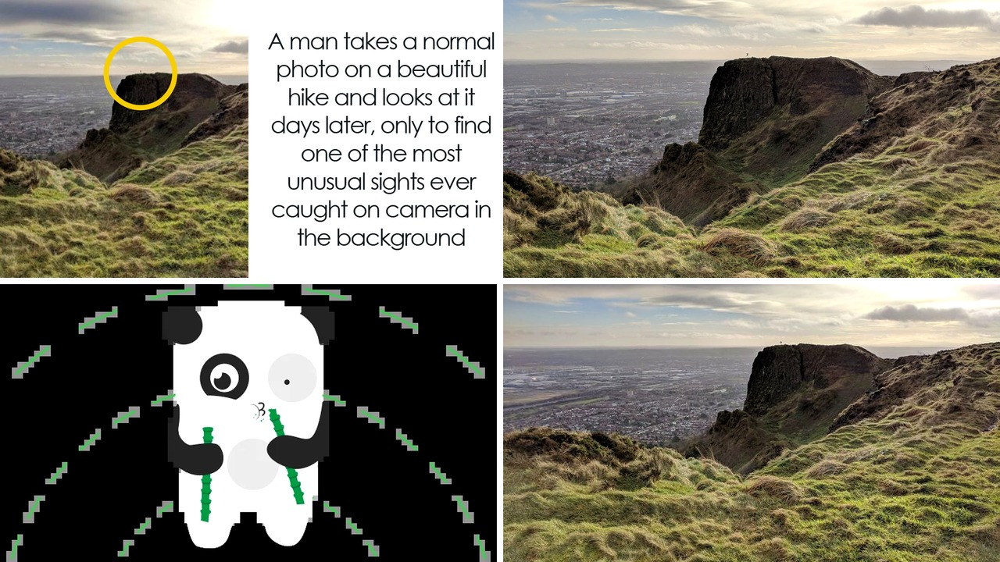

# صورة غريبة على كايفهيل تثير دهشة المتابعين

تخيلوا إنكم تقفون على قمة كايفهيل في ليلة رأس السنة، والهواء البارد يلفكم، وفجأة تلمحون شخصًا يبدو كأنه يطفو في الهواء فوق صخرة بعيدة. يا جماعة، هذا ما شفته في صورة أخذتها لتوًّا مع أصدقائي، وما فاجأني هو أن المشهد كان واضحًا كأنه مشهد من فيلم خيال علمي.

أنا قرأت الخبر وقلت في نفسي: "هل هذا حقيقي؟". الصورة كانت مجرد لقطة عادية للمنظر، لكن عندما عدت لتفحصها بعد أيام، لاحظت شيئًا غير متوقع. ما رأيكم، هل تعتقدون أن الكاميرا تستطيع «تخليد» لحظات لا يتوقعها أحد؟

## اللقطة غير المتوقعة

غافين بيست، شاب يبلغ من العمر 43 سنة، كان يتجول مع أصدقائه على كايفهيل في بلفاست. قرر يتوقف ويأخذ صورة للمنظر الجبلي، وما كان في باله غير الاستمتاع بالمنظر. لكن عندما عاين الصورة عن قرب، لاحظ شخصًا على صخرة بعيدة يبدوا وكأنه ينجرف في الهواء، وكأنه قام بـ "قفزة نجمة". الصدمة كانت حقيقية؛ الجسم كان مكوّنًا من ظلٍ واضح يبرز ضد السماء.

## تدقيق الصورة

بصراحة، أول ما فعلته هو تكبير الصورة. هنا شفت تفاصيل أكثر: الشخص كان واقفًا على حافة صخرة، وليس في الهواء فعليًا. بعد دقائق من التقاط اللقطة، صادف غافين مجموعة من المتسلقين على نفس الصخرة، فأدرك أن الوضع كان مجرد لحظة توقيت محض. وش رايكم، هل يمكن للصدفة أن تكون أقوى من التخطيط؟

## تفاعل المتابعين

بعد ما نشر غافين الصورة على تويتر عام 2018، انطلقت موجة من التعليقات. الناس بدأوا يتساءلون إذا ما كان الشخص يقفز لإنهاء حياته أو مجرد وضعية للصور. البعض خاف على سلامته، والبعض الآخر استمتع بالصدفة الفريدة. حتى أن أحد المتابعين قال إن هذه الصورة تشبه "قنبلة بصرية" تجذب الأنظار. هذا ذكّرني بمقالنا السابق عن الدب الذي اقتحم مكتبة في كاليفورنيا، حيث تحول موقف غير متوقع إلى قصة تُروى على السوشيال ميديا. 

**اقرأ أيضًا:** [دب يقتحم مكتبة في كاليفورنيا ويسرق وعاء عسل](https://www.almosaitiron.com/2026/10/blog-post_464.html)

## تفسير الصدمة

في النهاية، الظاهرة تُظهر لنا كيف يمكن للصدفة أن تتحول إلى ظاهرة فيروسية. الفوتوبومبينغ، كما يُعرف، أصبح جزءًا من ثقافتنا الرقمية، حتى إن قاموس كولينز اختار الكلمة عام 2014 كـ "كلمة العام". لكن ما يميز حالة غافين هو أن الفوتوبومبر لم يكن مقصودًا، بل كان مجرد متسلق يلتقط صورة لنفسه في لحظة عابرة. الصراحة، أعتقد أن هذه اللحظات تُضيف نكهةً خاصةً للذكريات، وتذكرنا بأن العالم مليء بالمفاجآت إذا نظرنا بعيونٍ مفتوحة.

رأيي الشخصي أن هذه الصورة تبرهن على جمال العشوائية، وتُظهر أن الطبيعة والإنسان يتقاطعان في لحظات لا تُخطط لها. ما هو موقفكم إذا صادفتم شيئًا مشابهًا؟ هل ستشاركونه مع العالم أم ستتركه سرًا؟
