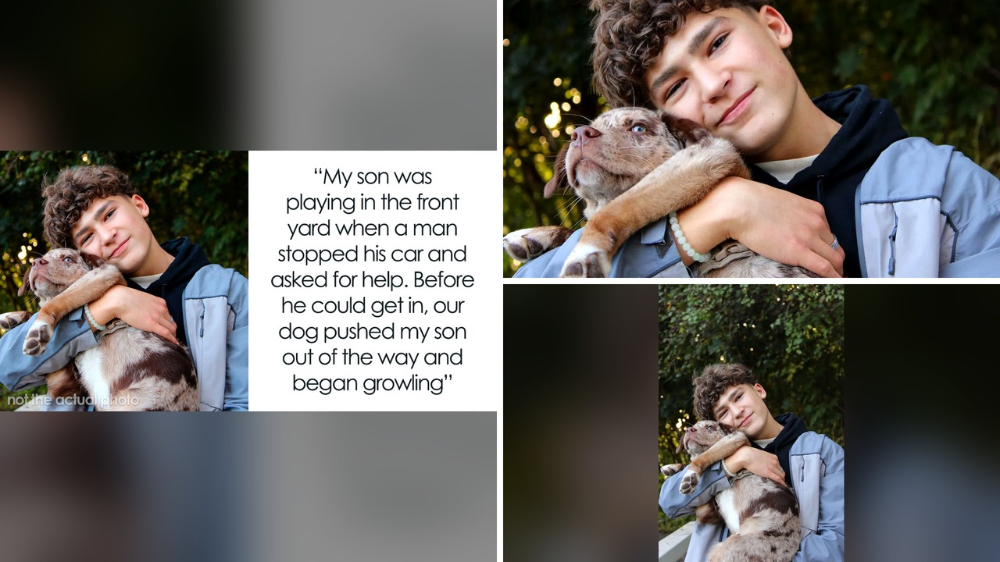

# قرب من الموت: قصص حقيقية كادت تصبح ألغازاً غير محلولة

## بداية غير متوقعة
تخيلوا إنكم تلعبون في شارع هادئ وتلاحظون سيارة شرطة تقف على الجانب الآخر، لكن ما يختلف عن المشهد الاعتيادي هو أن الشرطي يفتح النافذة ويطلب منكم المساعدة. هذا ما حدث لأختٍ صغيرة وصاحبة السرد، وما فاجأني هو أن الوالدة رفضت تصديق ما وقع. الصراحة، القصة تحسّسنا بمدى هشاشة الثقة في الأشخاص اللي يفترض إنهم يحافظوا على أماننا.

## عندما يتحول الاستكشاف إلى خطر
في قصة أخرى، كان أحد المتسلقين يتوغل في مستنقعات المانغروف، وفجأة وجد نفسه محاصرًا حتى مستوى الإبطين. رغم أن الفيلم يخلّف لنا صورة للغرق الفوري، الحقيقة أن الخروج كان ممكنًا إذا استخدم الضحية جسمه كرافعة. لكن المخاطر كانت حقيقية: المدّ العالي يمكن أن يغمر الرأس في أي لحظة. هذا يذكرنا بأهمية إبلاغ أحد عن مسارك، خصوصًا بعد ما قرأت أن مكتب التحقيقات الفيدرالي سجل ما يقرب من نصف مليون حالة اختفاء في ٢٠٢٥.

## لقاء غير متوقع على متن القطار
قصة ثالثة تتعلق برجل استيقظ فجأة على متن قطار مترو بينما كان ينام. ضابط ملابس مدنية ظهر من بين الركاب، أظهر له مجموعة من الرجال يقتربون. بفضل تدخل الضابط، نجى الرجل من احتمال التعرض للسرقة أو أسوأ. الصدمة كانت في أن القليل من الناس يلاحظون ما يدور حولنا، خاصةً عندما نغرق في الموسيقى أو الهواتف. وش رايكم لو كلنا خفّنا الصوت شويًّا لنسمع أصوات البيئة؟

## الخطر الخفي في الطرق المجهولة
وأخيرًا، قصة سيدة كانت تمشي إلى المتجر عندما توقفت سيارة رياضية بجوارها لتقفل الطريق. السائقين حاولوا إقناعها بالركوب، لكن حسّها الداخلي أنقذها من الوقوع في فخ محتمل. لحظةً واحدةً من الشكّ كافية لتغيير النهاية. يا جماعة، هل سبق لكم أن شعرتم بحدس يحمّسكم للهرب من موقف؟

رأيي الشخصي أن هذه القصص تبرز مدى أهمية الاستماع للحدس وعدم التقليل من أي إشارة تحذيرية، مهما كان المصدر يبدو غير مهدد. ما أروع أن نتعلم من الأخطاء قبل أن تتحول إلى مأساة لا تُحل. إذاً، ما هو القرار الذي ستتخذونه إذا شعرتم بحدس قوي في موقف مشابه؟
