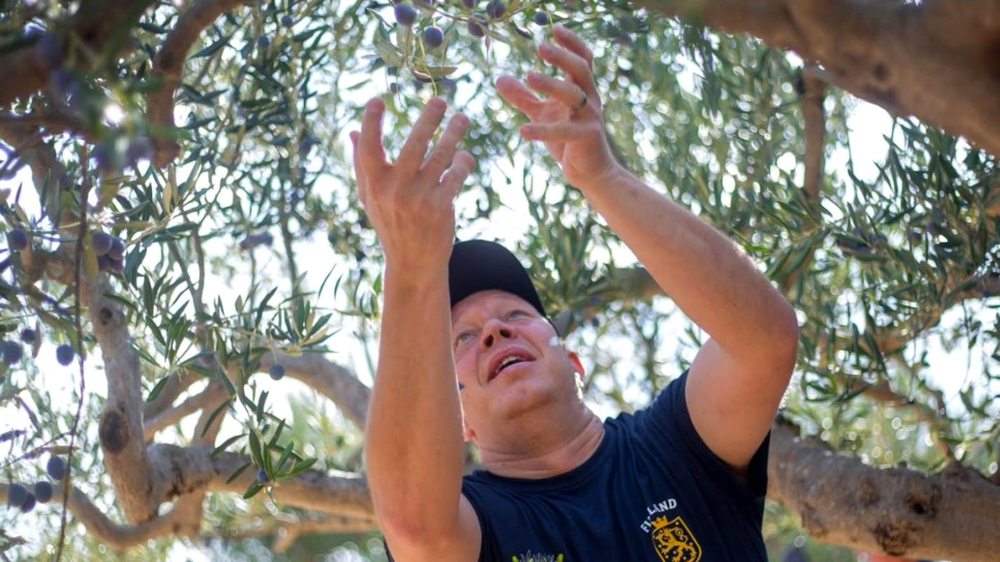

# فريق من بلد بلا زيتون يتوج بطلا للعالم في قطافه

تخيّل أن تشارك في مسابقة عالمية لمهارة زراعية لا وجود لها في بلدك بالكامل، ثم تعود إلى منزلك حاملاً الكأس! الصراحة، عندما قرأت هذا الخبر لأول مرة توقفت عنده مذهولاً من المفارقة.

القصة حدثت في 19 أكتوبر على جزيرة براتش الكرواتية، حيث أُقيمت بطولة العالم السنوية لقطاف الزيتون. المنافسة جمعت فرقاً جاءت من عشر دول، وكل فريق يتكوّن من رجلين وامرأتين، يتسابقون جميعاً لمعرفة من يستطيع جني أكبر قدر من الثمار خلال 45 دقيقة فقط.

## قواعد صارمة ومئزر تقليدي

المنافسة لم تكن عشوائية أبدًا؛ المشاركون يقطفون الزيتون بأيديهم دون آلات، ويرتدون مئزراً تقليدياً من الخيش يُعرف باسم "ساكيتي" لتخزين الحبات قبل تفريغها في الصندوق المخصص لكل فريق. يعني إيه تشارك ضد متنافسين ربما قضوا حياتهم بين الأشجار وتكسبهم؟ هذا بالضبط ما حدث.

المفاجأة الكبرى كانت فوز الفريق الفنلندي بالمركز الأول بعدما حصدوا 122.1 رطلاً من الزيتون في الوقت المحدد، متفوقين على الجميع. تخيّلوا، بلد لا تنمو فيه شجرة زيتون واحدة ينال لقب بطل العالم! قائد الفريق الفنلندي، بيتري أوتريانين، صرّح بأنهم أرادوا تحسين مركزهم الرابع الذي حققوه العام الماضي، لكن الفوز باللقب كان أمراً يفوق توقعاتهم، ووصف الإنجاز بأنه خيالي وغير حقيقي.

هذه النتيجة المدهشة التي قلبت الموازين ذكّرتني بقصص كسر الأرقام في مجالات لا تخطر على بال، تماماً مثل تلك السيدة التي تحدت كل المألوف بطريقتها الخاصة.

**اقرأ أيضًا:** [مسنة بريطانية تسجل رقما قياسيا في المشي على أجنحة الطائرات](http://www.almosaitiron.com/2026/10/blog-post.html)

## الترتيب النهائي وتنظيم عريق

ما فاجأني حقاً لم يكن الفائز فقط، بل منصة التتويج كاملة؛ فقد حلت جمهورية التشيك في المركز الثاني بجمع 106.7 رطلاً، بينما جاءت بولندا في المركز الثالث بـ 102.7 رطلاً. وش رايكم في قائمة الفائزين الخالية تماماً من الدول الشهيرة تاريخياً بإنتاج الزيتون؟

هذه البطولة تُقام سنوياً منذ عام 2017، ويقف خلف نجاحها وتنظيمها مجلس بوستيرا السياحي، بالتعاون مع بلدية بوستيرا، والتعاونية الزراعية في البلدة، وشركة ألدورا سبورت. هالسالفة تثبت أن الرغبة والسرعة قد تتفوقان أحياناً على الخبرة الجغرافية والتاريخية.

رأيي الشخصي أن الفوز لا يعتمد دائماً على البيئة التي نشأت فيها، بل على الجهد المباشر والتركيز العالي في اللحظة الحاسمة. هل تعتقد أن التدريب والروح الرياضية يكفيان للتفوق على أصحاب الخبرة المتوارثة؟
