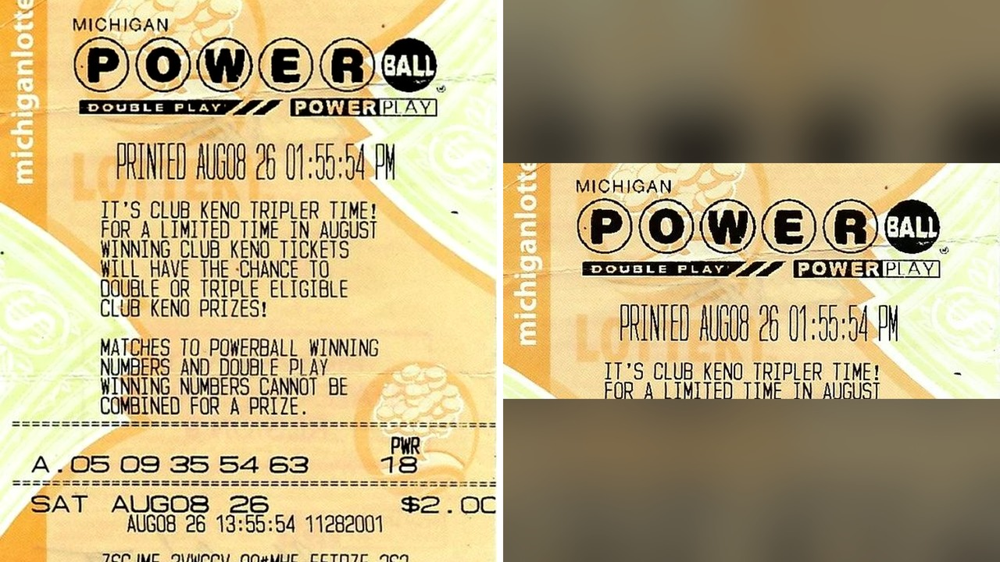

# ورقة يانصيب منسية تجعل أمريكياً مليونيراً بالصدفة

تخيّل أن تحمل في محفظتك ورقة بقيمة مليون دولار لمدة شهرين كاملين دون أن تدري! هذا ما حدث بالفعل مع رجل يدعى مايكل فاندر لوغت، البالغ من العمر أربعة وخمسين عاماً، من مدينة وايوامينغ بولاية ميشيغان.

عندما قرأت هذه القصة، استوقفني كيف يمكن لصدفة بسيطة في يوم عادي أن تقلب حياة إنسان رأساً على عقب. أحياناً نمر بظروف عادية جداً بينما نحمل الخير في أيدينا دون أن نشعر.

## ورقة نسيها في محفظته

بحسب ما ورد في التقرير، اشترى مايكل بطاقة لسحب يانصيب جرى في الثامن من أغسطس من متجر يسمى "بيغ توب ماركت". وبدلاً من مراجعة أرقامها، وضعها في محفظته مع بطاقات أخرى وتركها هناك طوال شهرين تقريباً.

مرت الأيام دون أن يخطر بباله أن تلك الورقة المهملة تحمل تقديراً مالياً ضخماً. هل تصادف أن نسيت شيئاً هاماً في جيبك أو محفظتك لفترة طويلة؟

## مفاجأة متجر البقالة

اللحظة المفصلية جاءت بطريقة غير متوقعة مطلقاً. توقف مايكل عند متجر لشراء مشروب غازي، وأثناء إتمام الشراء اكتشف أن المبلغ النقدي الذي بحوزته لا يكفي.

الصراحة، وبدلاً من استخدام بطاقته المصرفية، آثر أن يعطي الموظفة بضع بطاقات يانصيب كان يعلم أن بعضها فاز بمبالغ بسيطة جداً ليخصم منها الشراء. لكن عندما مسحت الموظفة إحدى البطاقات، ظهرت لها رسالة تطلب منه تقديم طلب رسمي في مكتب اليانصيب. هل يمكنك تخيل شعورك لو كنت مكانه في تلك اللحظة؟

## أرقام غيّرت كل شيء

عكف مايكل فور دخوله إلى سيارته على مطابقة أرقام السحب القديم. وبمجرد أن قارنها حتى اكتشف تطابق أرقام بطاقته مع الكرات البيضاء الخمس، وهي: 05، 09، 35، 54، و63.

شعر الرجل بذهول عارم عندما أدرك القيمة الحقيقية للورقة التي ظلت بين يديه لأسابيع دون أن يدري أنها تساوي مليون دولار كاملة. وقد أعلن أنه سيوجه هذا المبلغ لسداد الرهن العقاري لبيته واستثمار جزء منه.

رأيي الشخصي أن هذه القصة تذكرنا بأن بعض التحولات المفصلية تأتي هادئة وبسيطة في غفلة منا. لو حظيت بمثل هذه المفاجأة السارة، هل تبدأ بسداد ديونك أم تفضل استثمار المبلغ كاملاً؟
