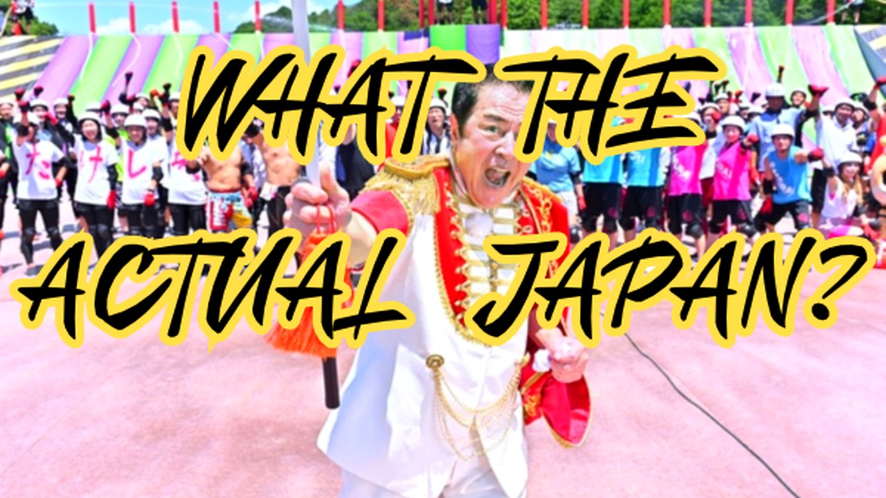

# أغرب مسابقات التلفزيون الياباني بين الطين والجدران المتحركة

تخيل أن تدير التلفاز في مساء هادئ، فتفاجأ بمتسابق يُقذف فجأة وبكامل سرعته في بركة من الطين دون أي مقدمات.

مشهد كهذا قد يبدو غريبًا في أي شاشة أخرى، لكنه في بعض برامج المسابقات اليابانية يبدو طبيعيًا تمامًا ومألوفًا لجمهوره. الصراحة، استوقفني حديث تقرير اطلعت عليه حول هذا النوع المثير من الترفيه التلفزيوني الذي خرج تمامًا عن السائد والمألوف.

هل تساءلت يومًا إلى أي مدى يمكن لفريق إعداد برنامج أن يبتعد عن القواعد المعتادة للترفيه؟

## جدران متحركة وتحديات غريبة

ما لفت انتباهي بحسب ما نُشر، أن منتجي هذه العروض التلفزيونية في اليابان كأنهم اتفقوا جماعيًا على أن الترفيه العادي لم يعد يقنع أحدًا.

المتسابقون يشاركون في تحديات تبدو وكأنها خرجت من أحلام حمى غريبة. تخيل متسابقًا يضطر إلى التواء جسده بحركات بالغة الصعوبة حتى يتمكن من العبور عبر جدران متحركة تندفع نحوه في ثوانٍ معدودة. يا جماعة، الفكرة وحدها تجعلك تترقب كيف سينجو الشخص قبل أن ترتطم به تلك الحواجز!

## برك الطين والعقوبات العجيبة

الأمر لا يتوقف عند التحديات الحركية فقط، بل يمتد إلى مواقف وعقوبات تبدو صادمة لمن لم يعتد عليها.

وفق ما ورد في التقرير، يواجه المتسابقون أحيانًا مصير القذف المباشر إلى حفر الطين، أو تحمل عقوبات غريبة لا تخطر على بال عند ارتكاب أي خطأ. وهنا يتبادر لذهني سؤال: شو الذي يدفع هؤلاء للموافقة والتوقيع على المشاركة في مثل هذه التجارب القاسية؟

المؤكد أنك بعد رؤية ما يمر به المشاركون هناك، لن تنظر إلى البرامج الهادئة مثل مسابقة فاميلي فيود التلفزيونية بالطريقة نفسها أبدًا، فالفرق شاسع بين لعبة أسئلة عائلية وهذا الصخب العنيف.

## كسر قواعد الترفيه المألوف

المثير في هالسالفة كلها هو الجرأة في تحويل شاشة التلفزيون إلى ساحة غير تقليدية تختبر صبر الإنسان وردود أفعاله الجسدية.

الحين، صار واضحًا أن الفكرة لم تعد مجرد فوز وخسارة، بل صناعة مشهد بصري حابس للأنفاس يجعل ما يدور أمامك مش معقول مقارنة بأي مسابقة تقليدية نعرفها.

رأيي الشخصي أن هذا النمط المتطرف من التلفزيون يكسر ملل الشاشات المعتادة، رغم أنني لا أتصور نفسي أبدًا في مكان أي متسابق هناك.

لو فُرض عليك الاختيار، هل تجازف بالتواء جسدك لتفادي جدار متحرك، أم تختار القفز المباشر في بركة الطين؟
