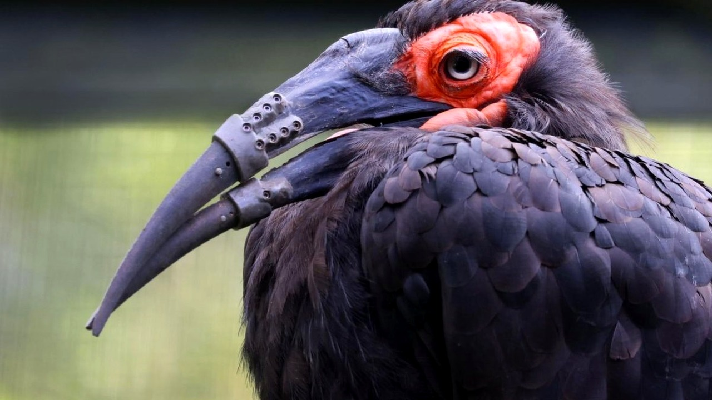

# أول طائر في العالم يحصل على منقار اصطناعي مزدوج

كيف يمكن لطائر أن يواصل حياته إذا فقد أهم أداة يملكها لتناول الطعام والعناية بنفسه؟ هذا التحدي الصعب واجهه طائر أبوقرن الأرضي الجنوبي في حديقة حيوان أرتيس بالعاصمة الهولندية أمستردام، بعد تعرضه لإصابة قاسية ألحقت أضراراً بالغة بالجزءين العلوي والسفلي من منقاره.

## حل مبتكر لأزمة مزدوجة
فقدان المنقار لا يعني مجرد تغير في شكل الكائن الحي، بل يحرمه تماماً من التقاط الأطعمة الصعبة من الأرض أو تنظيف ريشه. وبحسب الخبر، هالسالفة دفعت إدارة حديقة الحيوان إلى التحرك سريعاً عبر التعاون مع كلية الطب البيطري بجامعة أوتريخت والمستشفى الجامعي وشركة أمنوفيس. الصراحة، الفكرة التي طرحها الفريق المعالج كانت جريئة للغاية وغير مسبوقة.

## جراحة فريدة وتقنية ثلاثية الأبعاد
قرر الأطباء تصميم طرفين اصطناعيين للجزأين العلوي والسفلي معاً باستخدام تقنية الطباعة ثلاثية الأبعاد. استوقفني هذا الإنجاز بشكل خاص؛ فالمراجع العلمية تسجل حالات سابقة لطيور حصلت على تعويض لجزء واحد من المنقار، لكنها المرة الأولى عالمياً التي يركّب فيها طائر منقاراً كاملاً بشقيه. شو رأيكم في هذا التطور التقني الذي يخدم الحياة البرية؟

## عودة سريعة إلى الحياة الطبيعية
الدهشة لم تتوقف عند حدود العملية المبتكرة، بل امتدت إلى رد فعل الطائر نفسه بعد استيقاظه. تخيّلوا أنه في اليوم نفسه الذي أُجريت فيه الجراحة، بدأ الطائر استخدام منقاره الجديد بسلاسة وبأسلوب فطري يتطابق مع سلوك أبناء نوعه. يا جماعة، قدرة الكائنات على التكيف تتجاوز دائماً كل توقعاتنا البشرية. هل كنت تتوقع أن يتأقلم طائر مع جزء اصطناعي ميكانيكي بهذه السرعة؟

## موقف وتأمل
رأيي الشخصي أن تسخير التقدم العلمي لإنقاذ أسطح الكائنات الضعيفة يمثل أبهى صور الإنسانية، ويؤكد أن الابتكار قادر على معالجة أعقد الأزمات البيئية. هل تؤيد إنفاق الموارد والجهود الطبية المعقدة لإنقاذ طائر واحد، أم تعتقد أن هذه الإمكانيات يجب أن توجّه لحماية مجموعات كاملة من الانقراض؟
