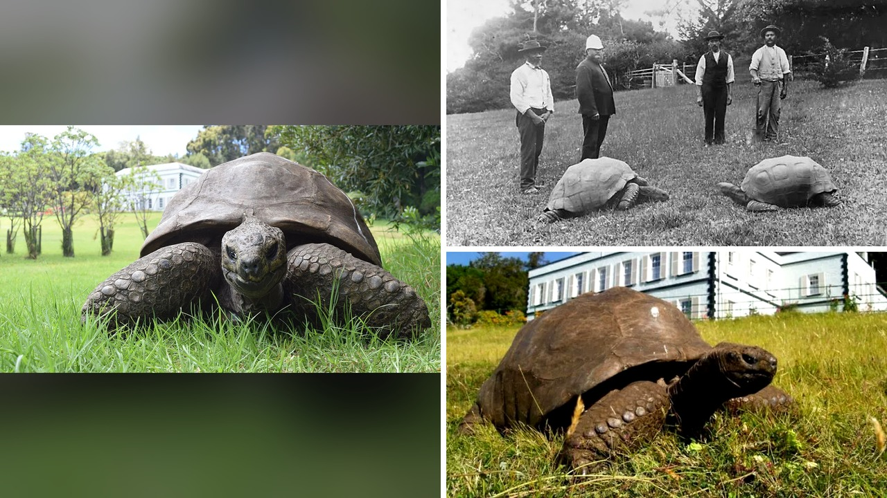

# السلحفاة جوناثان تبلغ 194 عاماً وتكشف أسرار طول العمر

تخيّل أن تعيش على هذا الكوكب منذ زمن سبَق اعتلاء الملكة فيكتوريا عرش بريطانيا، ولا تزال حتى اليوم تستمتع بوجبة خضراوات طازجة واهتمام الزوار! هذا ليس مشهداً من فيلم خيالي، بل تفاصيل يومية حقيقية للسلحفاة العملاقة "جوناثان" التي تعيش في جزيرة سانت هيلينة النائية بجنوب المحيط الأطلسي. عندما قرأت الخبر لأول مرة، توقفت مصدوماً أمام الرقم. نحن نتحدث عن سلحفاة يُقدَّر أنها فقست في عام 1832 تقريباً، ما يعني أنها تبلغ من العمر حوالي 194 عاماً في سنة 2026.

هذا العمر الاستثنائي يجعل جوناثان أكبر حيوان بري حي معروف على وجه الأرض، وأكبر سلحفاة تم تسجيلها في التاريخ. بصراحة، مش معقول كيف يعبر كائن حي كل هذه العقود ليصبح جزءاً حياً من التاريخ نفسه.

## حياة امتدت لأكثر من قرنين

وصل جوناثان إلى جزيرة سانت هيلينة عام 1882 كهدية لحاكم الجزيرة، قادماً من جزر سيشل. تخيّلوا أنه عندما وصل، كان بالفعل سلحفاة بالغة ومكتملة النمو، ويُقدَّر عمره حينها بـ 50 عاماً على الأقل! وهذا هو السبب الذي جعل المؤرخين والباحثين يحددون سنة ولادته التقريبية بعام 1832، مع علمهم أن عمره الحقيقي قد يكون أكبر من ذلك بكثير.

منذ وصوله، يعيش جوناثان في حدائق بيت الرئاسة، وهو المقر الرسمي لحاكم سانت هيلينة. خلال هذه السنوات الطويلة، عاصر هذا الكائن الاستثنائي أكثر من 30 حاكماً للجزيرة، وعاش أحداث حربين عالميتين، وشهد ثورات تقنية لا حصر لها. كان عمره قد تجاوز القرن بالفعل عندما هبط أول إنسان على سطح القمر عام 1969. أليس من المدهش أن تتأمل كائناً عاصر ثمانية ملوك لبريطانيا؟

أهالي سانت هيلينة لا يرون فيه مجرد سلحفاة معمرة، بل يعتبرونه كنزاً وطنياً حقيقياً، حتى إن صورته وُضعت على قطعة النقد المالي من فئة خمسة بني. وفي يونيو من عام 2026، كرّمته موسوعة جينيس للأرقام القياسية رسمياً بمنحه لقب "أيقونة"، تقديراً لتأثيره العالمي الواسع. هذا التكريم المدهش للحيوانات المعمرة يذكرني بما حكيته لكم سابقاً عن الفرس التي كسرت رقماً قياسياً عالمياً بفضل طول ذيلها الفريد.

**اقرأ أيضًا:** [فرس في أوهايو تكسر رقما قياسيا بأطول ذيل في العالم](https://www.almosaitiron.com/2026/10/blog-post_18.html)

## حواس ضعيفة وروتين يومي مليء بالنشاط

على الرغم من تقدمه الكبير في السن، لا يزال جوناثان يتمتع بحياة نشطة ومريحة نسبياً. هو يشارك مرعاه العشبي في حدائق بيت الرئاسة مع ثلاثة السلاحف العملاقة الأخرى وهي دايفيد وإيما وفريد. يا جماعة، المثير للاهتمام أن حاسة البصر لديه تدهورت كثيراً، كما فقد معظم حاسة الشم، لكن حاسة السمع لديه لا تزال وسيلته الأساسية للتعرف على محيطه والتفاعل مع رعاته.

أندرو "أندي" كَنت، كبير الأطباء البيطريين في سانت هيلينة، يروي تفاصيل ممتعة عن شخصية جوناثان. يقول إنه يتفاعل فوراً مع صرير البوابة المميز عندما يدخل أحدهم يحمل الطعام، فيرفع رأسه ويتجه مباشرة نحو الصوت! وبسبب ضعف بصره، يُطعم يدوياً بوجبات أسبوعية من الخضراوات الطازجة كالجزر والخص والخيار، رغم أن العشب يشكل غذاءه الأساسي.

وليس هذا فحسب، بل إن الدكتور أندي يذكر أن جوناثان يظهر أحياناً حيوية تتجاوز رفاقه الأصغر سناً، وما زال يظهر اهتماماً عاطفياً بالإناث في المجموعة وهي إيما! كما أنه يحب التربيت الجسدي، فعند تدليك رقبته أو أرجله بعد الطعام، يدخل فيما يشبه الغيبوبة اللطيفة، فيمد أرجله ويقف منتصباً بكل استرخاء. هل تتخيلون سلحفاة بعمر 194 عاماً تتفاعل بهذه العاطفة؟

## السر البيولوجي في لعاب السلحفاة

لم تقتصر قصة جوناثان على إعجاب الزوار، بل أثارت فضول العلماء بشدة. في أكتوبر من عام 2026، نشر باحثون دراسة في مجلة "ساينس أدڤانسز" تناولت جينوم جوناثان وبنيته الجينية لمعرفة أسرار بقائه على قيد الحياة لنحو قرنين. ولأن سحب الدم منه قد يشكل خطراً صحياً غير ضروري، جمع العلماء العينات من لعابه وبطانة خده.

كشفت الدراسة عن سر مذهل يرتبط بظاهرة "مثيلة دي إن إيه"، وهي عملية تنظيم نشاط الجينات. في المعتاد، تفقد هذه الأنماط تنظيمها مع تقدم العمر فيما يُعرف باضطراب المثيلة. لكن الباحثين وجدوا 272 محفز جيني لدى جوناثان حافظت على ثبات أنماطها بشكل مدهش، خاصة الجينات المرتبطة بإنتاج الطاقة في الميتوكندريا ومعالجة حمض آر إن إيه.

هذا الثبات الخلوي قد يساعد العلماء مستقبلاً في فهم الأمراض المرتبطة بالتقدم في السن لدى البشر، كون الثدييات والسلاحف تتشارك في عمليات بيولوجية أساسية. هالسالفة تعطينا أملاً كبيراً في أبحاث طول العمر، شو رايكم بهذا الاكتشاف العلمي المثير؟

## محبة لا تنتهي ورأي شخصي

في النهاية، يبدو جوناثان غير مهتم بكل هذه الضجة العلمية، فهو يستمتع بروتينه اليومي بين الشمس والعشب واهتمام محبيه. الدكتور أندي يتحدث معه باستمرار، معترفاً بروح دعابة أن المحادثة تكون من طرف واحد، لأن جوناثان "أكبر وأحكم مني" ويفضل الاحتفاظ بأفكاره لنفسه!

رأيي الشخصي أن قصة جوناثان تذكرنا بأن الحياة الجميلة لا تتطلب التعقيد، بل تكمن في البساطة والدفء والتمتع باللحظات اليومية الصغيرة، بصرف النظر عن السنين التي تمر بنا.

لو خُيِّرت بين العيش لقرنين في هدوء طبيعي بعيداً عن صخب العالم، أو تقديم إنجازات سريعة في حياة قصيرة، فأيهما تختار؟
