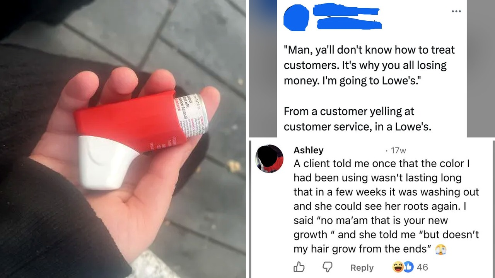

# التعامل مع الزبائن: لماذا يتحول المتسوق إلى شخص غاضب؟

تخيّل أن تقف خلف منصة البيع لساعات طويلة، تبتسم في وجوه الغرباء، وفجأة يصرخ في وجهك شخص لا تعرفه لمجرد خطأ بسيط لم ترتكبه. الصراحة، هذا الموقف يتكرر يومياً في كل مكان حول العالم، ولا يقتصر على زمان أو مكان محدد.

قرأت تقريراً استوقفني كثيراً حول تاريخ تصرفات المشترين عبر العصور، وما فاجأني حقاً هو أن هذه المشكلة ليست وليدة العصر الحديث وضغوطاته السريعة، بل هي سلوك بشري قديم جداً، يمتد لجذور التاريخ.

## سلوكيات لم تتغير منذ أثينا

تعال نتوقف عند ما دوّنه الفيلسوف الإغريقي ثيوفراستوس، وهو أحد تلاميذ أرسطو، في كتاب جمع فيه ثلاثين نمطاً للشخصيات المزعجة في مجتمع أثينا القديمة. لو تأملت تلك النماذج لوجدت أنها تشبه تماماً ما يواجهه موظف المتجر في عصرنا الحالي.

وصف الفيلسوف مثلاً "الرجل الوقح" الذي يدخل دكان الجزار ويذكره بأنه زبون دائم طالباً معاملة تفضيلية، ثم يغافله ليدس قطعة لحم إضافية في الميزان دون أن يدفع ثمنها. وهناك أيضاً نمط الشخص الذي يشتت انتباه بائع الفاكهة بالحديث الطويل ليمد يده ويسرق الثمار. بل حتى الشخص المتباهي الذي يدّعي الثراء كان يساوم على شراء حصان باهظ الثمن، وحين يحين وقت السداد يدّعي أن خادمه نسي جلب المال ليغادر المكان بمظهر الرجل الغني دون أن يشتري شيئاً. هل تشعر أن هذه التصرفات ما زالت تتكرر بيننا اليوم؟

## طبق طائر في حانة فيينا

لم يتوقف هذا الإحراج عبر القرون، بل امتد حتى إلى شخصيات تاريخية مرموقة تركت بصمتها في الفن. يروي فرديناند ريس، وهو تلميذ الموسيقار الشهير بيتهوفن، موقفاً صادماً حدث في حانة البجعة في فيينا.

قدّم النادل لبيتهوفن طبقاً مختلفاً عما طلبه، وحين احتج الموسيقار، رد النادل بجدال بدلاً من الاعتذار. استشاط بيتهوفن غضباً، وأمسك بطبق يحتوي على رئة عجل مغطاة بكمية كبيرة من الصلصة، وقذفه مباشرة نحو رأس النادل المسكين. امتلأ وجه النادل وملابسه بالمرق، وبدأ الاثنان في الصراخ وتبادل الشتائم أمام رواد المكان المذهولين، قبل أن ينفجر الموسيقار نفسه في نوبة ضحك.

هذا الموقف العنيف والمحرج في آن واحد يعكس كم يمكن أن تكون بيئة التعامل المباشر مع الناس مشحونة بالتوتر وسريعة الاشتعال.

هذا التوتر المستمر في مواجهة طلبات الزبائن المرهقة ذكّرني بما حكيته لكم سابقاً عن الموظف الذي قرر ترك مديره يواجه عميلة صعبة بمفرده بعد سنوات من التقليل من معاناته.

**اقرأ أيضًا:** [مدير يقلل من صعوبة عميلة متطلبة فيقرر موظفه تركه يواجهها وحده](https://www.almosaitiron.com/2026/10/blog-post_19.html)

## أرقام تكشف قسوة الواقع

إذا ابتعدنا عن طرائف الماضي ونظرنا إلى الأرقام الحديثة، سنجد أن الأمر لم يعد مجرد حوادث فردية مضحكة، بل تحول إلى عبء نفسي ثقيل يتحمله العاملون في المتاجر بشكل يومي.

أظهر استطلاع شمل ما يقارب تسعة آلاف موظف في قطاع التجزئة بالمملكة المتحدة، نُشر في عام ألفين وستة وعشرين، أن ثمانية وسبعين بالمئة منهم تعرضوا لإساءات لفظية خلال عام ألفين وخمسة وعشرين، بينما أفاد أربعة وخمسون بالمئة بتعرضهم لتهديدات صريحة. وفي أيرلندا، كشفت دراسة أن سبعين بالمئة من عمال التجزئة واجهوا سلوكيات وقحة أو غير لائقة من المتسوقين، وأكد ثلث هؤلاء المتضررين أن مثل هذه المواقف تتكرر معهم مرة واحدة على الأقل كل أسبوع. يا جماعة، كيف يمكن لإنسان أن يواصل عمله بهدوء وهو يتوقع الإهانة في أي لحظة؟

## شماعة الغضب وفارق القوة

لكن ما الذي يجعل بعض الأشخاص يفقدون السيطرة على أنفسهم أمام موظف بسيط، بينما لا يجرؤون على الصراخ في وجه مديرهم إذا تأخر اجتماع، أو تحطيم طابعة تعطلت في المكتب؟

تفسر ميلاني موريسون، أستاذة علم النفس في جامعة ساسكاتشوان بكندا، هذا السلوك بما يسمى بنظرية كبش الفداء، مشيرة إلى وجود خلل واضح في ميزان القوة. العامل البسيط مقيد بسياسات وظيفية ولا يملك سلطة للرد أو الدفاع عن نفسه، مما يجعله هدفاً سهلاً لتفريغ الإحباط المتراكم. حين يغضب المرء من ظروف حياته، يخشى عواقب تفريغ غضبه في مديره أو زملائه، فيجد في موظف الخدمة ضحية لا تملك حق الرد.

رأيي الشخصي أن اللطف في مواجهة العاملين ليس مجرد ذوق عابر، بل هو اختبار حقيقي لوعينا الإنساني؛ فمن السهل دائماً أن نكون قساة مع من لا يستطيع الرد علينا.

حين تجد نفسك محبطاً في متجر بسبب خطأ غير مقصود، هل تختار التعبير عن غضبك فوراً، أم تفضل التماسك ومراعاة مشاعر العامل أمامك؟
