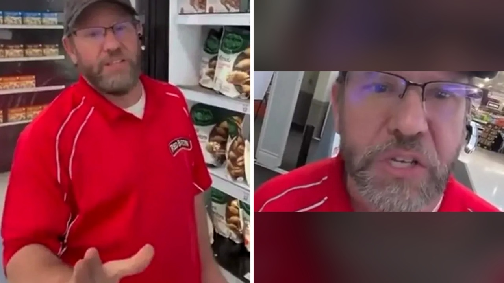

# صرخة عامل مجهد تحول مقلباً ساماً إلى موجة دعم إنساني واسعة

كان والتر زيرود، وهو أب لأربعة أطفال، يواصل عمله المجهد في إعادة ترفيف البيتزا المجمدة داخل متجر بمدينة وايت ليك في ولاية ميشيغان الأمريكية. كان الوقت متأخرًا في شهر أغسطس الماضي، وقد تجاوز ساعات عمله المعتادة بساعة كاملة، ولم يكن يفكر إلا في إنجاز مهامه والعودة إلى بيته لرؤية أطفاله.

في تلك اللحظة بالذات، اقترب منه صانع محتوى بحجة سؤاله عن الوقت. وبمجرد أن أخرج والتر هاتفه للتحقق، قرّب صانع المحتوى هاتفه وأصدر صوت إشعار دفع وهمي لخدمة «أبل باي»، ادعى فيه أنه سحب منه عشرة دولارات.

تخيّلوا أن تكون في أقصى درجات التعب بعد يوم طويل ثم تجد نفسك فجأة مادة للعرض دون إذنك. لم يبتسم والتر ولم يجارِ المزحة، بل طفح به الكيل وانفجر غاضبًا أمام الكاميرا في مشهد يعبر عن قسوة الضغوط اليومية.

## لحظة انفجار تحت ضغط الإرهاق

أوضح التقرير أن والتر يعمل لمصلحة العلامة التجارية «ريد بارون»، وكان ينتظره يوم شاق آخر يبدأ في الخامسة صباحًا لخدمة عشرة متاجر إضافية. وعندما بدأ صانعو المحتوى التابعون لحساب «ذا أكتيف ورلد» بملاحقته نحو منصة الدفع، قال لهم بصوت خنقه التأثر إنه لا يملك رفاهية المزاح.

أشار والتر بصراحة إلى أنه يعاني لتدبير أقساط منزله، وأن أطفاله الأربعة ناموا قبل أن يصل إليهم، مؤكدًا أن تصرفهم غير ظريف بالمرة. كما عبر عن خشيته من أن تتسبب تلك الفوضى في إحداث مشكلات له مع إدارة المتجر أو تهديد مصدر رزقه الوحيد.

كم مرة شعر أحدنا بأنه على وشك الانهيار لمجرد ضغط إضافي بسيط في نهاية يوم عمل مضنٍ؟ بصراحة، هذا الموقف يذكرنا بمدى الثقل الذي يحمله العمال اليوميون في صمت دون أن ينتبه لهم أحد.

## مزحة ثقيلة في وقت حرج

لم يكترث مصورو الفيديو بضائقة الرجل ولا برغبته في عدم التصوير، وقاموا بنشر المقطع على منصات التواصل الاجتماعي لجمع المشاهدات. لكن رد الفعل جاء عكس ما توقعوه تمامًا؛ إذ توالت التعليقات الغاضبة التي طالبت بوقف استغلال معاناة الناس الكادحين من أجل الترفيه.

أدى هذا الاستنكار الجماعي الحاد إلى تعطيل حساب صناع المقلب وإزالة حضورهم الرقمي. هذا الموقف المليء بضغوط بيئة العمل والتعامل مع السلوكيات المزعجة أثناء أداء المهام اليومية، يسلط الضوء على ما يواجهه الكثيرون أثناء محاولتهم كسب عيشهم بشرف.

**اقرأ أيضًا:** [مدير يقلل من صعوبة عميلة متطلبة فيقرر موظفه تركه يواجهها وحده](https://www.almosaitiron.com/2026/10/blog-post_19.html)

## تعاطف غير متوقع ينقذ الموقف

خوفًا من أن يتضرر والتر في عمله، تدخل شخص غريب يدعى لوك أوكينشيلد يوم الثلاثاء 27 أكتوبر، وأطلق حملة تبرعات عبر منصة «غو فند مي» لدعمه. جمعت الحملة مبلغ 446,910 دولارات من أصل هدفها البالغ 700,000 دولار، وكان من بين المساهمين شركة تقنية قدمت تبرعًا بقيمة 30,000 دولار.

تواصل لوك مع والتر عبر اتصال فيديو للتحقق من هويته وتنسيق تحويل الأموال، حيث عبر والتر عن امتنانه الشديد لهذا التعاطف الكبير. كما أكدت الشركة المالكة لعلامة البيتزا دعمها الكامل لوالتر، موضحة أنه عنصر محبوب ومهم في فريقها، ونشرت عبر حسابها الرسمي تأكيدًا على وقوفها إلى جانبه.

## يد العون تظلم صاحبها

المفارقة الإنسانية المؤثرة في هذه القصة تجلت عندما انكشفت ظروف لوك نفسه، الرجل الذي أطلق حملة الدعم الأولى. تبين أن لوك هو محارب قديم بلا ألموى، يعيش في سيارته الخاصة ويعاني من اضطراب ما بعد الصدمة والبطالة.

هذا الاستعداد لمساعدة الآخرين رغم قسوة الظروف دفع صديقًا له يدعى دوم سيرتاليك إلى إطلاق حملة مساعدة ثانية للوك بهدف جمع 6,500 دولار. وجمعت الحملة بالفعل 4,718 دولارًا من 141 تبرعًا لمساعدته في تأمين سكن ووسيلة نقل.

يا جماعة، كيف يستطيع شخص لا يملك سقفًا يحميه أن يحرك الملايين لإنقاذ شخص آخر لم يلتقِ به من قبل؟

## رأيي الشخصي

رأيي الشخصي أن هذه القصة تكشف عن جانبين متناقضين في واقعنا؛ الأنانية التي تحول آلام الناس إلى استعراض، والنبل الصامت الذي يدفعه الاحتياج للوقوف مع الغريب. إذا كنت في موقف والتر، هل كنت ستستجيب بالصمت وتتجاهل الموقف أم ستعبر عن غضبك كما فعل؟
