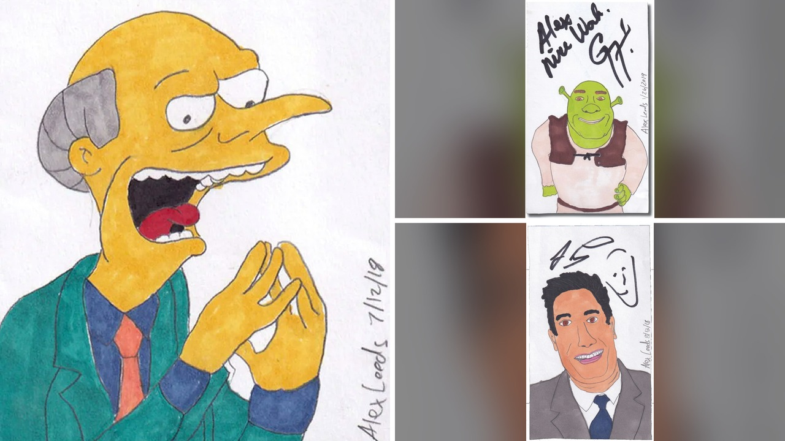

# فنان يرسل رسومات ساخرة للمشاهير ويحصل على توقيعاتهم

## فكرة ولدت من البريد

تخيلوا أن يقرر شخص ما أن يرسل آلاف الرسومات البسيطة، بل والساخرة أحياناً، إلى مشاهير حول العالم، فقط ليحصل على توقيعاتهم. هذا بالضبط ما فعله الفنان أليكس ليدز، الذي قرر أن يدمج بين حبه للبريد التقليدي وبين الرغبة في إحداث ضجة فنية. كان هدفه في البداية بسيطاً؛ دعم هيئة البريد الأمريكية والاحتفاء بمتعة استلام الرسائل الورقية في زمن طغت فيه التكنولوجيا.

لم يتوقع أليكس أن المبادرة ستتحول إلى مشروع ضخم يجمع توقيعات أسماء لامعة مثل جينيفر لورانس، التي وقعت على رسم لعشاء مجمد، أو الموسيقار ويرد أل يانكوفيتش، الذي وقع على صورة لشخصية كرتونية تحمل اسماً مشابهاً لاسمه. الصراحة، الأمر يبدو للوهلة الأولى مجرد عبث، لكنه في الحقيقة يكشف عن جانب غريب في علاقتنا بتوقيعات المشاهير.

## ثأر عمره ثلاثمائة عام

ما فاجأني حقاً في هذا الخبر ليس فقط الرسومات، بل الدافع الخفي وراءها. ليدز كشف أن مشروعه كان نوعاً من الثأر العائلي ضد بنيامين فرانكلين. قديماً، دخل سلفه تيتان ليدز في منافسة أدبية مع فرانكلين، الذي تنبأ بموته في تقويمه الشهير، وعندما لم يمت تيتان، أصر فرانكلين على نشر نعيه للسخرية منه. أليكس اختار أن يحيي هذا الخلاف بطريقته الخاصة، عبر رسوماته التي أرسلها للنجوم.

هذا النوع من القصص يذكرني بما حكيته لكم سابقاً عن مواقف إنسانية غير متوقعة، حيث تتحول الأفكار البسيطة إلى وسيلة للتعبير عن قضايا قديمة أو مشاعر شخصية عميقة.

**اقرأ أيضًا:** [الانفصال بسبب الإنجاب: طليقته تكشف قصتهما وهو يوضح الحقيقة](https://www.almosaitiron.com/2026/11/blog-post_529.html)

## ما بين الحقيقة والسخرية

يجب أن نكون حذرين عند قراءة الكتاب الذي جمع فيه ليدز هذه الرسومات. هو نفسه يوضح أن العمل في جوهره ساخر. التوقيعات التي نراها حقيقية تماماً، لكن الكثير من القصص والتعليقات والادعاءات المكتوبة بجانبها هي من وحي خياله، صاغها لغرض الكوميديا فقط. حتى المقدمة التي قد تظنها مكتوبة من قبل شخصية سياسية، هي في الواقع مجرد بريد إلكتروني اعتذاري من تلك الشخصية.

لماذا يمنحنا توقيع شخص مشهور قيمة إضافية لشيء لا قيمة فنية له في الأصل؟ هذا هو السؤال الذي يطرحه المشروع بذكاء. فجأة، يتحول رسم متواضع إلى قطعة فنية مطلوبة بمجرد وضع اسم نجم عليه.

## رأيي الشخصي

رأيي الشخصي أن هذا المشروع هو تجربة اجتماعية فريدة، تثبت أن الإصرار والجرأة يمكن أن يصنعا شيئاً من لا شيء. ليدز لم يقدم فناً بالمعنى التقليدي، بل قدم حالة من التفاعل الإنساني العفوي والمضحك مع المشاهير. استمتعت بفكرة أنه استغل ميزانية طوابع بريدية ليحول فكرة "مجنونة" إلى واقع ملموس.

لو كنت مكان أحد هؤلاء المشاهير ووصلتني رسالة تحتوي على رسم غريب ومضحك، هل كنت ستوقع عليه وتشاركه، أم كنت ستعتبر الأمر مضيعة للوقت؟
