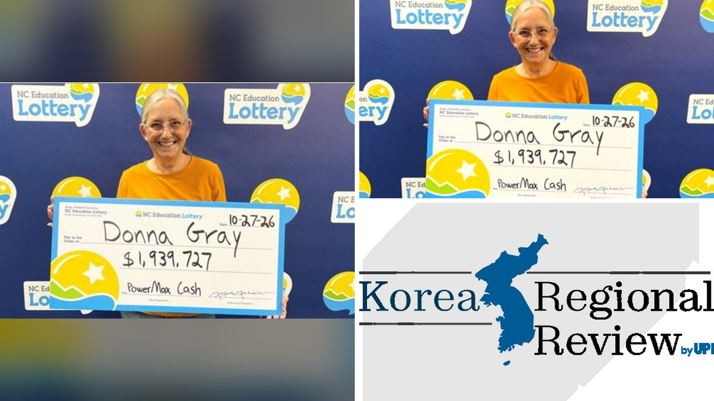

# دولار واحد يغير حياة امرأة أمريكية بجائزة مليونية غير متوقعة

تخيلوا أن تدفعوا دولاراً واحداً فقط في تجربة جديدة كلياً، وتتغير حياتكم المالية في دقائق معدودة. هذا بالضبط ما حدث مع دونا غراي، وهي امرأة تعيش في مدينة ماونت بليزانت بولاية كارولاينا الشمالية، حين قررت تجربة حظها بطريقة لم تعتد عليها من قبل.

كانت دونا معتادة على شراء تذاكر الكشط التقليدية بين الحين والآخر خلال السنوات الماضية. لكن في الأول من أغسطس، قررت للمرة الأولى اتخاذ خطوة جديدة والدخول إلى عالم الألعاب الرقمية الفورية عبر الإنترنت.

## تجربة أولى ونتائج غير متوقعة

لم تكن دونا تمتلك أي خبرة سابقة في هذه الألعاب الرقمية، إذ كانت مبتدئة تماماً عندما اختارت لعبة تُدعى باور ماكس كاش. بصراحة، لم تكن تتوقع شيئاً كبيراً، وكل ما أنفقته في تلك التجربة الأولى كان دولاراً واحداً لا غير.

حين بدأت الأرقام تدور على الشاشة، كانت تعتقد أن الأمر سينتهي بربح بسيط، ربما مئة دولار أو شيء من هذا القبيل. تظنون أن الشخص يمكن أن يستوعب مفاجأة ضخمة في لحظتها؟ لكن العداد استمر في الدوران دون أن يتوقف عند الرقم الذي توقعته.

## ذهول الصدمة وصعوبة التصديق

توقف العداد أخيراً عند رقم مذهل: مليون وتسعمائة وتسعة وثلاثون ألفاً وسبعمائة وسبعة وعشرون دولاراً. لقد فازت بالجائزة الكبرى من محاولتها الأولى ذات الدولار الواحد.

تخيلوا الحيرة التي عاشتها في تلك اللحظة! أسرعت دونا فوراً لتخبر زوجها بالخبر السار، وقالت له بثقة: لقد كسبت مبلغاً كبيراً. لكن الزوج لم يصدق كلماتها في البداية وظن أن الأمر مجرد مزاح. هل تصدقون بسهولة لو جاءكم أحدهم بهذا الخبر؟ الواقع أن الأمر تطلب منهما معاً بضعة أيام كاملة ليستوعبا أن ما حدث كان حقيقة ثابته.

## خطط هادئة للقدر المالي الجديد

عندما يتغير الوضع المالي بهذا الشكل المفاجئ، تختلف التصرفات بين الناس؛ فهناك من يندفع نحو الإنفاق، وهناك من يتريث. بالنسبة لدونا، فضل الزوجان اختيار طريق الهدوء والأمان المالي.

أوضحت دونا لمسؤولي اليانصيب أن هذه الأموال لن تذهب نحو شراء أشياء باهظة، بل ستتجه مباشرة إلى حساب التوفير لضمان مستقبلهما. خطوة بسيطة وهادئة تظهر كيف يمكن للمرء أن يتعامل مع الأرقام الكبيرة بوعي وحكمة.

رأيي الشخصي أن أجمل ما في قصة دونا ليس فقط حجم المبلغ، بل تعاملها الهادئ والرزين مع هذه المفاجأة المفاجئة من الحياة، واختيارها حفظ المال بدل الاندفاع. لو كنت في موقفها، هل كنت ستسارع إلى إنفاق جزء من المال في رحلة استجمام، أم ستفضل إيداع المبلغ كاملاً في التوفير مثلهما؟
