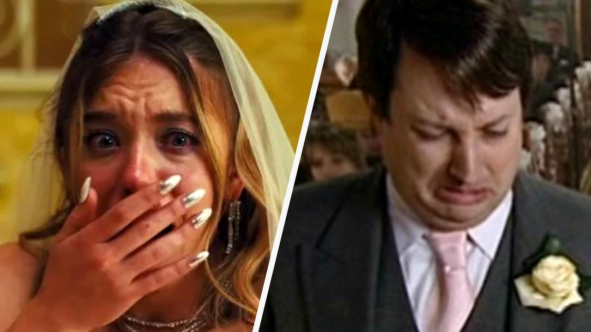

# علامات حاسمة كشفت نهاية العلاقات الزوجية قبل بدايتها

قرأت خبرًا نُشر حديثًا يتضمن تجارب شخصية رواها أشخاص شهدوا بدايات علاقات زوجية وانتهت بشكل لم يكن مفاجئًا لهم. استوقفتني تفاصيل هذه القصص وكيف يمكن لبعض التصرفات والقرارات السريعة أن تعطي إشارات واضحة عما سيحدث مستقبلاً.

تخيلوا أن تبدأ علاقة وتصل إلى الزواج خلال أربعة عشر يومًا فقط. في إحدى الحالات المذكورة في التقرير، انتقلت امرأة مع أطفالها إلى منزل رجل بعد سبعة أيام فقط من التعارف، وفي اليوم العاشر صرحت بأنها تجرب الارتباط بناءً على الشخصية لا المظهر. وفي اليوم الرابع عشر أقيم حفل زواج بسيط في حديقة المنزل الخلفية.

## قرارات سريعة وتغيرات مفاجئة

توقع أحد المعارف في هذه القصة أن تتجه العلاقة إلى نهاية سيئة خلال عام واحد فقط. وما حدث بالفعل هو أنه في اليوم المئة والعشرين تقريبًا، قام الرجل بتغيير أقفال المنزل أثناء غياب المرأة وأطفالها، وقطع جميع وسائل التواصل معها. بصراحة، إن السرعة الفائقة في اتخاذ قرارات مصيرية مثل الانتقال والزواج دون دراسة كافية غالبًا ما تضع طرفي العلاقة أمام مواقف قاسية وغير متوقعة.

وفي حكاية أخرى ذكرها التقرير، كان هناك زوجان عاشا موقفًا إنسانيًا معقدًا. قبل زواجهما، تعرضت المرأة لمضاعفات حمل كادت تودي بحياتها وفقدت جنينها، وكان خطر تكرار ذلك مؤكدًا بنسبة مئة بالمئة إذا حملت مجددًا. وكان الرجل يفضل عدم إنجاب الأطفال إطلاقًا لحماية حياتها.

## مواقف قاسية وأمنيات معقدة

خلال فترة الخطوبة وقبل الزواج بفترة قصيرة، أبدت المرأة رغبة شديدة في الإنجاب وحمل طفلها الخاص. حاول الرجل مرارًا البحث عن خيارات أخرى مثل التبني أو الرعاية الكفيلة أو التطوع، لكنها أصرت على موقفها. أقيم الزواج، لكن الزوج رفض تمامًا المشاركة في أي خطوة قد تعرض حياتها للخطر.

فُسخ الزواج بعد فترة قصيرة بالتراضي بينهما. ولاحقًا ارتبطت المرأة برجل آخر وحملت ونجت هي وطفلها الصغير، بينما ظل الزوج السابق متأكدًا أنه اتخذ القرار الصحيح لحمايتها رغم حزنه على الفراق. هل تعتقدون أن الحرص الزائد على حياة الشريك يبرر إنهاء الزواج عندما تختلف الرغبات الجوهرية؟

## كلمات العهود والمشاعر المخفية

أحيانًا تظهر المؤشرات الجلية خلال مراسم الزفاف نفسها، وتحديدًا عند تبادل عهود الزواج. يذكر التقرير قصة عريس كتب كلمات مليئة بالحب والتقدير لزوجته والترحيب بها في عائلته، بينما اختارت العروس أن تتضمن عهودها تهكمًا واستهزاءً به وبأصدقائه. بعد سنوات قليلة، اكتشف الزوج من خلال طفله البالغ من العمر ثماني سنوات أن زوجته كانت تخونه. هذا الموقف يوضح كيف أن احترام الشريك في المناسبات العامة يعكس حقيقة المشاعر المتبادلة.

وفي واقعة أخرى، أقام زوجان يُدعيان كيفن وماري حفل زفاف ضخمًا حضره مئتا شخص مع استضافة أقارب من أوروبا وإنفاق عشرات الآلاف من الدولارات. لكن القصة بدأت قبل ذلك بكثير عندما كانت ماري تفكر في الانفصال بسبب عدم التوافق. أثناء رحلة تخييم، فاجأها كيفن بخاتم خطوبة جميل، فلم تستطع الرفض. هالسالفة تذكرنا بالضغوط الاجتماعية وتكاليف الزفاف المرتفعة التي قد تُنفق على علاقات هشة في أصلها.

هذا الموقف يذكرني بما قرأناه سابقًا عن الضغوط المالية والاجتماعية التي ترافقت مع ترتيبات الزفاف والتوقعات العالية من الأهل.

**اقرأ أيضًا:** [ابنة زوج تطلب 160 ألف دولار لزفافها رغم جحودها](https://www.almosaitiron.com/2026/10/160.html)

## حفل ضخم وتوقعات مقلقة

كان كيفن يرغب في إعلان الخطوبة سريعًا لينافس أصدقاءه الذين كان زفافهم قريبًا. وأثناء حفل زفافهما المكلف، نظم أصدقاؤهما المباشرون مراهنة ودية بقيمة عشرين دولارًا للتكهن بمدة استمرار الزواج، وفاز بها من توقع الانفصال بعد عام وأسبوع واحد فقط.

أما الموقف الأخير الذي ورد في الخبر، فكان عندما دعت العروس حبيبها السابق إلى حفل الزفاف. وخلال الحفل، قام العريس بسكب إبريق كامل من القهوة الساخنة عليه أمام المدعوين. لم يستمر الزواج أكثر من عام، وانتهى بالطلاق لتعود العروس لاحقًا إلى حبيبها السابق. هل يمكن للغيرة المفاجئة أو وجود أطراف من الماضي أن يدمر الزواج في مهده؟

رأيي الشخصي أن الصراحة منذ البداية والروية في اتخاذ قرارات الزواج هما الأساس لأي علاقة مستقرة، بينما تجاهل المؤشرات المباشرة غالبًا ما يؤدي إلى نهايات مؤلمة. لو خيرت بين مواجهة الخلافات الجوهرية قبل الزواج أو المجاملة والاستمرار أملاً في التغير، فأي الخيارين تختار؟
