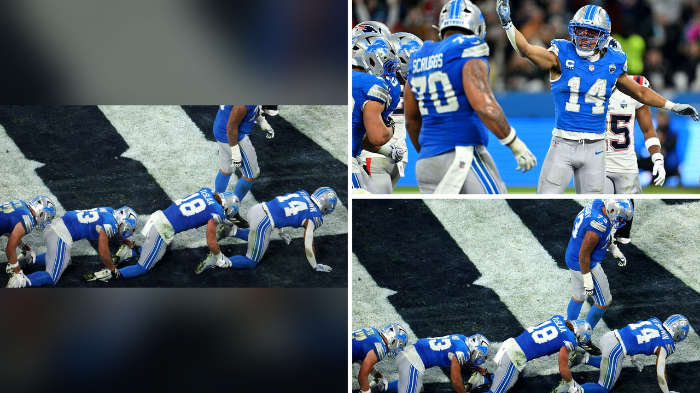

# احتفال غريب في الدوري الأمريكي يثير صدمة واشمئزاز المتابعين

سقط لاعب الهجوم أمون را سانت براون على يديه وركبتيه داخل ملعب مباراة كرة القدم الأمريكية في مدينة ميونخ الألمانية. الحادثة وقعت خلال الربع الثالث من مواجهة فريقه ديترويت لايونز ضد نيو إنجلاند باتريوتس. لكن ما حدث بعد تلك اللقطة لم يكن مجرد رقصة فوز عادية، بل تسبب في موجة عارمة من الاستغراب والجدل.

تخيلوا أن سبعة لاعبين محترفين قرروا فجأة الاصطفاف خلف بعضهم والزحف على الأرض بطريقة غريبة ومثيرة للريبة. تلك المباراة انتهت بفوز ديترويت بنتيجة خمسة وثلاثين مقابل عشرة. إلا أن الحديث كله تحول فورًا إلى مشهد الاحتفال بعد الهدف الثاني لسانت براون، والذي رفع النتيجة وقتها إلى ثمانية وعشرين مقابل ثلاثة.

## لقطة غير متوقعة فوق العشب

في تلك اللحظة المشهودة، تقدم اللاعب إسحاق تيسلا وتمركز خلف سانت براون مباشرة، بحيث اصطفت خوذته خلف زميله مباشرة. ثم انضم باقي أعضاء الفريق ليشكلوا خطًا متصلاً يزحف إلى الأمام عبر منطقة النهاية. المشهد بدا غريبًا للغاية وغير مألوف في ملاعب كرة القدم الأمريكية.

الجمهور والمتابعون على شبكات التواصل الاجتماعي لم يتأخروا في التعبير عن دهشتهم الصادقة. بصراحة، التغطية المباشرة للمباراة شهدت ذهول الكثيرين، وتساءل بعضهم إن كان هذا التصرف مجرد استعراض متهور أم رسالة لم يفهمها أحد. هل يعقل أن نرى لاعبين محترفين يزحفون بهذا الشكل أمام ملايين المتابعين؟

## اتهامات وتكهنات على مواقع التواصل

ما فاجأني حقًا هو الاتجاه الذي ذهبت إليه التحليلات عبر شبكات الإنترنت. المتابعون ربطوا هالسالفة فورًا بفيلم رعب هولندي شهير صُدر عام ألفين وتسعة للمخرج توم سيكس، تدور أحداثه حول طبيب جراح ألماني يقوم بربط الضحايا جراحيًا في خط واحد. ونظرًا لأن المواجهة جرت في ألمانيا، ظن البعض أن اللاعبين يتعمدون الإشارة إلى ذلك الفيلم الصادم.

الانتقادات انهالت بسرعة كالنار في الهشيم. صحفي المراهنات أري ميروف وصف الاحتفال بأنه جنوني. أما صانع المحتوى مات فروليتش فقد عبر عن غضبه الشديد مطدقًا صيحة احتجاج، مطالبًا بتغريم كل لاعب شارك فيه بمبلغ خمسمائة ألف دولار، لأن الأطفال كانوا يشاهدون تلك التغطية المباشرة. شو رأيكم في رد الفعل هذا؟ هل ترونه مبالغًا فيه أم مستحقًا؟

## الحقيقة من غرفة الملابس

لكن الحقيقة ظهرت سريعة من لسان صاحب الهدف نفسه. الكواليس لم تكن لها أي علاقة بأفلام الرعب ولا بالطبيب الألماني. سانت براون كشف في تصريحات صحفية أن منسق ألعاب التمرير في الفريق ميك كافكا هو من عرض عليهم مقطع فيديو قديمًا. الفيديو كان يعود لإحدى مباريات الدوري الأمريكي القديم في أوروبا، حيث احتفل اللاعبون وقتها بهذه الطريقة بالضبط.

اللاعبون أُعجبوا باللقطة كثيرًا واحتششدوا ضاحكين في غرفة الاجتماعات قبل المباراة، واتفقوا على تطبيقها فور تسجيل أول هدف. الحين، الاعتراف اللطيف من سانت براون أوضح أنه نسي تنفيذ الاحتفال بعد هدفه الأول في اللقاء لأنه كان متحمسًا للغاية. وعندما سجل هدفه الثاني، تذكر الاتفاق وسقط على الأرض، ليدفعه زملاؤه وتكتمل اللقطة التي أثارت هذا اللغط الكثيف.

## عقوبات سابقة وقواعد صارمة

الضجة الحالية تأتي في وقت تفرض فيه الرابطة الوطنية لكرة القدم الأمريكية قواعد صارمة جدًا على الاحتفالات خلال موسم ألفين وستة وعشرين. الرابطة والاتحاد أصدارا بيانًا مشتركًا في أكتوبر يحدد الإشارات الممنوعة في ثلاثة تصنيفات رئيسية: الحركات العنيفة التي تحاكي الأسلحة، والإشارات المرتبطة بالمخدرات، والتلميحات غير الأخلاقية.

يا جماعة، سانت براون ليس غريبًا على العقوبات المالية. في سبتمبر الماضي تعرض لغرامات مالية بلغت نحو ستين ألف دولار بعد مباراتهم ضد بوفالو بيلز. العقوبة فرضت عليه بواقع أربعة عشر ألف دولار عن كل مرة قيل إنه قلد فيها حركة تدخين السجائر على الملعب. وقد أعلن وقتها أنه يقدم طعنًا ضد هذه العقوبة الضخمة، مشيرًا إلى صعوبة الموقف ماليًا. هل تعتقدون أن الرابطة سترى في الاحتفال الأخير تلميحًا يستوجب غرامة جديدة؟

## رأيي الشخصي والختام

رأيي الشخصي أن اللقطة طريفة ومأخوذة من أرشيف اللعبة بالفعل، لكن قلة وعي اللاعبين بالربط الذهني الذي قد يحدثه المشهد في أذهان الجمهور هو ما أوقعهم في هذه الأزمة الإعلامية. في نهاية المطاف، الرياضة تحتاج بعض المرح، لكن حدود هذا المرح تظل خطًا فاصلًا بين الإمتاع وسوء الفهم.

لو كنت مكان رئيس الرابطة، هل كنت ستفرض غرامة مالية على اللاعبين بسبب هذا الاحتفال، أم تكتفي بتنبيههم لعدم تكراره؟
