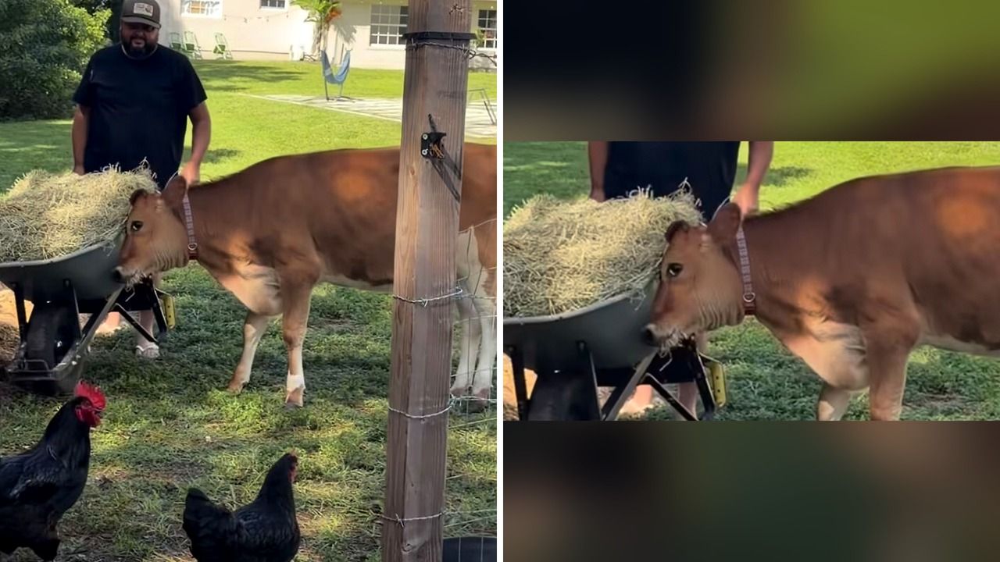

# بقرة ترحب بصاحبها بقفزات الفرح وكأنها كلب ينتظر عودته

يقف عند السياج في الفناء الخلفي، وينتظر بصبر خروج الرجل الذي اعتاد رعايته. بمجرد أن ينفتح الباب، يندفع بسرعة نحو صاحبه، يقفز فرحاً بين الأعشاب بطريقة لم نعهدها عادة من حيوانات المزرعة.

هذا الموقف الدافئ الصراحة لم يأتِ من كلب أليف، بل من بقرة تعيش في مزرعة صغيرة أقامتها داني مورا البوكيرك وزوجها خلف منزلهما. المزرعة تضم مجموعة مختلفة من الحيوانات مثل الدجاج والماعز والكلاب والأبقار، لكن هذه البقرة بالذات خطفت الأضواء بأسلوب استقبالها الفريد.

## مشاعر غير متوقعة خلف السياج

كتبت داني تعليقاً طريفاً على الفيديو الموثق للحظة، موضحة أن زوجها لم يكن يرغب في اقتناء بقرة في البداية. لكن الآن، أصبحت البقرة تنتظره عند الباب وكأنه عائد من حرب طويلة.

ما استوقفني في هذه اللقطة البسيطة هو قدرة الحيوانات على التعبير عن التعلق والوفاء لأصحابها بصور غير مألوفة. هل تخيلت يوماً أن تجد بقرة تقفز ركضاً لمجرد رؤية من يحضر لها الطعام؟

## كلب ريفي بحجم مختلف

تفاعل المشاهدون بكثافة مع مقطع الفيديو، حيث شبه الكثيرون هذه البقرة بكلب منزلي متحمس. أحد المتابعين مزح قائلاً إنها مجرد كلب لكن بمهارات حركة محدودة، بينما وصفها آخر بأنها جرو برتقالي ضخم يلعب في العشب.

هذا الاتصال العاطفي بين الإنسان والحيوان يذكرنا بمدى عمق المشاعر التي تظهر في المزارع وبيوت الرعاية. وهذا ذكّرني بما حكيته لكم سابقًا عن التواصل اللطيف الذي جمع بين إنسان وحيوان في الأماكن العامة.

**اقرأ أيضًا:** [سنجاب بري يصادق صاحب عربة مثلجات قرب برج لندن](https://www.almosaitiron.com/2026/10/blog-post_22.html)

تساءل متابع آخر بنبرة مرحة: هل أنتم متأكدون أنها بقرة وليست جرو مرعى؟ الفيديو أظهر كيف يمكن للرعاية اليومية المخلصة أن تصنع رابطاً خاصاً يغير سلوك الحيوان بالكامل. شو رأيكم بهذه المشاعر الدفينة؟

## عاطفة صادقة في تفاصيل يومية

وأضافت داني مازحة أن موافقة زوجها على الزواج منها كانت تعني ضمناً التزاماً بتقديم وجبات القش المتواصلة طوال العمر. لكن النتيجة كانت هذه اللحظات التي تجمع بين المودة والبهجة اليومية.

رأيي الشخصي أن المشاعر والتعلق الصادق لا يقتصران على الحيوانات الأليفة التقليدية مثل الكلاب والقطط، بل يمتد لكل كائن يجد الاهتمام والحب من حوله. هل تفضل الاستقبال الدافئ الهادئ أم تروق لك هذه الاستقبالات الحافلة بالقفز والحماس؟
