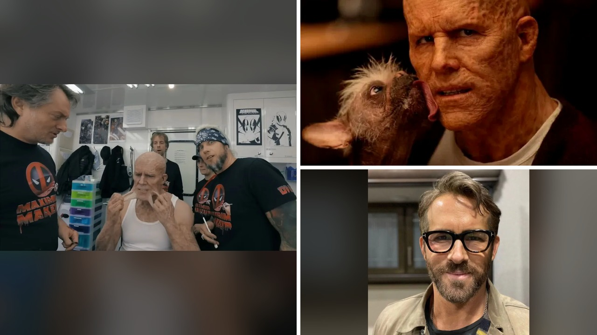

# مقلب ثمان ساعات لـ ريان رينولدز يثير غضب الجمهور

تعال نتوقف عند مقطع قديم عاد للظهور وصنع ضجة كبيرة على الإنترنت حول النجم ريان رينولدز. الصراحة، ما فاجأني هو حجم الغضب الواسع الذي اجتاح مواقع التواصل بعد انتشار هذا الفيديو. تخيّلوا أن يتقبل فريق العمل كل هذا الضغط بصمت تام. المشهد يعود لكواليس تصوير فيلم ديدبول 2 وتحديداً لعمل استغرق سبع إلى ثمان ساعات كاملة.

## تفاصيل ثمان ساعات من التعب المهدور

أمضى ريان رينولدز ساعات طوال في كرسي المكياج بينما كان مصمم المكياج الرئيسي بيل كورسو وفريقه يضعون بدقة قطع السيليكون المعقدة على وجهه وعنقه لخلق مظهر وايد ويلسون المشوه. بعد انتهاء هذا الجهد المضني، نظر الممثل إلى المرآة وأبدى عدم رضاه بالمرة عن النتيجة. قال للفريق المتعب بكل برود إن الأمر خاطئ تماماً ويجب البدء من جديد، قبل أن يبدأ فوراً بتمزيق الأجهزة التعويضية عن وجهه بوحشية.

الفنانون بدا عليهم الذهول الشديد وكأن تعبهم يتبدد أمام أعينهم في ثوانٍ معدودة. بعضهم غادر الإطار تماماً، بينما ظهر أحد أعضاء الفريق وهو يلقي بفرشاته بغضب شديد. حسب ما نُشر، كان ريان قد علم مسبقاً أن تصوير ذلك اليوم قد ألغي بالكامل، لكنه آثر أن يترك الفريق ينهي عمله الشاق قبل أن يكشف لهم تلك المزحة الثقيلة. هذا التصرّف فتح باباً واسعاً للجدل حول ما إذا كانت هذه الفبركة طرافة أم إهانة واضحة.

## غضب واسع واتهامات بالتنمر

تفاعل الجمهور مع المقطع بحِدّة غير مألوفة، واعتبر الكثيرون أن ما جرى لا يندرج تحت باب الكوميديا أبداً. علّق أحد المنتقدين بغضب واصفاً الأمر بأنه تنمر صريح مؤكداً أن المزحة يجب أن تسعد الجميع. قال آخر إن فريق المكياج كان يستحق أجراً إضافياً واعتذاراً رسمياً وأسبوع إجازة كاملاً بعد تلك التجربة القاسية. وكتب مشاهد آخر معبراً عن إحباطه من استهلاك وقت ومجهود العاملين بهذه الطريقة المستفزة. 

الصراحة، هالسالفة تذكرني بوقائع أخرى جرت في كواليس هوليوود مؤخراً.

**اقرأ أيضًا:** [مدير يقلل من صعوبة عميلة متطلبة فيقرر موظفه تركه يواجهها وحده](https://www.almosaitiron.com/2026/10/blog-post_19.html)

المثير للاهتمام أن هذا الفيديو القديم عاد للواجهة في توقيت حساس للغاية يواجه فيه ريان وزوجته بليك לייفلي تدقيقاً عاماً واسع النطاق. يأتي ذلك على خلفية المعركة القانونية التي خاضاها سابقاً مع المخرج جاستن بالدوني والتي انتهت بتسوية خارج المحكمة في مايو 2026. التسريبات والوثائق التي انتشرت خلال تلك الأزمة جعلت الجمهور ينظر لكل تصرفات الثنائي بعين جديدة تماماً، بعيداً عن الكوميديا المعتادة.

## توقيت حساس وضغط جماهيري متزايد

الجدل القانوني السابق بين بليك לייفلي وجاستن بالدوني شهد اتهامات متبادلة وحملات خلف الكواليس أدت إلى توتر علاقات الثنائي بعدد من الشركاء في الصناعة. تزامن انتشار مقلب المكياج مع هذه الأجواء المشحونة جعل ردود الفعل قاسية للغاية وجرد الموقف من أي طابع فكاهي. حتى أن بعض المعلقين أكدوا أن كراهية بعض المتابعين لريان رينولدز لا تتعلق بهذا المقلب وحده، بل بصورة عامة عن طريقته في التعامل.

رأيي الشخصي أن المزاح الثقيل الذي يهدر مجهود الآخرين يفقد معناه تماماً، خصوصاً عندما يصدر من شخصيات تمتلك سلطة في مواقع التصوير. شو رأيك أنت، هل تعتبر ما حدث مقلباً خفيفاً يدخل ضمن طرافة الكواليس أم تجاوزاً مرفوضاً بحق العاملين؟
