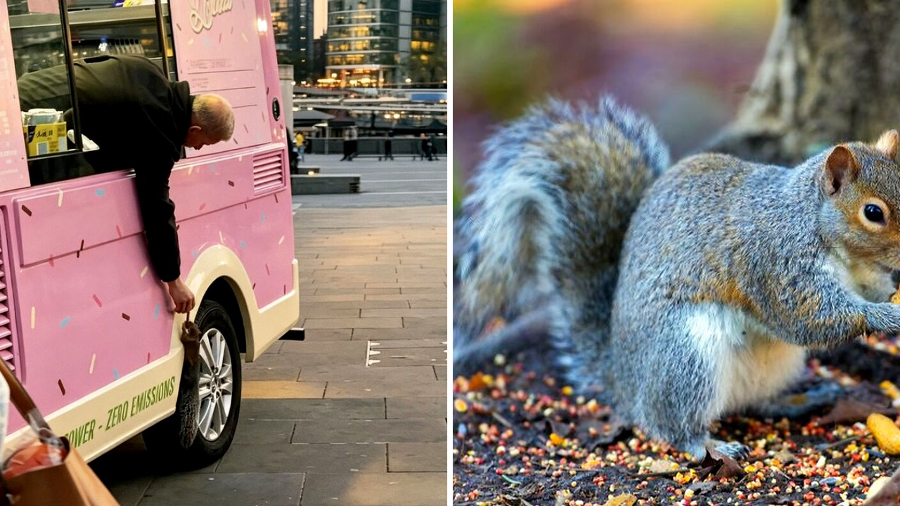

# سنجاب بري يصادق صاحب عربة مثلجات قرب برج لندن

تخيل أنك تقف قرب جسر برج لندن الشهير، تنتظر شراء الحلوى، وفجأة يمر بجانبك زائر غير متوقع إطلاقاً. سنجاب بري يتحرك بثقة كاملة، ويتجه نحو نافذة العربة كأنه زبون دائم يعرف موعده بدقة.

هذا المنظر اللطيف انتشر بشكل واسع بعد أن وثقه أحد المارة عبر مقطع مصور، ليخطف قلوب المتابعين. ما لفت انتباهي حقاً هو الهدوء الشديد والطمأنينة التي ظهرت بين السنجاب وصاحب عربة المثلجات الشهيرة بتقديم نوع خاص من القشطة.

## زائر يطلب ضيافته بنظام

وصل السنجاب الصغير إلى نافذة الخدمة كأنه في زيارة روتينية منتظمة. وقف بأدب ينتظر نصيبه من الحلوى، يتناول قضمة بشغف، ثم يسرع لإخفاء باقي كنز الصغير.

هل سبق أن رأيتم حيواناً برياً يتصرف بهذا الرقي والهدوء في مكان عام حافل بالناس؟ الصراحة، المشهد يبدو كأنه لقطة من فيلم سينمائي، حيث يتلاشى الخوف الطبيعي تماماً بين الإنسان والحيوان.

هذا التواصل العفوي ذكّرني بما حكيته لكم سابقاً عن دب قرر دخول مكتبة في كاليفورنيا للبحث عن وجبة خفيفة من العسل.

**اقرأ أيضًا:** [دب يقتحم مكتبة في كاليفورنيا ويسرق وعاء عسل](https://www.almosaitiron.com/2026/10/blog-post_464.html)

## موجة من التعاطف والإعجاب

المقطع المصور أثار تفاعلاً كبيراً بين المتابعين الذين أبدوا دهشتهم من هذه الألفة الساحرة. كتب أحد المتابعين معلقاً أن السنجاب يقف ينتظر دوره بنظام، بينما أضاف آخر أن اللطف لا يكلف شيئاً.

واعترف متابع آخر بأن رؤية هذا المشهد أعادت إليه السكينة والهدوء. حتى إن البعض اقترح فكرة طريفة؛ صنع سلم صغير مع طاولة نزهة مصغرة على جانب عربة المثلجات لتسهيل زيارة السنجاب.

تفاعل الناس لم يتوقف عند هذا الحد، بل دفع آخرين لمشاركة تجاربهم الشخصية. أحد المتابعين نشر قصته مع طائر حناء أطلق عليه اسم كريستوفر روبين، يزوره يومياً عند المكتبة المحلية حتى أصبح يأكل من يده مباشرة. هالسالفة تؤكد أن مشاعر العطف ليست حصراً على البشر.

## الثقة بين الكائنات

رأيي الشخصي أن هذه المشاهد البسيطة تذكرنا بمدى جمال التناغم مع الطبيعة حولنا حين نفتح قلوبنا لها. العطف والرفق بالحيوان لا يحتاجان لإمكانيات ضخمة، بل لفتة إنسانية بسيطة قد تغير يوم كائن كامل.

لو كنت مكان صاحب عربة المثلجات، هل كنت ستستقبل هذا السنجاب يومياً أم ستخاف من اقترابه؟
