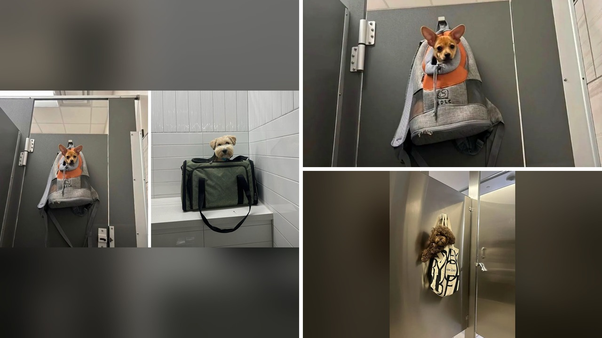

# حقائب السفر تحول الكلاب إلى مسافرين لطاف في صور متداولة

تخيل أن تفتح حقيبة يدك اليومية، فلا تجد فيها أوراقك أو أغراضك الشخصية، بل تجد رفيقك الأليف يطل برأسه من الداخل بكل هدوء. ما استوقفك في هذا الخبر ليس مجرد الفكرة، بل تلك النظرات البريئة التي تظهر على وجوه الحيوانات وهي تتنقل محمولة على أكتاف أصحابها.

الصراحة، المشاهد التي جرى تداولها مؤخرًا لحيوانات أليفة، وتحديدًا الكلاب وبعض القطط، وهي تسافر وتتحرك داخل الحقائب تجعل أي شخص يبتسم دون أن يشعر. هل جربتم من قبل رؤية كلب يجلس داخل حقيبة قماشية عادية كأنه في جولة سياحية فاخرة؟

## رحلات قماشية وأناقة عفوية

الحقائب لم تعد مجرد وسيلة لنقل المستلزمات اليومية، بل تحولت إلى مقاعد مريحة لهؤلاء الرفاق الصغار. التقرير يشير إلى أن بعض الحيوانات تبدو مستمتعة تمامًا بهذه الطريقة غير التقليدية في التنقل، وكأنها وجدتها فرصة لاستكشاف العالم من مستوى أعلى دون عناء المشي.

الجمال في هذه الصور يكمن في البساطة؛ فالكلب يمنح الحقيبة العادية لمسة من اللطف الشديد بمجرد جلوسه فيها. وهناك قطط أيضًا شاركت في هذه التجربة، ليصبح المنظر اليومي في الشارع أكثر دفئًا وإثارة للبهجة.

## الانتظار في لحظات غير متوقعة

تصبح القصة أكثر طرافة عندما نصل إلى مواقف الانتظار اليومية، مثل تواجد أصحاب الحيوانات في دورات المياه. هناك، ينتظر الرفاق الصغار داخل حقائبهم بحيرة واضحة، وكأن ملامحهم تتساءل عن سبب وجودهم في هذا المكان تحديدًا.

بعض الكلاب تظهر في الصور مسترخية تمامًا ولا تشعر بأي توتر، بينما تطلق وجوه أخرى تعابير ناطقة تقول بوضوح: هل يمكننا العودة إلى المنزل الآن؟ هذه التفاعلات اللطيفة تذكرنا بالروابط العفيفة التي تجمعنا بالحيوانات الأليفة في حياتنا اليومية.

هذا المشهد الدافئ والتفاعل العفوي مع الحيوانات يذكرني بما قرأناه سابقًا عن مواقف إنسانية مشابهة تجمع الناس بالحيوانات في الأماكن العامة.

**اقرأ أيضًا:** [سنجاب بري يصادق صاحب عربة مثلجات قرب برج لندن](https://www.almosaitiron.com/2026/10/blog-post_22.html)

## اثنتان وعشرون لقطة تزرع الابتسامة

تم جمع اثنين وعشرين مشهدًا مصورًا عبر صفحة متخصصة بنشر محتوى الكلاب على منصات التواصل الاجتماعي. جميع هذه الصور تؤكد فكرة واحدة: الكلاب قادرة على جعل أي شيء يبدو أكثر لطفًا، حتى لو كان مجرد حقيبة عادية من القماش.

يا جماعة، تصفح هذه الصور يترك أثرًا طيبًا في النفس، لأنها تلتقط لحظات حقيقية غير متصنعة لحيوانات تعيش تفاصيل يومية بسيطة مع أصحابها، وتضيف على حياتنا قدرًا من البهجة والصحبة.

## مشاعر صادقة ورفقة دافئة

رأيي الشخصي أن هذه الصور لا تقتصر على كونها لقطات طريفة للترفيه، بل تعكس حجم التعلق والرفقة الدافئة بين الإنسان وحيوانه الأليف، حيث يصر الصاحب على إبقاء رفيقه بجانبه حتى في أبسط تحركاته.

إذا كنت تمتلك حيوانًا أليفًا، هل تفضل أن تتركه يتجول بحرية على قدميه أثناء النزهة، أم تفضل حمله في حقيبة مخصصة ليبقى قريبًا منك طوال الوقت؟
