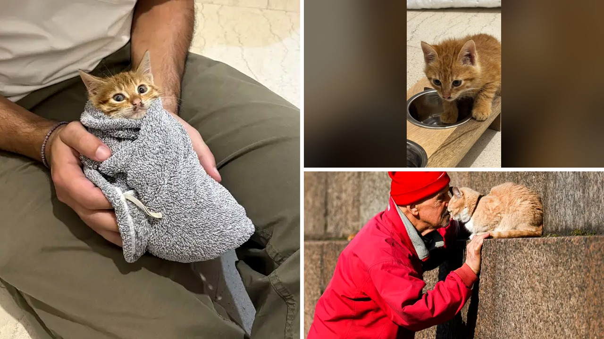

# كيف غيرت قطط الشوارع حياة من أنقذوها بالصدفة؟

أمضى ست سنوات في الخدمة العسكرية، وفقد خلالها أشخاصاً مقربين جداً من قلبه، ثم تعثر فجأة بقط صغير يبكي داخل محرك سيارته. لم يكن يخطط لأي شيء، لكن ذلك الكائن الصغير منحه شعوراً بالراحة لم يعشه منذ وقت طويل.

تخيل أن تخرج في يوم عادي لقضاء غرض سريع، فتعود إلى بيتك برفقة روح جديدة تماماً تقلب روتينك رأساً على عقب. هذه التفاصيل اليومية البسيطة هي ما يجعل تجارب تبني الحيوانات المشردة مليئة بالدفء، بصراحة.

## صدف في مواقف السيارات وحاويات القمامة

تتكرر الحكايات التي يتشاركها الناس عن لحظة العثور الأولى. أحدهم وجد قطاً جائعاً داخل صندوق كرتوني مبلل على الرصيف، وكتب بتلقائية متسائلاً إن كان قد أصبح مسؤولاً عن تربية قط الآن. شخص آخر وجد قطه داخل حاوية قمامة، ليتحول بعد فترة قصيرة إلى فرد مدلل يفرغ أطباق طعامه بانتظام داخل منزل دافئ.

وفي موقف سيارات أحد المتاجر، رصد أحدهم كتلة فرو سوداء نحيلة للغاية، فقرر ألا يتركها، لتصبح تلك القطة الصغيرة رفيقة سرير نومه كل ليلة بصحبة كلبه وقطته الأخرى. يا جماعة، ما يدهشني في هذه المشاهد هو المكان غير المتوقع؛ فهل تصورت يوماً أن تلتقي برفيق دربك تحت عجلات مركبة أو في زاوية متجر؟

هذه المصادفات تعيد للأذهان كيف تبدأ حياة جديدة من وسط الإهمال التام، وهو أمر رأيناه في حوادث مشابهة حين تُترك حيوانات ضعيفة داخل علب عادية في انتظار من يمد لها يد العون.

**اقرأ أيضًا:** [عثروا على صندوق مقرمشات أمام المستشفى وبداخله مفاجأة](https://www.almosaitiron.com/2026/11/blog-post_13.html)

## قلوب مكسورة تلتئم بالاهتمام

الجانب الإنساني المؤثر يظهر بوضوح في حالة شخص فقد كلبه وقطته في وقت متقارب، وكان يمر بحزن عميق، حتى رأى قطاً تحت سيارة في الشارع. جلس على الإسفلت الساخن لفترة طويلة وتأذى من حرارته، فقط لينال ثقة القط المذعور ويجعله يشعر بالأمان، واليوم يعيشان معاً في هدوء رغم إصابة الحيوان بالربو وتطلبه رعاية طبية مستمرة.

وفي تجربة أخرى، التقى شخص بقطته في شوارع العاصمة الفرنسية باريس، وذكر أنها منحته فيضاً من المودة في فترة كان يعاني فيها من كآبة شديدة. شو رأيك في هذه الرابطة الصامتة التي تنشأ بين إنسان مثقل بالهموم وحيوان لا يطلب سوى الأمان؟ تبدو العلاقة في ظاهرها إنقاذاً لحيوان ضعيف، لكن المدقق في تفاصيلها يدرك سريعاً أن كلاً منهما كان طوق نجاة للآخر من عزلته وألمه الداخلي.

## جراح صغيرة وبدايات آمنة

الكثير من هذه الحيوانات يبدأ رحلته بإصابات مؤلمة. إحدى الفتيات كانت عائدة من مدرستها، فركضت نحوها قطة هزيلة تعرج، وحين فحصها الطبيب تبين وجود كسر في ساقها، لتنتهي القصة بجبيرة صغيرة ومنزل جديد تمضي فيه وقتها بالخرخرة المستمرة واللعب.

وفي طريق عام، عثر أب كان يصطحب ابنه من دروس السباحة على قطة صغيرة تدور حول نفسها في حلقات مفرغة، عاجزة عن الرؤية بسبب التهاب حاد في عينيها. وبعد أسابيع من العلاج الدقيق والنظافة، استعادت مظهرها المشرق، وأصبح لديها رفيقة تلعب معها في أرجاء البيت. وهناك أيضاً من تسلل إلى الداخل متجاوزاً كلب حراسة ضخماً، ليفرض وجوده الهادئ ويصبح بمرور الأيام الصديق الأقرب للجميع، حتى للكلب نفسه الذي استسلم لحضوره الصغير.

رأيي الشخصي أن أعظم ما في هذه التجارب هو عفويتها المطلقة؛ فالبيوت الدافئة لا تُبنى دائماً بالتخطيط، بل بقرار سريع وحنون يختاره المرء في ثانية واحدة حين يرى روحاً تتألم أمامه. لو وضعتك الصدفة في موقف مماثل، هل ستأخذ هذا الكائن الصغير إلى بيتك أم ستكتفي بإطعامه وتركه في مكانه؟
