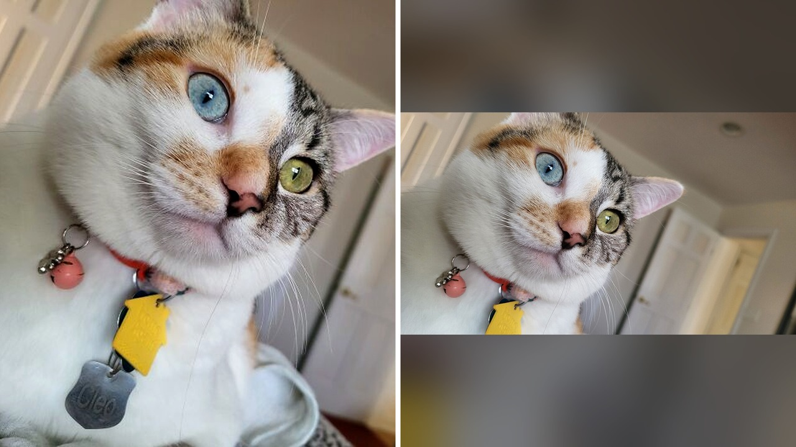

# قطة تبهر عائلتها باكتشاف جيني نادر في دمها

عائلة تتبنى قطة أليفة في ديسمبر 2025، وتتوقع حياة هادئة مع كائن جميل. لكن السجلات الطبية في الملجأ كانت تخبئ شيئًا لا يخطر على بال أحد.

أثناء تقليب الأوراق، ظهرت نتائج فحص الدم. القطة تحمل في جسدها طاقمين مختلفين من الخلايا الجينية: نحو 70% خلايا إناث، و30% خلايا ذكور!

اسمها كليو، وهي قطة منقذة تبنتها عائلتها من منظمة نورث شور أنيمال ليغ أوف أمريكا، وتبين أنها قد تكون حالة كيميرا جينية نادرة جدًا.

## أوراق طبية تكشف السر

حسب ما ورد في التقرير، الفحوصات الطبية أظهرت أن كروموسومات كليو تجمع بين كروموسومات الإناث والذكور، وهي تركيبة لا تتعايش عادة في دم حيوان واحد. المصادفة أن الوثائق سجلت أيضًا حالة ثنائية الجنس لدى القطة، حيث تبين وجود أجهزة تناسلية ذكرية جرى إزالتها أثناء عملية التعقيم.

الجميل في الأمر أن الأطباء البيطريين أكدوا عدم وجود أي مشاكل في المسالك البولية، ولا يتوقعون مضاعفات طويلة الأجل. يا جماعة، ما فاجأني حقًا هو أن هذا الاكتشاف المذهل جاء بالصدفة المحضة بعد التبني! هل تتوقعون أن حيواناتكم الأليفة قد تخفي أسرارًا مماثلة؟

## ألوان مختلفة وعينان بسحر خاص

بصراحة، المظهر الخارجي لكليو وحده يكفي لجذب الانتباه. وجهها مقسم بتناسق عجيب بين ألوان البرتقالي والأبيض والتجزيعات الداكنة. أما عيناها، فهما حالة خاصة من التباين الكامل في لون العينين: واحدة بلون أزرق فاتح والأخرى بأصفر يميل للأخضر.

هذا التباين في لون العينين لا يؤثر إطلاقًا على قدرتها على الرؤية بحسب ما تشير إليه أبحاث حماية القطط. هذا ذكّرني بما حكيته لكم سابقًا عن الحالات الجسدية الغريبة في عالم الحيوان، وكيف تظهر الطبيعة مفاجآت مدهشة.

**اقرأ أيضًا:** [فرس في أوهايو تكسر رقما قياسيا بأطول ذيل في العالم](https://www.almosaitiron.com/2026/10/blog-post_18.html)

لكن هل اللون المزدوج في الوجه يعني بالضرورة أنها كيميرا؟ التقرير يوضح أن انقسام ألوان الفراء قد يحدث في قطط السلحفاة والكاليكو العادية بسبب ظاهرة تعطيل كروموسوم X أثناء النمو المبكر، وفق أبحاث نُشرت في مجلة كيرنت بايولوجي، وليس بالضرورة بسبب الكيميرا.

## هل هي كيميرا أم شيء آخر؟

عائلة كليو تعتقد أنها كيميرا حقيقية، وهي حالة تحدث عندما يتكون الكائن من خلايا مصدرها أكثر من بويضة مخصبة، كأن يندمج جنينان في مرحلة مبكرة جدًا ليصيرا حيوانًا واحدًا يحمل سلالتين جينيتين.

ومع ذلك، شو رأيكم في الخيارات الأخرى التي طرحتها وثائق البيطري؟ الأوراق تشير إلى احتمال كيميرا خلايا الدم أو الموزاييك الجيني، حيث تنشأ خلايا مختلفة جينيًا من بويضة واحدة. لمعرفة السبب الدقيق، سيتطلب الأمر فحوصات إضافية.

تخيلوا أيضًا أن العائلة تشتبه في وجود طفرة جسدية بعد الإخصاب ساهمت في أشكال الفراء الغريبة، رغم أن الفحوصات لم تؤكد ذلك بعد. وفي دراسة نُشرت عام 2026، وثّق العلماء حالة كيميرا مماثلة جرى فحصها عبر الدم وبصيلات الشعر واللعاب.

## نهاية سعيدة في بيتها الجديد

من الصعب جدًا قياس مدى ندرة حالة كليو تحديدًا، لعدم وجود بيانات جينية شاملة تقارن جميع القطط الحية. لكن المقربين منها لا يكترثون كثيرًا بالأرقام.

أصحاب كليو عبروا في تصريح لشبكة بورد باندا عن حماسهم الشديد لمشاركة قصتها مع العالم، وأكدوا أنهم في غاية السعادة لوجودها في حياتهم، بغض النظر عن الألغاز المتبقية في DNA الخاص بها.

رأيي الشخصي أن الأهم في قصة كليو ليس ندرة جيناتها أو شكل عينيها، بل إنها وجدت عائلة تحبها وترعاها بعيدًا عن لغة الأرقام والفحوصات المعملية.

إذا خُيّرت بين تبني قط طبيعي تمامًا أو قط يحمل طفرات جينية وشكلًا نادراً، أيهما تختار؟
