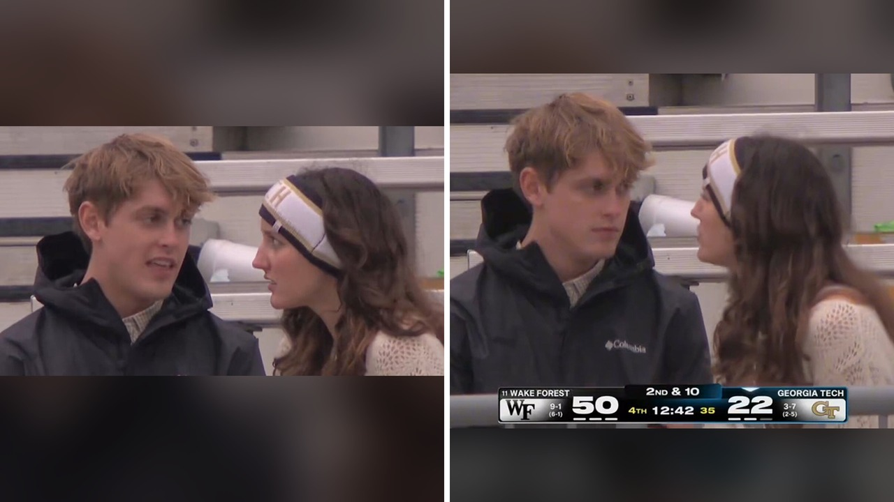

# شجار ثنائي في مباراة كرة قدم يتحول إلى تريند عالمي

في الربع الرابع من مباراة كرة القدم الأمريكية بين فريقي جورجيا تك وويك فورست في ملعب بوبي دود بأتلانتا، كانت النتيجة تتجه لصالح ويك فورست بخمسين نقطة مقابل تسع وعشرين. لكن عدسات التلفزيون قررت أن تترك التنافس في الملعب وتتحول فجأة نحو المدرجات.

هناك ظهر شاب وفتاة ترتدي عصابة رأس لشعار جورجيا تك في حوار حاد للغاية. كانت النظرات بينهما مشدودة والحديث يبدو جادًا إلى درجة لفتت انتباه المعلقين البث المباشر بأكمله.

تخيلوا أن تكونا في وسط شجار شخصي، وفجأة تكتشفان أن الملايين يتابعون كل إيماءة منكما على الهواء مباشرة!

## لقطة غير متوقعة في المدرجات

استوقفتني هالسالفة لأنها تعكس كيف يمكن للبث التلفزيوني المباشر أن يحول لحظة خاصة بين شخصين إلى حدث عام في ثوانٍ معدودة. لم تكتفِ الكاميرا بنقل المشهد، بل حثت المعلقين على التوقف عنده وإطالة الحديث عنه.

قام المعلق جو تيسيتوري بدعوة زميله جيسي بالمر لتحليل موقف هذا الثنائي. ولأن بالمر كان سابقًا مشاركًا ومقدمًا في برنامج العلاقات الشهير ذا باتشيلور، فقد بدا للجميع الشخص الأنسب لقراءة تفاصيل هذا المشهد الدرامي.

يا جماعة، لم يتردد بالمر في تقديم تحليله الفكاهي على الفور. أشار إلى أن حدة الحوار بينهما قد تتجاوز شدة المنافسة في المباراة نفسها، مشددًا على كثافة التواصل البصري بين الشاب والفتاة.

## تحليل تلفزيوني لدراما عاطفية

مع زيادة التدقيق في لقطات الكاميرا، تم استخدام رسومات جرافيك على الشاشة لتسليط الضوء على لغة جسدهما. أشار بالمر إلى أن الشاب كان محددًا جدًا في موقفه وكأنه يطالب بإجابة واضحة ولا ينوي المغادرة دون الحصول عليها.

يبدو أن الفتاة أغمضت عينيها وانسحبت إلى الخلف قليلاً في تلك اللحظة المحرجة. هنا أطلق المعلق تيسيتوري صيحة تعجب، بينما استخدم بالمر عبارته الشهيرة من برنامج العلاقات، داعيًا إياهما للاعتذار وتوديع بعضهما البعض.

الصراحة، التحليل كان طريفًا وكأننا نتابع برنامج واقع لا مباراة رياضية، حتى إن تيسيتوري اقترح مازحًا تحويل هذه اللحظة إلى برنامج متابعة مباشر على قناة إيه بي سي. لكن هل ينبغي للمشاهدين الاستمتاع بهذه التفاصيل على حساب خصوصية الناس؟

## القبلة التي أنهت الخلاف

القصة لم تنتهِ هنا، ومش معقول كيف تغير المشهد بعد دقائق قليلة فقط! فعندما بقيت في المباراة أكثر من ثماني دقائق بقليل، عادت كاميرات شبكة إي إس بي إن لترصد الثنائي من جديد.

فجأة، تحول الخلاف الحاد إلى تصالح كلي. شوهد الطرفان وهما يتبادلان القبلات ويبدوان في غاية السعادة مقارنة باللقطة الأولى. المشهد جعل المعلق تيسيتوري يعلق بحماس داعيًا الجمهور لاحتضان الحب.

الحين لم يفوّت بالمر فرصة المزاح مجددًا، حيث مازحهما بأن يذهبا لإيجاد غرفة خاصة. وحتى الآن، لم يتضح ما إذا كان الاثنان حبيبين أو صديقين أو مجرد زميلين يخوضان نقاشًا عابرًا، إذ لم تذكر القناة أو مقاطع الفيديو طبيعة علاقتهما أو موضوع الخلاف.

## جدل المحافظة على الخصوصية

انتشر المقطع كالنار في الهشيم على منصات التواصل الاجتماعي، وانقسم المتابعون في ردود أفعالهم. البعض اعتبر هذه الدراما العاطفية أكثر متعة من المباراة نفسها، وخاصة أن النتيجة كانت حاسمة تقريبًا بفارق أربعة أهداف.

قارن بعض المتابعين هذا الموقف بحادثة حفل كولدبلاي الشهيرة العام الماضي، مشيرين إلى أن هذا الشجار حتى لو انتهى بالانفصال لن يكون بسوء تلك الحادثة. كما مزح آخرون بأن إدارة الملعب ربما حذرت الثنائي وطلبت منهما التصالح كي لا يأكلهما الإنترنت لأسابيع.

على الجانب الآخر، ظهرت أصوات غاضبة تطالب باحترام خصوصية الطلاب. وتساءل أحد المعلقين بنبرة حادة عن سبب ملاحقة الكاميرات لطلاب جامعيين وتحويل مواقفهم الخاصة إلى عرض تلفزيوني يُعاد بثه آلاف المرات.

رأيي الشخصي أن الكاميرات التلفزيونية تجاوزت حدودها بتسليط الضوء على لحظة انفعال شخصية وتحليلها على الهواء، حتى لو انتهى المشهد بصلح وقبلات أمام الجمهور.

وش رايكم، هل ترون تصرف البث المباشر مع هذا الثنائي مجرد ترفيه بريء أم أنه انتهاك صريح لخصوصيتهما في المدرجات؟
