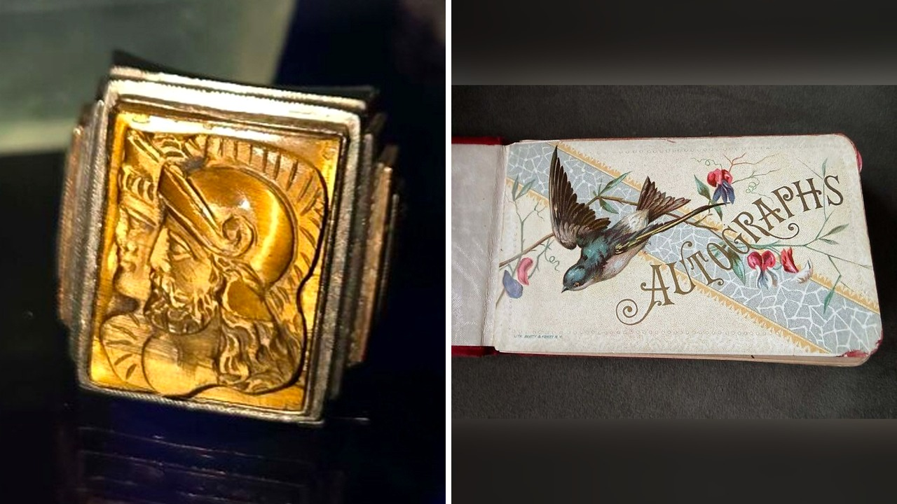

# أشياء غريبة عثر عليها أصحاب بيوت داخل الجدران

تخيل أنك تقرر تجديد بيتك القديم، ترفع السجادة أو تفتح خزانة مغلقة منذ سنوات، فتقع عينك على شيء لم يكن في الحسبان. معظم المنازل تحتفظ بأسرار بسيطة وغير مهمة، كدرج مليء ببطاريات قديمة أو مفتاح مجهول لا يفتح أي باب. لكن بصراحة، ما قرأته مؤخراً عن اكتشافات بعض الناس داخل جدران منازلهم جعلني أعيد التفكير في كل زاوية في بيتي!

## الجدران التي تحتفظ بالسر
عندما قرر بعض الملاك إزالة لوح خشبي من الأرضية أو كسر جزء من الجدار، لم يتوقعوا أبداً ما كان ينتظرهم هناك. هالسالفة ليست مجرد مزاح، فقد وجد البعض كبسولات زمنية كاملة رُتبت وعُزلت بعناية لتخفي تفاصيل حياة أشخاص عاشوا في المكان نفسه قبل عقود. يا جماعة، الأمر يشبه فتح صندوق كنز قديم، لكنه يقبع داخل غرفتك الشخصية. هل تساءلت يوماً عما قد يكون مدفوناً تحت بلاط غرفتك؟

هذا الموقف المليء بالمفاجآت ذكّرني بما حكيته لكم سابقاً عن شخص اشترى صندوق مقتنيات قديمة ليفاجأ بما هو غير متوقع ومخيف بداخلها.

**اقرأ أيضًا:** [مشتريات قديمة تقود أمريكياً لصندوق قنابل حية](https://www.almosaitiron.com/2026/10/blog-post_928.html)

## رسائل غريبة من الماضي
المثير للدهشة لم يكن فقط الأغراض القديمة، بل الرسائل التي تركها السكّان السابقون. بحسب ما نُشر، عثر بعض الملاك على رسائل مكتوبة على أوراق ومخبأة بعناية، كُتبت من قِبَل أشخاص كان لديهم الكثير ليفكروا فيه وليكتبوه قبل مغادرتهم. بعض تلك الرسائل كان لطيفاً ودافئاً، بينما كان بعضها الآخر غريباً ومربكاً ويجعلك تتساءل: شو كان يدور في بالهم وقتها؟ تخيّلوا أن تفتح جداراً لتجد صاحب البيت القديم يوجه لك كلاماً مباشراً!

## هل تجرؤ على فتح العلية؟
بعض هذه الاكتشافات يجعل فكرة تجديد البيت مغامرة غير محسوبة العواقب. هناك أشياء عُثر عليها تجعلك تفكر مرتين قبل استخدام المطرقة لكسر جدار، وتجعلك تحذر تماماً من فتح العلية بعد غروب الشمس تحديداً. وش رايكم، هل تملكون الجرأة لشق جدار في بيتكم القديم بحثاً عن المستور، أم تفضلون البقاء في أمان وتجاهل ما خفي؟

رأيي الشخصي أن المنازل القديمة ليست مجرد حجارة وسقوف، بل هي ذاكرة حية تحتفظ بقصص وأسرار أصحابها الراحلين. لو تخيرتم اليوم بين فتح علية قديمة مظلمة في بيتك ليلاً للبحث عن أسرارها، أو تركها مغلقة للأبد دون فضول، ماذا تختارون؟
