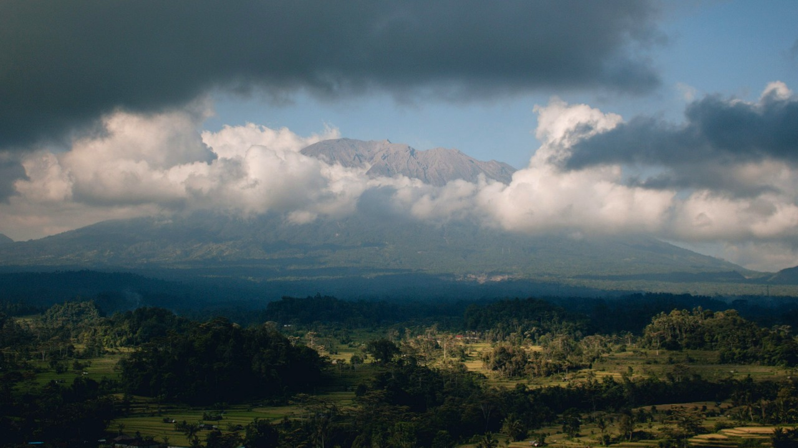

# صورة عارية على جبل مقدس تعرض سائحاً للترحيل في بالي

أن تقف على قمة جبل مقدس بالنسبة إلى السكان المحليين، وتلتقط صورة دون ملابس سفلى فقط لتبهر متابعيك على إنستغرام، هذا بالضبط ما فعله سائح روسي يدعى يوري في بالي. ما فاجأني في الخبر ليس الصورة بحد ذاتها، بل حجم التجاهل الذي أبداه لقوانين وثقافة المكان الذي يزوره.

تعال نتوقف عند التفاصيل: كيف تحولت صورة استعراضية على قمة بركان إلى أزمة قد تنتهي بطرد صاحبها من البلاد؟

## قدسية المكان وتصرف غير مسؤول
حسب ما نُشر، تسلق يوري برفقة ستة من أصدقائه جبل أغونغ، وهو أعلى نقطة في بالي، دون الحصول على تصريح رسمي يُجيز لهم التسلق. هذا الجبل ليس مجرد مرتفع طبيعي، بل يعتقد الهنود الباليون أنه موطن الآلهة، وتحديدًا "ماهاديوا" الذي يمثل التجسد الأعلى للإله شيفا.

تخيّل أن تقف في مكان بهذه القدسية وأنت ترتدي سترتك السوداء فقط، بينما بنطالك عند كاحليك وظهرك للمواجهة! الصورة انتشرت بسرعة كالنار في الهشيم عبر منصات التواصل نهاية الأسبوع، وأثارت موجة غضب عارمة بين السكان والمسؤولين.

## اعتذار ومحاولة لتصحيح الخطأ
رئيس مكتب القانون وحقوق الإنسان في بالي، أنغيات نابيتوبولو، صرح بوضوح أن ما فعله السائح الروسي يمثل انتهاكًا صريحًا للأعراف وعدم احترام لثقافة المجتمع. الصراحة، لم يجد يوري مفرًا من حذف الصورة ونشر مقطع فيديو يرتكز على الاعتذار في حسابه.

في الفيديو، أقر يوري بعدم وجود أي مبرر لتصرفه، وأرجع الأمر إلى جهله الشخصي بخصوصية الديانة المحلية. ولم يكتفِ بالاعتذار، بل أبدى استعداده للمشاركة والتمويل المالي لطقوس تقديم القرابين للآلهة لتطهير المكان.

## عقوبة معلقة ومستقبل مجهول
شو رأيك في العقوبة المتوقعة؟ السلطات قررت منع يوري من دخول إندونيسيا لمدة لا تقل عن ستة أشهر. لكن القرار النهائي بشأن ترحيله الفوري لم يُتخذ بعد بالكامل.

وفق ما ورد في التقرير، فإن السلطات سمحت له بالبقاء لفترة قصيرة للترويج للسلوك الجيد، ليكون بمثابة نموذج للسائح المنضبط بعد اعتذاره. يا جماعة، تكرار هالسالفة يجعلنا نتساءل عن حدود سلوك السياح في الدول المستضيفة.

رأيي الشخصي أن الجهل بالقوانين والثقافات لا يُعد عذرًا إطلاقًا عند زيارة الأماكن المقدسة، وكان من الواجب على يوري احترام المكان منذ اللحظة الأولى بدلاً من تقديم الاعتذارات بعد وقوع الأزمة.

هل تعتقد أن السماح له بالبقاء للترويج للسلوك الجيد قرار منصف، أم أن الترحيل الفوري هو العقوبة الرادعة الوحيدة لمثل هذه التصرفات؟
