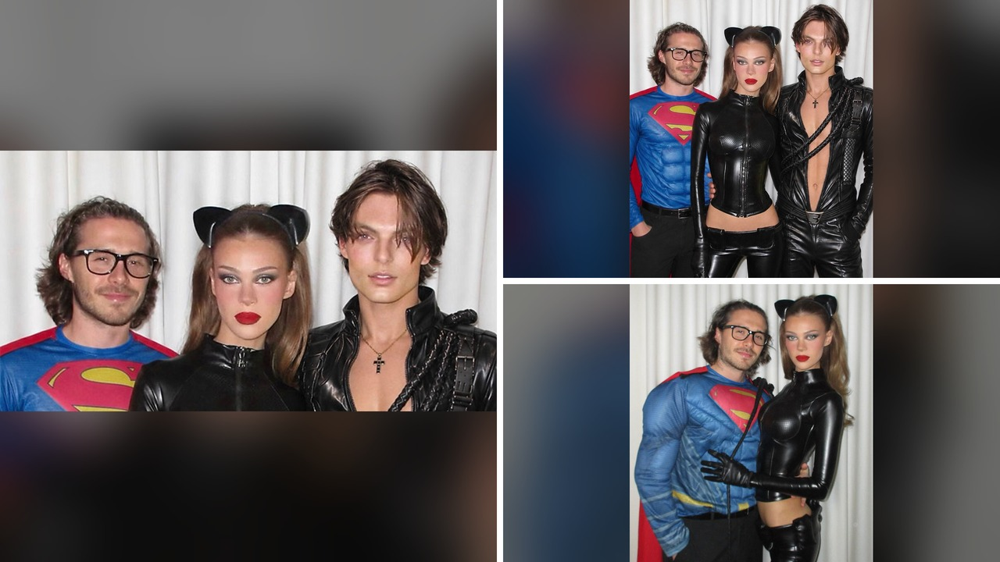

# الخلاف الكبير حول صورة بروكلي هالوين مع نيكولا وداميان

### مقدمة

تخيلوا مشهد هالوين على إنستغرام: بروكلي بيكهام يلبس زي سوبرمان، نيكولا بيلتز تتألق ككاتمان، وداميان هورلي يلمع ببدلة جلدية سوداء. الصورة تبدو كأنها إعلان أزياء، لكن… ما فاجأني هو رد فعل المتابعين. فجأة، تحول الاحتفال إلى ساحة نقد حادة، والبروكلي وجد نفسه في قلب الجدل.

أنا شفت الصورة وقلت لنفسي: "وش رايكم؟" لأن التكوين كان واضح – داميان يلف ذراعه حول نيكولا، وبروكلي واقف خلفهما يضع يديه في جيوبه. الصراحة، حسيت إن الصورة تقول شيء غير المقصود. فالمتابعين ما تركوا الأمر، بل بدأوا يطرحون أسئلة عن علاقة نيكولا ببروكلي.

## الصورة التي أطلقت السخرية

اللقطة انتشرت بسرعة على X (Twitter) بعد نشرها في أول نوفمبر. المتابعون لاحظوا أن نيكولا وداميان يبدوان كزوجين، بينما بروكلي يبدو "الغريب" بينهما. أحد التعليقات كتب: "الذراع حول رجل آخر قدامك مو مقبول". ومن ثم تلاها تعليقات أخرى تقول إن نيكولا "مقربة" من داميان. الفكرة كانت أن لغة الجسد كانت واضحة للكل.

## محاولة التحكم بالضرر

بروكلي ما قعد صامت. قرر يحذف الصورة من البوست، ثم أضاف ستوري على إنستغرام يذكر نيكولا بـ "my girl". الخطوة هذه زادت من حدة الانتقادات؛ البعض شافها كدليل على أن الشكوك كانت "صحيحة". أحد المتابعين وصفه بأنه "متملك وغيور". يا جماعة، هل حذف الصورة كان حلًّا أم زاد الطين بلة؟

## فيديو الطهي الغريب

ما كان الجدل يقتصر على الصورة فقط. بروكلي شارك فيديو لهالوين يطبخ دجاجة كاملة داخل قرع عسكري. المشاهد استغربوا: "وش الفائدة من حفر القرع ووضع الدجاج جواه؟" وأيضًا انتقدوا التوابل. أحد التعليقات قال: "الدجاج ما كان متبهّر". الفكرة كانت إن بروكلي يحاول يثبت نفسه كطباخ، لكن النتيجة كانت سخرية إضافية.

## خلفية العلاقة وتاريخ الاحتفال

في أكتوبر الماضي، احتفل الزوجان بالذكرى السابعة لأول موعد لهم (29 أكتوبر). بروكلي نشر صورة يقبل فيها نيكولا على الخد، وكُتب فيها: "أنتِ عالمي كله، صديقتي المقربة، أهم شخص في حياتي". نيكولا ردّ بحبّها: "سعيدين بسبع سنوات معًا، أحبك بروح كاملة". بالرغم من هالكلمات الرومانسية، المتابعين ما زالوا يطرحون تساؤلات عن زواجهما منذ ربطهما في أبريل 2022. وش رايكم، هل الكلمات الرقيقة تكفي لتطمين الجمهور؟

## رأيي الشخصي

صراحة، أعتقد أن حذف الصورة كان رد فعل سريع ومُستعجل. بدل ما يوضح موقفه، خلى المتابعين يطّلعون على تفاصيل أكثر ويزيدوا من الضجة. لو كان استجاب بتوضيح صريح أو حتى ترك الصورة بدون رد، ربما كان الوضع أهدأ. رأيي الشخصي إن الصمت أحيانًا يكون أبلغ من الكلام.

**سؤال للقراء:** هل تعتقدون أن حذف الصورة كان خطوة ذكية أم أن التجاهل كان أفضل؟
