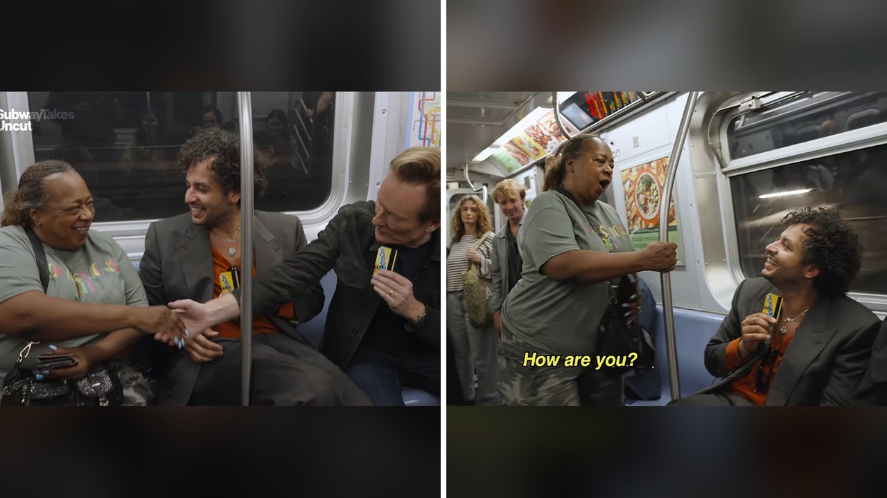

# سيدة تمازح كونان أوبراين في المترو وتتحول إلى نجمة

تخيل أن تركب قطار الأنفاق كعادتك اليومية، فتقرر المزاح مع مذيع شهير لتبدأ بينكما مسرحية ارتجالية. هذا ما حدث بالضبط مع سيدة تبلغ من العمر ثمانية وستين عامًا تُدعى دبي شيلدز.

تسعة وثمانون ثانية فقط كانت كافية لتحول صاحبة حانة عادية في بروكلين إلى حديث مواقع التواصل الاجتماعي. بصراحة، القصة ليست مجرد صدفة عابرة، بل مشهد كوميدي سريع أطاح بالجميع من الضحك.

## زواج وهمي وعائلة في السجن

قصة هذا اللقاء بدأت عندما كانت دبي تنقل مع صديقها توني بين خطوط القطار. هناك لمحت الكوميدي الشهير كونان أوبراين يصور حلقة من برنامج شبكي يسمى سوبواي تيكس مع كريم رحمة. صديقها توني كان معجبًا بكونان، فقررت أن تجلس بجانب المذيع وتفتتح الحديث معه.

عندما سأل كريم المذيع عما إذا كان يعرفها، ادعى كونان مزاحًا أنهما كانا متزوجين قديماً. لم تتردد دبي، بل اندمجت في الدور فوراً وادعت أن لديهما طفلين، أحدهما في كلية الطب والآخر في السجن! وعندما اعتذر كونان عن عدم إرسال أموال، ردت بثبات أن طفليهما ما زالا يحبانه لأن صوره تنتشر في كل مكان بالمنزل.

## سرعة بديهية أبهرت الجميع

يا جماعة، الارتجال لم يتوقف عند هذا الحد على الإطلاق. كونان واصل المزاح قائلاً إن زواجه منها كان أسعد عام ونصف في حياته. ردت عليه دبي بسرعة خاطفة قائلة إنها سمعت هذه الجملة من أزواجها الثلاثة الآخرين أيضاً. هذا الرد جعل الكوميدي الشهير يدخل في نوبة ضحك هيستيرية.

أشاد كونان بتوقيتها الكوميدي واقترح أن يقوما بإنشاء برنامجهما الخاص، بينما أعلن كريم رحمة أن دبي هي المضيف الجديد للبرنامج. مش معقول كيف تعاملت دبي مع الموقف دون أن تخرج من الشخصية أو تتردد لحظة واحدة، وكأن هناك تاريخاً عائلياً معقداً يجمعهما بالفعل.

## زحام غير متوقع وزبائن جدد

الانتشار السريع للمقطع انعكس مباشرة على حياة دبي وحانتها المسماة كونفيشن بار في حي بيد-ستاي ببروكلين. المئات شاهدوا المقطع وقرروا زيارة حانتها لرؤية المرأة التي أضحكت كونان بهذه السهولة العجيبة.

دبي عبّرت عن اندهاشها من هذا التغيير السريع وقالت إن دقيقة وتسعًا وعشرين ثانية غيرت حياتها بالكامل. الحين أصبحت تجد المارين يحيونها بحرارة ويمتدحون ظهورها التلفزيوني. حتى أن أحد الزبائن صرح بأن هذا التقدير كان يستحقه حضورها منذ زمن طويل.

## كوكتيل خاص ومستقبل على المسرح

شغف دبي بإضحاك الناس كان حاضراً دائماً في حياتها، حتى أنها تضحك في الجنازات مما يسبب لها بعض المواقف المحرجة. هي بالفعل تستضيف ليالي كوميدية أسبوعية في حانتها لتقديم الموهوبين، لكنها لم تكن تجرؤ على تقديم الكوميديا الفردية بنفسها.

شو يمنعها من التجربة الآن؟ بعد هذا التفاعل الجماهيري، تفكر دبي جدياً في صعود المسرح ككوميدية. واستغلت هذا التفاعل لابتكار مشروب خاص في حانتها أطلقت عليه اسم والد الطفل أوبراين، كما كشفت أن كونان قد يزور حانتها مستقبلاً للغناء في ليلة الكاريوكي.

رأيي الشخصي أن العفوية والقدرة على صناعة الابتسامة هي موهبة حقيقية لا ترتبط بعمر معين. دبي أثبتت أن اللحظات غير المخطط لها قد تفتح أبواباً جديدة كلياً في حياة الإنسان.

هل تعتقد أن القدرة على الارتجال المضحك موهبة يولد بها الشخص أم مهارة تتطور مع الخبرة الحياتية؟
