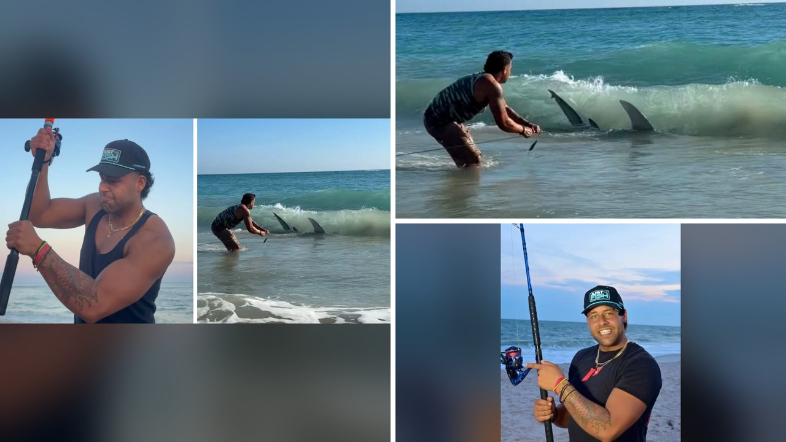

# حظر إنفلونسر صيد القرش الأبيض من ولاية ماساتشوستس

تخيلوا إن شخص سحب قرش أبيض عملاق إلى شاطئ كيب كود، وبعدها طُرد من الولاية بأكملها. الصدمة ما كانت بس في الفيديو اللي انتشر، بل إن القاضي قرر يمنعه من دخول ماساتشوستس بالكامل. يا جماعة، القصة دي خدت منحى غير متوقع، فخلوني أشرح لكم التفاصيل.

## ما حدث على شاطئ كيب كود
في أكتوبر 2025، صانع محتوى صيد يُدعى كريستوفر ستيفانو، المعروف باسم LISHARKMAN، جاب عميل أوروبي إلى شواطئ كيب كود الشرقية. استخدموا طائرة بدون طيار ومعدات أخرى لاصطياد قرش أبيض بطول 9.5 أقدام، سُمي محليًا "آرون القرش". بعد ما مسكوا الحيوان، جرّوه إلى الشاطئ وصوّروا لحظة الوقوف معه قبل ما يطلقوا سراحه. هل تصدقوا إنهم فعلوا كل هذا للعرض على السوشيال ميديا؟

## قرار المحكمة وحظر الولاية
في 21 أكتوبر 2026، حضر ستيفانو جلسة التوجيه في محكمة بارنستابل العليا. القاضي حدد كفالة بقيمة 10,000 دولار، لكنه أصدر أمرًا بحظر المتهم من دخول ماساتشوستس، بالإضافة إلى سحب رخصة الصيد وإلزامه بحذف كل الصور والفيديوهات المتعلقة بالقرش. إذا أُدين، قد يواجه سجنًا يصل إلى سبع سنوات بتهمة القسوة على الحيوان. وش رايكم في العقوبة دي؟

## ردود الفعل على الإنترنت
الموضوع أثار جدلًا واسعًا على السوشيال ميديا. بعض المستخدمين قالوا "مش معقول" إن شخص يجرّ قرشًا إلى الشاطئ للمتعة، بينما آخرون وصفوه بـ "وايد" من الفوضى. أحدهم كتب: "أنا ما عندي أي احترام له على الإطلاق". وفي الوقت نفسه، محاميه ادعى إن كريستوفر يحترم الصيد المستدام ويشارك في أبحاث علمية. الصراحة، الانقسام واضح بين من يرى فيه صائدًا شجاعًا ومن يعتقد أنه انتهك القانون.

## ما تقول القوانين عن صيد القرش الأبيض
ماساتشوستس تتبع قوانين صارمة لحماية القرش الأبيض. من غير المسموح جذب أو صيد أو استهداف هذا النوع في معظم السواحل. الصيد من الشاطئ باستخدام طُعم بحجم داخل الفتحة أكبر من 5/8 بوصة أو سلك معدني أطول من 18 بوصة ممنوع. كمان يُحظر استخدام الطائرات بدون طيار أو القوارب اللاسلكية لنشر الطُعم. هالقوانين تهدف لحماية النوع وسلامة العامة. يعني، إذا تم إثبات المخالفة، العقوبات ممكن تكون شديدة.

## ما ينتظر الصانع في المحكمة
ستيفانو سيظهر مرة أخرى أمام المحكمة في 11 ديسمبر لمزيد من الإجراءات. محاميه يصرّ على براءته ويؤكد إن المتهم يساهم في التعليم والبحوث البحرية. لكن المدعين العامين يركزون على أن الفعل كان له دوافع تجارية، خاصةً إن العميل الأوروبي دفع مبالغ كبيرة للرحلة. السؤال الآن: هل سيتفادى السجن أم سيُقضى عليه بحكم القسوة على حيوان محمي؟

رأيي الشخصي أن الحظر خطوة ضرورية لحماية البيئة وإرسال رسالة واضحة للمتسولين على الإنترنت. بس برضه، لازم نضمن إن العقوبات تكون عادلة وتراعي نوايا المتهم إذا كان فعلاً يهدف للتوعية. شو رأيكم في الموقف ده؟
