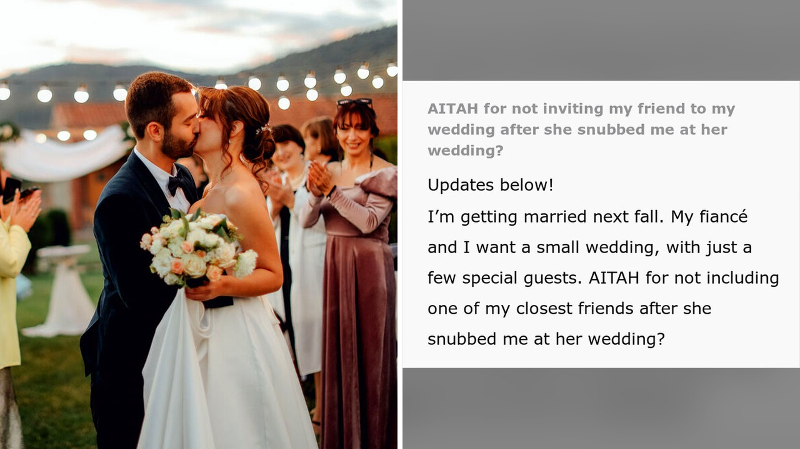

# وعدت صديقتها بلقب الوصيفة لخمسة عشر عاما ثم خذلتها

خمسة عشر عاماً من الوعود والحديث المستمر عن يوم الزفاف، تلاشت كلها في لحظة واحدة عندما طُلب منها أن تكتفي بإحضار المشروبات للضيوف. هذا الموقف بالذات استوقفني بشدة وجعلني أفكر في كمية الألم الصامت الذي قد تسببه لنا صداقات نمنحها أصدق ما لدينا.

من الصعب جداً أن نكتشف فجأة أن من كنا نعدهم الأقرب إلينا لا يروننا بالمكانة نفسها، بل قد يتجاوزون حدود مشاعرنا بتصرفات غير متوقعة.

## عهد قديم وطلب غير متوقع

ما قرأته في هذا الخبر يروي قصة امرأة عاشت سنوات طويلة مع وعد صريح من صديقتها بأنها ستكون وصيفة الشرف الأولى في يوم زفافها، وهو دور يحمل قيمة معنوية كبيرة في تقاليد الأعراس. لكن الصدمة وقعت حين حان ذلك اليوم بالفعل، وبدلاً من أن تشاركها فرحتها في المكانة الموعودة، فوجئت بطلب يقلل تماماً من شأنها، وهو خدمة الحضور وجلب المشروبات.

هذا الموقف المؤلم ذكّرني بما مرّ بنا سابقاً حول كيف يمكن للمناسبات الكبرى أن تكشف خبايا النفوس وتضع الروابط الإنسانية في اختبارات قاسية.

**اقرأ أيضًا:** [ابنة زوج تطلب 160 ألف دولار لزفافها رغم جحودها](https://www.almosaitiron.com/2026/10/160.html)

تخيّلوا كيف يكون شعور الإنسان عندما يُعامل بازدراء وتجاهل تام في اللحظة التي انتظرها لسنوات كي يفرح لصديق عمره؟

## قرار حاسم ومشورة البدايات الجديدة

أمام هذا التجاهل والإهانة التي لحقت بها في زفاف صديقتها، وجدت المرأة نفسها في حيرة حقيقية عندما حان موعد زفافها هي. الصراحة، لم يكن القرار سهلاً، لكنها اتخذت خطوة جريئة وقررت منع تلك الصديقة من حضور عرسها نهائياً، ثم شاركت قصتها على الإنترنت لطلب المشورة حول ما إذا كان تصرفها صحيحاً.

تفاعل الناس بكثافة مع هذا الخلاف الإنساني المعقد، وقدموا آراء مختلفة حول وضع الحدود الصارمة في العلاقات، قبل أن تعود العروس لاحقاً بمستجدات حول ما حدث بعد قرارها.

رأيي الشخصي أن الصداقة الحقيقية تُقاس بالاحترام المتبادل وصدق المشاعر، وحين يتحول الوفاء إلى تقليل من القيمة، يصبح الابتعاد ووضع الحدود أمراً ضرورياً لحماية كرامتنا، حتى وإن كلفنا ذلك إنهاء علاقة استمرت لسنوات.

لو وُضعت في الموقف نفسه، هل كنت ستمنع تلك الصديقة من حضور زفافك لحفظ كرامتك، أم ستتجاوز عن الأمر وتدعوها؟
